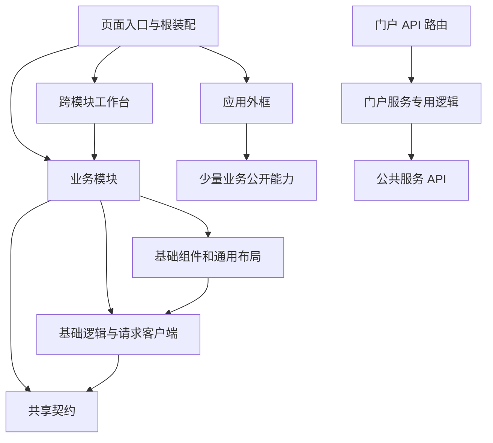

# SthStart 前端架构规范

版本：1.2  
生效日期：2026-11-10  
最近同步：2026-11-15  
适用范围：SthStart 门户前端、门户服务接口及其与公共服务的边界。

本文件是后续前端开发与代码审查的架构标准。新代码遵循下述职责和依赖规则；现有代码按实施计划逐步收敛。目标目录不代表已迁移完成，不要求为一次局部修复搬迁无关代码。

当前实施状态：S0–S6 已完成本轮代码与集成验收，架构整理阶段574文件/2035条本地依赖；故事世界最终集成检查为615文件/2251条本地依赖，无文件循环、模块循环、边界违规或过期例外。架构阶段证据、原有lint债务及实机验证限制见 [交付记录](development/reviews/2026-11-11-frontend-architecture-delivery.md)，故事世界扩展另见其验收记录。

- 产品模块及来源、采用、制作的语义以 [创作工作区与模块职责](PRODUCT_WORKSPACE.md) 为准。
- 故事世界扩展遵循[故事世界架构标准](development/STORY_WORLDS_ARCHITECTURE.md)，包括个人知识隔离、持久化运行、公共图片队列与历史采纳；实施状态以该模块验收记录为准。
- 故事世界独立创建与编辑由 `features/story-worlds/authoring` 管理字段、候选和编辑信封；`/new`（名称创建）、`/:worldId/setup`（待配置补全）与 `/:worldId/edit` 是普通滚动页。待配置实体和列表仍由 Query 管理，未保存内容由编辑信封管理；完成配置后服务在同一事务内建立世界与初始分支。项目图片采纳在 `workspaces/story-worlds` 装配，通过插槽交给功能模块，不允许功能模块反向依赖工作台。操作说明见[配置与 AI 填充](development/WORLD_AUTHORING.md)。
- 实施范围、顺序和验收见 [前端架构整理计划](development/FRONTEND_ARCHITECTURE_PLAN.md)。
- 执行状态唯一登记在 [开发待办](development/BACKLOG.md)，实际架构验收结果记录在可纳入 Git 的 [阶段记录](development/reviews/)；仓库默认忽略 `plans/` 与 `logs/` 的新文件，不将正式标准仅保存在这些目录。
- 页面布局和交互同时遵循 [前端核心规则](../app/AGENTS.md)。本文件管理代码职责，不替代视觉与交互规范。

## 1. 已确定的架构决策

| 决策 | 标准 | 原因 |
| --- | --- | --- |
| 前端技术栈 | 保留 React、TypeScript、现有 Next 风格路由和 Vinext/Vite 构建 | 本轮通过职责整理改善维护性，不承担框架迁移成本。 |
| 应用组织 | 保留按业务划分的模块，增加明确的应用外框与跨模块组合边界 | 业务规则留在所属模块，综合工作台负责协调。 |
| 服务器数据 | 继续使用 TanStack Query | 复用缓存、查询失效、请求状态和后台更新机制。 |
| UI 体系 | 已收敛至 Mantine 9.8.0（`@mantine/core@9.8.0` + `@mantine/hooks@9.8.0` + `@mantine/notifications@9.8.0`）公共适配器，配合 Tailwind 与 `app/styles/theme.css` 语义 token | 统一基础控件、浮层与通知语义：`MantineThemeBridge` 配置 `withCssVariables={false}` 与 `withGlobalClasses={false}` 避免运行时生成约 27 KB 默认色板与全局样式冲突；通过 `app/styles/mantine-bridge.css` 静态映射 `theme.css` 四套主题，并在 `app/globals.css` 按 `@layer mantine, theme, base, components, utilities;` 顺序按需导入 21 个 Mantine `@mantine/core/styles/*.layer.css` 与 `@mantine/notifications/styles.layer.css`（避免引入全量 `styles.layer.css`）。保留自研语义化 `CalendarView` 网格与 `Modal + Combobox` 命令面板，不引入 `@mantine/dates` 与 `@mantine/spotlight`。 |
| 数据与契约 | 保留服务 API、数据库结构、现有 ID 与修订规则 | 前端结构调整不隐含数据迁移或业务协议变更。 |
| 组件复用 | 提取有明确职责、已有复用需求的能力 | 避免万能编辑器、万能表单和仅为目录对称而新增抽象。 |
| 验收方式 | 静态依赖、类型、行为测试、浏览器验收各有独立证据 | 编译通过不能证明草稿、输入法、离线与布局行为正确。 |
| 边界检查 | `scripts/architecture/check.mjs` 解析 `app/` 的运行时依赖；例外集中在 `scripts/architecture/exceptions.json` | 让文件循环、分层违规和客户端可达的服务实现可复现地暴露，而不是靠人工约定。 |

如未来需要改变这些决策，在开发日志或独立 ADR 中记录触发原因、备选方案、影响及迁移办法，并同步本规范。常规实现选择可在已授权范围内直接推进。

## 2. 当前结构与目标结构

### 2.1 当前真实边界

门户位于 `app/`，公共服务位于 `apps/service/`。`packages/contracts/` 保存跨端契约，`packages/activity-playback/` 保存播放和渲染相关的独立能力。邻舍位于 `upstream/linshe/`，保留独立前端和数据边界。

本轮代码与集成验收已完成，当前主要边界如下。

- `app/shell/`：`AppShell`、导航、命令面板、任务抽屉、页头插槽和主题切换等全站外框。
- `app/workspaces/`：`home`、`resources`、`projects`、`story`、`generation`、`media`、`narrative` 等跨模块组合；资料库和项目综合页在这里装配。
- `app/features/`：业务模块。Activities 已建立 `planning`、`studio`、`images`、`comic`、`publication`、`playback` 和有限的 `shared` 分组；Story、Notebook、Characters 等编辑器与业务逻辑仍在各自模块。
- `app/components/`：`ui/` 基础控件，`shared/` 通用布局与展示；`workspace-header` 通过 `HeaderSlot` 接收外框注入的工具，不查询业务任务。
- `app/providers/`：Query、主题和通知分别接入；`ui-provider.tsx` 只保留组合与旧 Hook 兼容。
- `app/server/`：管理会话和发布桥策略等服务专用实现；`app/lib/admin-fetch.ts` 是客户端请求包装，不包含服务端密钥。
- `app/styles/`：`globals.css` 与 `shell.css` 作为有序入口，具体规则位于 `styles/` 根目录片段和 `styles/shell/` 子目录；`workspace-b.css`、`workspace-unified.css` 保留为明确分层的工作台几何与紧凑装配层。

当前明确的跨模块公开入口包括 `features/characters/public.ts`（浏览 Hook 与筛选 URL 纯逻辑）、`features/characters/public-ui.ts`（筛选、分页组件与头像生成面板类型）、按业务建立的 `query-keys.ts`，以及 `workspaces/generation/index.ts`（生成来源加载与选择器装配）。`app/lib/query-keys.ts` 仍作为纯重导出兼容入口存在，不再承载查询实现。

### 2.2 目标职责目录

以下结构是本轮收敛后的职责，也是当前主要目录形态。未列出的文件和公开入口仍按 2.1 与实际代码核对；不要为了目录对称移动单一业务工作台。

```text
app/
  layout.tsx、page.tsx        根装配和首页入口
  apps/、settings/            页面入口与兼容路由
  api/                       门户服务接口：会话、鉴权和代理
  server/                    门户服务专用实现：管理会话、发布桥策略
  shell/                     全站导航、命令面板、全局工具的装配
  workspaces/                跨业务组合，不成为第二套数据层
    home/                    最近工作、日程与全站状态组合
    resources/               笔记、灵感、搜集、待整理、来源连接
    projects/                项目正文、角色、资料、制作与媒体的组合
    story/                   剧情页面与跨域制作/衍生物对话框组合
    generation/              生成来源加载与选择器装配
    media/、narrative/       媒体与叙事页面组合
  features/                  各业务模块
    story/、notebook/、characters/、generation/、...
    activities/               planning、studio、images、comic、publication、playback、shared
  components/
    ui/                      基础控件与交互原语
    shared/                  通用布局、分栏和展示组件
  lib/                       请求、存储适配、纯工具及可复用核心逻辑
  providers/                 Query、主题、通知等应用接入
  styles/                    全局 token、基础样式、外框和公共布局
packages/
  contracts/                 跨端请求、响应及其运行时校验
  activity-playback/          独立播放与渲染能力
apps/service/                持久化、任务执行和公共业务服务
```

`app/workspaces/projects` 负责组合页面；`features/projects` 仍拥有项目链接、采用动作及其 API。不要为了移动页面，把同一领域的数据模型和请求再复制一份。已有文件叫 `*-workspace.tsx` 不代表必须移动：仅包含单一业务的工作台可继续留在该业务模块。

`app/workspaces/resources` 负责资料库组合，`features/notebook` 只拥有笔记工作区、选择器和数据能力；旧 `/apps/notebook` 由 `workspaces/resources/notebook-entry.tsx` 适配。`features/resources` 只保留返回上下文等资源纯逻辑，不再承载资料库页面装配。

### 2.3 模块内部结构

小模块可采用 `api.ts + queries.ts + components/`。复杂模块才增加以下层次：

```text
features/<业务>/
  api.ts                     请求和响应校验；复杂时拆为 api/
  queries.ts                 服务器读取、缓存和轮询配置
  mutations.ts               服务器写入及本业务缓存更新
  query-keys.ts              模块查询键，可逐模块从旧集中入口迁出
  model/                     纯业务规则、状态转换和私有类型
  hooks/                     React 接入、编辑会话与交互协调
  components/                界面区块
  <业务>-workspace.tsx       单业务装配
  public.ts                  少量稳定逻辑入口，存在跨模块调用时建立
  public-ui.ts               可选：明确支持跨模块使用的组件入口
```

不要求每个模块建立上述所有文件。`public.ts` 不批量导出整个模块，避免通过一个入口同时引入 API、编辑器、样式和服务器代码。模块内部直接引用内部文件，不绕回自己的公共导出入口。

## 3. 依赖方向



| 层 | 可以依赖 | 不应依赖 |
| --- | --- | --- |
| 页面入口 | 外框、工作台、业务公开入口、合法的服务端入口逻辑 | 大段表单、草稿同步或业务写入实现 |
| 外框 | 通用组件、Provider、任务等业务公开能力 | 具体编辑器内部状态、业务私有组件 |
| 跨模块工作台 | 多个模块的公开 API、Hook、选择器和业务动作 | 复制其他模块的请求和业务规则 |
| 业务模块 | 自身实现、基础能力、契约；有方向的其他业务公开能力 | 页面入口、外框、跨模块工作台 |
| 通用 UI / 布局 | React、UI 依赖、通用工具、明确传入的展示类型 | 业务 API、业务查询、页面路由实现 |
| 纯业务模型 | 类型、纯函数、无 UI 的工具 | React、DOM、路由、网络和存储副作用 |
| API 客户端 | 公共请求封装、契约 | React Hook、Toast、组件 |
| 门户服务逻辑 | 服务端会话、代理策略、公共服务 API | 客户端 Provider 和组件 |
| 契约包 | Schema 与类型所需的独立依赖 | 前端模块、服务私有实现、密钥和运行配置 |

新增运行时依赖不得形成文件循环；模块之间也避免新增双向依赖。把双方用到的纯能力下移，或让上层协调。不能只用重导出隐藏循环。

跨模块组合允许真实业务联系。例如搜集任务可使用笔记模块公开的笔记选择器，但笔记模块不再反向装配搜集任务。导出选择器时只提供这一能力，不连带导出整个笔记工作台。

“加入项目”由项目模块拥有业务动作。笔记、媒体、原作阅读器通过上层传入动作插槽使用它；不把整个项目工作台反向引入资源模块。只包含来源类型的通用标识可以放在契约或所属纯模型中。

## 4. 模块职责

| 模块或组合 | 拥有的职责 | 边界 |
| --- | --- | --- |
| Story | 正式文档、章节、设定、项目角色条目、修订和提案审阅 | `features/story` 拥有编辑与保存；`workspaces/story` 只装配跨域制作和衍生物对话框。不直接执行模型任务；制作来源保留已选修订语义。 |
| Projects | 项目链接、来源快照、采用和项目级关系 | `features/projects` 拥有项目 API、采用动作和列表状态；`workspaces/projects` 只组合。引用不等于采用为正式内容。 |
| Notebook | 内容块、笔记元数据、本机保存、附件和同步 | `features/notebook` 提供笔记工作区与选择器；资料库装配和旧 `/apps/notebook` 适配在 `workspaces/resources`。不负责组织整个资料库。 |
| Knowledge / Topics / MCP sources | 搜集、待整理、灵感和来源连接各自的业务 | 由 `workspaces/resources` 组合；保留来源性质和证据边界。 |
| Characters | 可复用角色、资产、发布版本、角色浏览和选择 | 项目中的角色副本不能与角色库同步覆盖。 |
| Activities | 策划、分镜、媒体制作、漫画、出版、播放与导出协调 | 已按 `planning`、`studio`、`images`、`comic`、`publication`、`playback`、`shared` 分组；不新增第二套生成任务引擎。 |
| Generation | 通用生成配置、参数准备、任务接入和结果信息 | 角色/笔记等上下文选择由 `contextLoader` 或 `sourcesSlot` 从上层提供；`workspaces/generation` 负责实际来源装配。 |
| Media library | 媒体浏览、筛选和预览 | 保留归属与访问权限，缺失文件如实显示。 |
| Public services / Runtime / Backups | 设置、诊断和备份各自的查询与操作 | 结构整理不能触发真实恢复、删除或重新部署。 |
| Shell / Home | `app/shell` 负责全站入口、导航、任务和命令；`workspaces/home` 负责最近工作与日程组合 | 业务编辑草稿不存进全局外框。 |

Activities 的目标分组已经建立为 `planning`、`studio`、`images`、`comic`、`publication`、`playback` 和少量模块内 `shared`。分组名不代表所有集中式 `api.ts`、`queries.ts`、`mutations.ts` 都已拆完；后续仍按子域逐步收敛。`shared` 只容纳制作子模块间真实共用的能力；后端路径、活动类型与 URL 不随目录名改变。

## 5. 状态所有权与请求

### 5.1 一个状态有明确的拥有者

| 状态 | 拥有者 | 规则 |
| --- | --- | --- |
| 服务器实体与任务 | TanStack Query | 不再完整复制进全局 Store；表单草稿是有意独立的编辑副本。 |
| 筛选、分页、排序、可分享视图 | URL 状态适配器 | 保留不属于本模块的参数；前进、后退和返回列表可恢复。 |
| 编辑草稿、基准修订、保存冲突 | 一个编辑会话控制器 / Hook | 组件只读取状态并发送动作；后台刷新不能覆盖脏草稿。 |
| 离线笔记与附件 | IndexedDB 和现有同步模块 | 保留离线队列、附件归属和重试语义。 |
| 抽屉、菜单、临时选择、焦点 | 最近的组件或专用 Hook | 不提升到全局，除非确有跨页面生命周期。 |
| 主题、导航偏好 | 对应 Provider / 偏好适配器 | 首屏值与服务端渲染一致，挂载后同步本机偏好。 |
| 通知 | 通知状态与操作入口 | 主题消费者不订阅通知列表，通知操作引用保持稳定。 |

状态从多个来源初始化时，显式写出优先级，例如本机未同步草稿、服务器内容和新建默认值；不要靠多个 effect 的执行顺序决定覆盖关系。

### 5.2 API、Query 和缓存

- 普通请求进入所属业务 `api.ts`，复用 `app/lib/api-client.ts`。上传、流式、下载等特殊行为沿用 `adminFetch` 等已存在的适配，不强行改为 JSON 请求。
- 请求接受业务相对路径；门户管理转发与 `/api/v1/admin/` 服务路径分别由所属层负责。
- 有响应 Schema 时执行运行时验证。错误在 API 层保留结构，在 Hook 或界面层转成用户提示。
- `queries` 负责读取、启用条件、取消、轮询和缓存期限；`mutations` 负责写入及影响范围内的缓存更新。
- 查询键按业务拥有，位于各模块 `query-keys.ts`；`app/lib/query-keys.ts` 只保留无副作用重导出，供旧调用方过渡。保持参数正规化和稳定结构。迁移目录时先保持键值不变，不顺带清空缓存或改变所有查询策略。
- 跨业务写入的缓存协调由工作台动作或明确的协调 Hook 负责；避免 API 层导入 QueryClient。
- 相同 QueryClient 和查询键可以共享缓存；多个组件使用同一查询不能直接推断成重复网络请求。轮询是否重复需测量。
- 长任务执行留在服务端。切换页面只停止本页面订阅，不隐式取消后台任务；取消和重试保留现有明确操作。

### 5.3 URL 与环境边界

共享地址读写通过模块的 `url-state` / `filter-url` 等适配层组织。路由切换和纯筛选替换分别选择现有可用方式，避免 Router 与 `history` 各自维护一套不同的事实。嵌入选择器不默认修改宿主 URL。

`window`、存储、媒体查询与输入法事件留在 React Hook 或浏览器适配层。纯业务逻辑应可不启动浏览器单独验证。

## 6. 编辑器、自动保存与恢复

### 6.1 保留共同核心与不同存储策略

复用现有 `DraftSaveQueue` 作为串行、带版本写入的基础。公共状态可规范为加载中、已保存、未保存、保存中、仅本机、冲突、错误；在展示层翻译，不能让不同模块靠中文状态字符串判断业务。

各模块通过适配器提供保存请求、修订提取、草稿校验、恢复策略和本机存储。先比较行为并写明差异，再提取公共逻辑。Notebook 的本机优先和附件队列继续独立，不强制并入版本化文档保存 Hook。

### 6.2 必须保留的行为

1. 一个编辑会话拥有一个写入协调者；同一会话的连续修改按顺序保存，较早响应不能覆盖较新输入。多标签页依靠服务器修订检查处理并发。
2. 保存中继续输入会进入下一次保存；保存状态只在对应版本持久化成功后显示为已保存。
3. 服务器返回冲突时停止自动覆盖，保留本机文本并提供明确的比较或恢复动作。
4. 断网、超时和存储不可用分别反馈；存储失败时不能声称草稿已落盘。
5. 切换条目、路由、标签、抽屉或屏幕尺寸时不丢失未保存内容。使用实体身份隔离草稿，防止 A 文档写到 B 文档。
6. 中文输入法合成态下，回车选词不触发保存、提交或删除；快捷键有当前编辑区域和弹层的作用域。
7. 后台图片、音频或提案结果只通过明确的采用和版本规则更新内容，轮询不自动替换正在编辑的文档。
8. 保留当前本机存储键、记录结构、修订字段和恢复有效期。改变这些属于显式兼容工作，不能夹带在文件搬迁中。

核心逻辑通过输入和动作可验证；依赖焦点、挂载、输入法和页面切换的行为必须有浏览器证据。

## 7. UI、外框、样式与加载

- `components/ui` 提供基础控件，`components/shared` 提供布局和展示。两者不直接查询业务数据。
- 全局任务和命令等应用能力由 `shell` 获取并通过属性、插槽或专用接入组件传入；通用顶栏不承担任务请求。
- 自然滚动页面与持续编辑工作台分别使用现有页面容器和分栏能力；保留 `min-h-0`、`min-w-0`、独立滚动和窄屏操作可达。
- 主题 token 归 `theme.css`；Mantine 变量映射与浮层表面覆写归 `mantine-bridge.css`；外框几何归 `shell/` 片段；共享工作台布局归公共布局样式；笔记、Story 等业务样式跟随模块。`globals.css` 和 `shell.css` 仅负责有序导入与必要的基础规则。
- S5 已把 `globals.css` 与 `shell.css` 的规则按原 AST 顺序拆到职责片段，`shell.css` 保留为有序入口；`workspace-b.css` 与 `workspace-unified.css` 保留文件名并补充 6/7 层职责注释。后续调整仍需逐规则确认归属，保留当前主题、紧凑程度和滚动效果；无障碍减少动画、平台输入框等例外不机械移除。
- 非立即需要的重型编辑器、历史面板和弹窗可以按需加载。草稿控制器的生命周期必须独立于可卸载的面板，或有可靠持久化与恢复。
- 加载优化以生产构建的实际请求、传输量、交互耗时为依据。静态 import 或大文件本身不证明首屏加载了全部代码。
- 超过约 800 行、拥有多个独立业务流程的组件优先审查；行数只是信号，不以拆小文件数作为验收目标。

### 7.1 公共适配器边界（`components/ui` 与 `components/shared`）

- `app/components/ui/`：作为 Mantine 9.8.0（`@mantine/core@9.8.0`、`@mantine/hooks@9.8.0`）与 SthStart 语义样式、无障碍及输入法适配的唯一公共封装层，提供 `Button`、`Input`、`Textarea`、`Select`、`Checkbox`、`Switch`、`Alert`、`PageTabs`、`Dialog`、`Drawer`、`ResponsiveEditOverlay`、`AnchoredPopover`、`RowActionsMenu`、`Tooltip`、`CommandPalette`、`FormField` 与 `useImeSafeHandlers` 等原语；全局通知 `ToastProvider`（`app/providers/toast-provider.tsx`）基于 `@mantine/notifications@9.8.0`（`createNotificationsStore()` + `Notifications` + `Notification`）实现并保留 `ToastActionsContext` / `ToastListContext` 订阅隔离与 `MAX_VISIBLE_TOASTS = 3` 淘汰语义。业务页面与工作台优先复用该层控件，不得另外引入第二套通用 UI 库。
- `app/components/shared/`：提供跨业务复用的通用页面骨架、顶栏插槽与展示组件（如 `WorkspaceHeader`、`PageHeader`、`PageLayout`、`SectionHeader`、`SplitPanes`、`HeaderSlot`、`LazyPanel`、`TagsInput`、`StatusIndicator`）。两层组件均只消费传入属性或通用环境上下文，不引入业务 API、Query 或业务编辑草稿。
- 保留自研与原生边界：
  - **主月历网格（`app/features/calendar/calendar-view.tsx`）**：不引入 `@mantine/dates`，保留自研语义化 `.calendar-day` 日程网格（支持每格 3 行日程 + 溢出提示、四套主题 `>= 4.5:1` 对比度选中态），仅将图例复选框等表单控件收敛至共享 `Checkbox` / `Button`。
  - **命令面板（`app/components/ui/command.tsx`）**：不引入 `@mantine/spotlight`，采用 `@mantine/core` 的 `Modal` + `Combobox` 实现，以保留 `hasBlockingModal()` 阻塞不挂载、`Ctrl/Cmd+K` 开关切换、`isComposing`/`keyCode === 229` 输入法防护与既有 ARIA 契约，避免冗余依赖与热键冲突。
  - **专用原生控件**：`<input type="file">`、`<input type="range">`、`<input type="color">`、`<input type="radio">`、语义折叠（`<details>`），以及画布、节点图、时间轴、阅读器、微尺寸图标/卡片触发器保留原生或各自编辑器专用实现，不强行套用通用表单控件外观。

### 7.2 浮层、焦点与 CJK 输入法规则

- **Mantine 原生浮层与 Esc 逐层关闭**：`Dialog`（`app/components/ui/dialog.tsx`）、`Drawer`（`app/components/ui/drawer.tsx`）与 `CommandPalette`（`app/components/ui/command.tsx`）已全面迁至 Mantine `Modal` / `Drawer` / `Combobox`（彻底移除原生 `<dialog>.showModal()`、`dialog[open]`、`.ui-dialog`/`.ui-drawer` 与自研焦点陷阱）。三者统一传 `closeOnEscape={false}`，并与 `AnchoredPopover`、`RowActionsMenu` 共用 `overlay-policy.tsx` 的 LIFO `useOverlayEscapeLayer` 栈（含未注册浮层与 IME 合成态守卫），保证每次 `Esc` 只关闭最顶层；`useModalFocusContainment` 为当前顶层模态维护背景 `inert` 与焦点边界，同时保持 `OverlayLayer` / `useOverlayPortalTarget()` 门户及通知区域可交互。
- **WebKit 回焦与短视口滚动**：统一向 Mantine `Modal` / `Drawer` 传 `returnFocus={false}`，改由 `useWebKitReturnFocus`（`app/components/ui/use-webkit-return-focus.ts`）通过 `invokerRef`、指针激活追踪与卸载兜底完成跨浏览器（含 WebKit 点击按钮不聚焦及条件挂载弹窗）单一回焦。`Dialog` 与 `Drawer` 均将 `scrollAreaComponent` 设为透传组件 `OverlayFlexScrollArea`，避开 Mantine `DrawerContent` 内置 `height: 100vh` 滚动壳对 `position="bottom"` 贴底抽屉和 560px 短视口内 `[data-autohide-scroll]` 与粘性动作条的破坏。
- **阻塞态禁止命令面板**：全局快捷键判断 `isCommandShortcut` 触发命令面板前必须检查 `hasBlockingModal()`；当存在可见且未惰性的 `[aria-modal="true"]` 浮层时禁止唤起命令面板。
- **视口锚定的 Select 菜单**：共享 `Select` 的下拉菜单 Portal 到 body 直系的 `data-overlay-floating-root`，使用 `position: fixed` 与视口坐标，不再受 Dialog 内容 transform 或横向滚动影响；`overlay-policy` 将该根排除在模态背景 `inert` 之外。菜单在滚动、缩放和 390px 视口下重新定位，靠近底部时向上翻转并限制可用高度。
- **抽屉宽度与视口**：右侧 `Drawer` 使用 `min(28rem, 100vw)`，在 390px 下铺满视口而不是保持 448px 后向左裁切；内容区仍使用 `overflow-x-clip` 防止业务表格撑宽。
- **工作台侧栏语义**：故事世界、创作项目编辑、活动工作台等自带 `WorkspaceHeader` 的页面默认使用紧凑侧栏，但侧栏底部按钮只切换侧栏展开/收起，并按当前会话保留展开状态；不得用同一个按钮暗中去打开右侧导航抽屉。全站导航仍由页头「导航」按钮或 `sthstart:open-nav-drawer` 事件打开。
- **导航转搜索**：从导航抽屉进入命令面板时，等待抽屉关闭后再打开。取消搜索时将焦点归还给原导航入口；命令面板仍拒绝覆盖其他活动模态框。
- **窄屏工作台与页签**：故事世界在 1152px 以下以底部抽屉呈现世界与筛选，画布保留完整宽度；桌面使用固定侧栏。长页签组保留横向滚动，以边缘渐隐提示更多选项，并在焦点或选中项变化时露出相应页签。
- **设置二级导航**：设置中心五个分类在手机上换行展示，不再依赖隐藏横向滚动条；桌面仍为固定宽度纵向列表。
- **窄屏贴底抽屉**：`ResponsiveEditOverlay`（`app/components/ui/responsive-edit-overlay.tsx`）在服务端与首屏水合阶段保持桌面 `Dialog` 结构，挂载后监听 `(max-width: 639px)` 媒体查询切换为 `position="bottom"` 的 `Drawer`（保留底部安全区与独立滚动容器）。
- **CJK 输入法安全**：`Input`、`Textarea`、`CommandPalette` 及 `CjkInput` / `CjkTextarea` 通过 `useImeSafeHandlers`（`app/components/ui/use-ime-safe-handlers.ts`）在合成态（`composing`、`nativeEvent.isComposing`、`keyCode === 229`）下阻断按键冒泡；`PageTabs`、`useOverlayEscapeLayer` 与 `isCommandShortcut` 同步守卫合成态，防止中文输入法选词确认或按 `Esc` 取消候选词时误触发提交、快捷键或关闭弹层。

### 7.3 Mantine 组件接入与升级流程

- **按需样式与桥接映射**：新增 Mantine 组件前先确认能否复用 `app/components/ui` 现有适配器；确需引入新 `@mantine/core` 组件或扩展包时，必须在 `app/globals.css` 的 `@layer mantine` 区间显式导入对应的 `.layer.css`（当前包含 `baseline`、`global`、`Input`、`Button`、`Alert`、`Checkbox`、`Switch`、`Tabs`、`Overlay`、`Paper`、`CloseButton`、`ScrollArea`、`Combobox`、`Loader`、`Notification`、`ModalBase`、`Modal`、`Drawer`、`Popover`、`Menu`、`Tooltip` 共 21 个 core 片段及 `@mantine/notifications/styles.layer.css`，禁止整包导入全量 `styles.layer.css`），并在 `app/styles/mantine-bridge.css` 中将新组件引用的 `--mantine-*` 变量与表面选择器（如 `--mantine-line-height-sm`、`--mantine-color-dark-0`、`.mantine-Modal-overlay` / `.mantine-Drawer-overlay`、`.mantine-Notification-*[data-toast-variant]`、`.mantine-Combobox-dropdown` / `.mantine-Combobox-search`）映射到 `app/styles/theme.css` 四套主题 token（桥接层仅允许中性黑白 `#ffffff` / `#000000`，禁止硬编码分主题色值）。
- **门禁与验证**：`app/providers/mantine-theme.test.tsx` 会以 `app/globals.css` 实际导入的 `@mantine/core/styles/*.layer.css` 与 `@mantine/notifications/styles.layer.css` 清单为基准，静态校验其中引用的所有 `--mantine-*` 变量均已在 `app/styles/mantine-bridge.css` 声明，并验证 `MantineProvider` 在 `withCssVariables={false}` 与 `withGlobalClasses={false}` 下不产生运行时内联变量或首屏颜色闪烁。每次接入或升级 Mantine 组件后，需运行 `node --import tsx/esm --test app/providers/mantine-theme.test.tsx app/components/ui/primitives.test.tsx app/providers/providers.test.tsx`、`npx tsc --noEmit`，并对受影响入口做四主题及桌面/窄屏核验（阶段归属与验收基准见 [Mantine 组件归属与迁移验收记录](development/reviews/2026-11-14-mantine-ui-maintenance.md)）。

## 8. 服务端、共享包与安全边界

门户 API 路由保留会话、来源校验、CSRF、管理令牌注入及必要的流式转发行为。服务专用逻辑已归入 `app/server`（如 `admin-session.ts`、`publication-bridge-policy.ts`）；客户端可达依赖树不得引入它。客户端会话与 CSRF 包装留在 `app/lib/admin-fetch.ts`。仅使用类型导入也应从中立类型位置获取，避免服务实现成为浏览器契约。

公共服务继续拥有数据库、生成调度和持久化。门户通过服务 API 交互，不直接打开公共服务或邻舍数据库。`packages/contracts` 只存跨端协议，私有 UI 状态留在模块。`activity-playback` 不依赖门户组件。

结构整理的默认范围不包含数据库迁移、服务重启、部署、真实备份/恢复、媒体删除、上游子模块修改和真实付费生成。测试使用隔离数据或已有模拟能力；本规则不改变用户已明确授权的任务范围。

## 9. 迁移期例外登记

2026-11-10 的 S0–S5 实施已关闭原有 EX-01 至 EX-08。关闭依据是各阶段报告的架构检查记录（局部运行结果为 562–574 files、1976–2034 local edges、0 violations、0 stale exceptions），以及本表对应的源码、公开入口和样式入口核对。S6 已在最终工作区复跑：574文件、2035条依赖，文件/模块循环与违规均为0；完整验收见交付记录。

| 编号 | 原情况 | 关闭结果 | 保留入口 |
| --- | --- | --- | --- |
| EX-01 | `backups/components/*` 子面板从 `backups-workspace` 取工具 | `features/backups/model/index.ts` 提供格式化与错误描述；三个面板和工作台从 `model` 引用，父子组件循环已解除；`backups-report.md` 记录 `runtime-cycle` 为 0。 | 无。 |
| EX-02 | `characters/components/character-filters.tsx` 导出浏览 Hook | Hook 位于 `features/characters/hooks/use-character-browser.ts`；跨模块从 `features/characters/public.ts` 取浏览 Hook 与筛选 URL 纯逻辑；`public-ui.ts` 只导出筛选、分页组件和头像生成面板类型。 | `character-filters.tsx` 保留单向重导出，供既有 UI 调用方过渡。 |
| EX-03 | `providers/ui-provider.tsx` 混合主题与通知 | `theme-provider.tsx` 与 `toast-provider.tsx` 分离 Context；`useTheme`、`useToast`、`useToastActions`、`useToastList` 分开订阅；`ui-provider.tsx` 只组合 Provider 和 `useUI`。 | `UIProvider` / `useUI` 旧入口保留，供尚未迁移的调用方。 |
| EX-04 | `components/shared` 中外框与顶栏装配业务任务 | `app/shell/workspace-global-actions.tsx` / `task-drawer.tsx` 接入全局任务查询，AppShell 负责外框；`components/shared/workspace-header.tsx` 通过 `HeaderSlot name="workspaceTools"` 接收；`app/shell/header-slots-provider.tsx` 负责注入。 | `workspace-header` 作为通用顶栏原语保留，不承载业务查询。 |
| EX-05 | Notebook 组合 Knowledge，Generation 反查 Characters/Notebook；资源组件直接包含项目采用动作 | `workspaces/resources/resources-workspace.tsx` 与 `notebook-entry.tsx` 装配 Knowledge、MCP 来源和笔记；`features/notebook` 不再导入 Knowledge。`ImageGenerationPanel` 通过 `contextLoader` / `sourcesSlot` 接收来源，`workspaces/generation/connected-image-generation-panel.tsx` 负责角色与笔记来源装配。资料库通过 `adoptAction` 插槽注入 `AdoptIntoProject`。 | 旧 `/apps/notebook` 由 `workspaces/resources/notebook-entry.tsx` 适配；`NoteAdoptAction` 类型仍在 `features/notebook/note-adoption.ts`。 |
| EX-06 | `app/lib/query-keys.ts` 集中保存查询键 | 各业务模块的 `query-keys.ts` 拥有键定义；`app/lib/query-keys.ts` 只重导出无副作用的键，不引入 Hook、UI 或请求实现。 | `app/lib/query-keys.ts` 纯重导出兼容入口。 |
| EX-07 | `app/lib/admin-session.ts` 等服务专用实现与客户端工具同目录 | 服务端会话与策略位于 `app/server/admin-session.ts`，路由从该实现导入；`app/lib/admin-fetch.ts` 只负责浏览器会话和 CSRF 包装。 | `app/lib/admin-fetch.ts` 作为客户端适配保留。 |
| EX-08 | `workspace-b.css` / `workspace-unified.css` 与外框、业务样式交叉覆盖 | `globals.css` 按原顺序引入 8 个职责片段，`shell.css` 按原顺序引入 `styles/shell/` 下的 19 个片段；`workspace-b.css` 与 `workspace-unified.css` 保留文件名并补充 6/7 层职责注释。`styles-order-report.md` 记录 4 个入口的 AST 逐序比对 100% 一致，架构检查为 0 violations。 | `globals.css`、`shell.css` 作为有序入口；`workspace-b.css`、`workspace-unified.css` 保留现有文件名和层叠位置。 |

保留入口的约束和退出条件如下。兼容入口只能单向转发，不能让新归属再导入旧文件；新增例外只登记具体边，不使用整目录通配。

| 入口 | 当前形态 | 使用约束 | 退出条件 |
| --- | --- | --- | --- |
| `app/lib/query-keys.ts` | 纯重导出 | 新代码直接导入所属模块的 `query-keys.ts`；此文件不得引入 Hook、UI 或请求。 | 全仓库调用方迁移后删除。 |
| `app/features/characters/components/character-filters.tsx` | 筛选 UI + 单向重导出 | 跨模块使用 `public.ts` / `public-ui.ts`；模块内部可直接使用具体文件。 | 内部调用方改用 Hook 和 `public-ui.ts` 后移除重导出。 |
| `app/providers/ui-provider.tsx` | Provider 组合 + `useUI` | 新代码使用主题或通知的独立 Hook；旧入口只服务未迁移调用方。 | `useUI` 调用方清零后移除。 |
| `app/features/activities/components/playback-workstation.tsx` | 单向重导出 `features/activities/playback` | `lazy-workstations` 等旧调用方仍可接入；新代码直接使用 `playback`。 | 旧调用方改指 `playback` 后删除。 |
| `app/workspaces/resources/notebook-entry.tsx` | 旧 `/apps/notebook` 路由适配 | 只作为入口适配，不承接笔记业务规则。 | 旧路由退役或重定向后删除。 |
| `app/styles/shell.css` | 有序 CSS 入口 | 只维护导入顺序；具体规则写入 `styles/shell/` 片段。 | 作为稳定入口保留，不作为业务规则落点。 |
| `app/styles/workspace-b.css`、`workspace-unified.css` | 工作台几何与紧凑装配层 | 保持现有选择器、层叠位置和职责注释，不当作通用样式堆放处。 | 设计系统调整时再评估，不作为临时兼容文件删除。 |
| `app/components/shared/workspace-header.tsx` | 带插槽的通用顶栏原语 | 不查询业务数据；全局工具由 `app/shell` 注入。 | 稳定入口，暂无移除计划。 |

新增例外必须在 `scripts/architecture/exceptions.json` 写明 `rule`、`from`、`to`、`reason` 和 `task`。当前仓库没有该文件，表示没有登记例外；不是把例外隐藏为零违规。

## 10. 验收与开发完成标准

| 改动类型 | 所需证据 |
| --- | --- |
| 文档与规则 | 链接、文件事实、命令及规范一致性检查 |
| 纯函数、URL、保存队列 | 对应行为测试；关键错误、并发和边界情形 |
| Hook、查询和模块 API | 对应行为检查和受影响类型检查；必要时浏览器验证缓存与交互 |
| 路由、编辑器与工作台 | 受影响流程浏览器验收，包括刷新、返回、保存失败及窄屏 |
| 外框、主题与全局样式 | 代表性普通页面和编辑工作台，多主题与桌面/窄屏 |
| 跨层协议或服务代理 | 契约/代理/服务对应测试，客户端边界与流式行为核对 |
| 加载优化 | 同环境、同构建方式和同测试数据的前后测量 |
| 架构边界 | `npm run check:architecture` 为 0 violations、0 stale exceptions；新增例外有 `reason` 和 `task`；文件循环、分层违规和客户端可达性分别核对 |

现有命令及适用范围见实施计划。`test:portal` 当前收集 `app/` 下的测试，不等于浏览器验收；具体收集规则以 `scripts/testing/catalog.mjs` 为准。`check:architecture` 是静态依赖检查，不能证明保存、输入法、视觉或性能行为。不要为无行为的文件移动写逐字匹配实现的测试。

每次相关开发应能回答：

- 新逻辑由哪个模块拥有，是否引入了反向依赖或服务代码进入客户端？
- 服务器数据、URL、编辑草稿、局部 UI 是否各有明确拥有者？
- 是否复用现有 API、Query、组件与保存能力，是否保留协议及存储兼容？
- 草稿、异步结果、输入法、焦点和页面切换的相关行为是否得到验证？
- 有无本轮新增但未验收的变化，实际证据与限制记录在哪里？

架构标准随实现维护。修改职责或公共入口时同步本文件；完成阶段同步验收记录与待办。设计生效、代码实施和真实设备验收应始终分别记录。本轮 S0–S6 结果及限制见 2026-11-11 交付记录；Mantine 9.8.0 公共 UI 收敛及验收记录见 [Mantine 组件归属与迁移验收记录](development/reviews/2026-11-14-mantine-ui-maintenance.md)。
