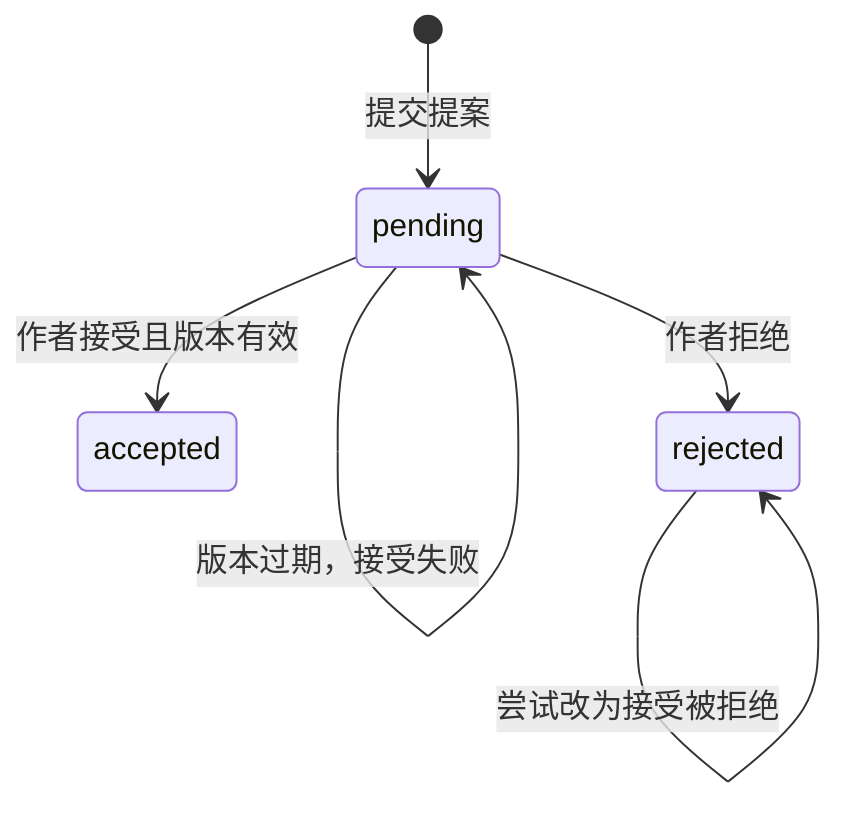

# 软件测试基础教材：从业务规则到前后端、AI 与自动化

更新时间：2026-11-07

这份教材是当前学习的主教材，先讲怎样判断软件行为，再讲不同模块如何验证。Python 是实现测试的一种工具，语法与 pytest 详解放在 [Python 测试基础教材](TESTING_FOUNDATIONS.md)。你不用先掌握全部章节才能开始实践；读完对应概念，就用项目里的一个小行为验证理解。

文中的项目场景用于解释测试思路；具体接口、按钮和运行命令以 [Story 实战指南](STORY_VERTICAL_TESTING_GUIDE.md) 及 [重构更新清单](FRONTEND_REFACTOR_TEST_UPDATE.md) 为准。这里不预先交付整套业务测试答案。

想结合已有代码练习时，直接打开 [SthStart 实训手册](STHSTART_TESTING_WORKBOOK.md)，从健康检查、已有章节冲突测试和第一个独立提案用例做起，再按需要回来查概念。

阅读方法：每章先读概念，再对照完整示范，最后不看参考思路写自己的方案。示例中凡写“教学规则”“教学模型”的内容，都是帮助理解的方法材料，不自动成为当前项目的新需求。对真实业务做判断时，回到已确认的契约与产品规则。

| 你现在遇到的问题 | 建议阅读 |
| --- | --- |
| 不知道要断言什么 | 第 2、4、6 章 |
| 搞不懂接口、页面与数据库的关系 | 第 5—7 章 |
| 不知道浏览器失败应该等什么 | 第 8—10 章 |
| 不知道模型、工具、Skill 哪个出问题 | 第 11 章 |
| 想知道怎么回归和写报告 | 第 12、14 章 |
| 想从头走一次实际观察 | 第 15、17 章 |
| 想检查自己真的理解没有 | 第 16、18 章 |

## 1. 先建立完整知识地图

| 范围 | 要回答的问题 | 代表练习 |
| --- | --- | --- |
| 测试思维与需求分析 | 为什么测，预期从哪里来？ | 把保存需求写成可观察结果 |
| 测试设计 | 怎么用少量案例发现重要问题？ | 边界、状态转换、权限组合 |
| 测试分层 | 哪个行为适合在哪层验证？ | API 冲突与页面提示分别验证 |
| Web 与网络 | 页面、服务、数据库如何协作？ | 跟踪一次保存请求 |
| 后端与 API | 请求、权限、契约、状态如何判断？ | 失败写入后重新读取 |
| 数据库与测试数据 | 怎样证明数据正确且用例独立？ | 独立项目、版本与清理 |
| 前端与浏览器 | 用户能否完成操作并看到正确反馈？ | 保存、刷新、失败草稿 |
| 自动化工程 | 用例怎样可靠运行和维护？ | fixture、Mock、超时、日志 |
| 回归与 CI | 每次修改需要跑哪些检查？ | 定向检查后做相关回归 |
| AI、MCP 与 Skill | 程序问题与模型质量如何分开？ | 固定工具调用和对照评估 |
| 非功能测试 | 除了功能，还有哪些质量要求？ | 性能、兼容、可访问性 |
| 缺陷分析与报告 | 失败如何变成可定位、可修复的问题？ | 报告步骤、证据与影响 |

这是一张范围地图。当前首期目标仍是“小而全”：用一个 Story 场景认识这些层次，性能专项和完整安全测试等留在后续深入。

## 2. 测试的目标、依据与局限

### 2.1 测试在减少什么不确定性

“保存按钮可以点击”与“正文可靠保存”是不同结论。前者观察到控件可操作，后者还需要确认请求、正式数据和重新加载结果。测试工作的第一步是明确准备得出哪一个结论。

一条用例通常包含：前置状态、输入、操作、预期响应、预期最终状态，以及判断依据。判断依据可以是明确需求、共享契约、业务规则、已确认设计。当前代码也是调查材料，但不能把代码当前做了什么直接当成应该做什么，否则真实缺陷也可能被写成预期。

需求不明确时，记录具体问题。例如“标题全是空格算有效吗？”比“需求不清楚”更容易得到答案。还不能确定规则时，不要悄悄把自己的猜测写成验收标准。

### 2.2 测试预言：怎样知道结果对不对

判断结果的依据有时叫 test oracle。这个术语指的是判断标准，不是某个测试框架。

| 目标 | 可用依据 | 较弱的检查 |
| --- | --- | --- |
| 保存成功 | 成功响应、重新读取新正文、刷新仍在 | 输入框出现新正文 |
| 失败不覆盖 | 失败后正式正文与版本保持原值 | 只检查错误提示 |
| 提案等待作者 | pending，正式数据未改变 | 创建响应里有 id |
| 模型分析可信 | 读过正确资料、引用准确、判断理由成立 | 输出很长、语气自信 |

通过意味着本次输入、环境和断言下没有发现不符合之处。它不证明没有任何缺陷。未执行、跳过、环境失败和通过必须分别记录。

### 2.3 验证与确认

可以把“实现是否符合已定义规则”理解为验证，把“这个规则做出的产品是否满足实际使用需要”理解为确认。二者会交叉。例如 API 保存字段正确，但用户需要滚动很久才能找到保存状态，依然可能不满足使用要求。

因此测试既检查协议与数据，也需要从使用者视角走流程。仅依据接口都返回成功，不能推断整个产品已经验收。

### 2.4 完整示范：把一句需求拆成能验证的规则

原始描述：“作者编辑章节后可以保存，失败也不能丢稿。”

先不要写脚本。这句话至少有五处需要澄清：保存是自动还是手动？保存成功是否表示服务器已确认？失败保留到哪里？刷新后是否恢复？与其他编辑者冲突时谁的内容保留？

为学习设计一组明确约定，注意以下是教学规则，具体产品仍查实际需求：

1. 只有服务器确认写入后，页面才显示本次保存成功。
2. 写入成功后，新打开页面能读到相同标题和正文。
3. 写入失败时，页面保留尚未保存的输入并说明失败。
4. 本机草稿不能未经明确规则就覆盖服务器的新版本。
5. 版本过期时，拒绝覆盖，并保留作者当前输入供恢复。

现在可以把第一条转成用例：准备正式正文 A，页面改为 B，触发保存，等待当前请求，检查成功反馈，再从正式 API 读回 B。第二条再增加重新加载检查。第三条需要可控制地制造失败，检查输入仍为 B、正式仍为 A。

这里的“等待当前请求”有意义：页面可能在输入之前就显示过“已保存”。如果检查旧提示，测试会在本次保存尚未发生时提前通过。

### 2.5 从需求到证据的追踪表

| 规则编号 | 风险 | 案例 | 关键证据 | 本次状态 |
| --- | --- | --- | --- | --- |
| R1 成功后持久化 | 看似成功却没写入 | 保存后重新 GET | 目标章节正文 B | 待编写 |
| R2 失败不丢输入 | 失败后文本消失 | 模拟 503 | 页面 B、正式 A | 待编写 |
| R3 冲突不覆盖 | 新版本被旧请求覆盖 | 基于 N 更新已到 N+1 的目标 | 冲突码、正式 N+1 | 待编写 |

这叫追踪关系：每条重要规则能找到用例，每条用例能解释保护哪条规则。它比“我写了 20 条测试”更有助于判断缺口。状态必须来自真实执行，不提前填通过。

**本章自检：**如果接口返回 200，但 GET 得到旧正文，你会如何描述结果？参考思路是：请求表面成功，但“持久化新正文”的验收没有成立；继续查目标 ID、缓存、异步提交约定和真实服务数据，不能只根据 200 结束调查。

## 3. 测试层次与分类：不要把不同维度混在一起

单元测试关注局部规则；集成测试关注真实组件的连接；系统测试关注系统整体；端到端测试贯穿一条实际业务路径。层次边界随系统结构变化，不能只按代码长短命名。

黑盒测试从外部输入输出判断行为；白盒测试利用内部结构设计检查。这是观察角度，与测试层次不是同一维度。接口测试通常偏黑盒，但也可能依据数据库和实现设计案例。自动化和手工同样是执行方式，不是质量等级。

### 3.1 测试金字塔怎么用

通常把大量明确、快速的规则放在较低层，跨层浏览器流程保留少量代表案例。因为越多真实依赖参与，启动和定位失败的成本通常越高。

金字塔不是数量配额。你的项目若主要风险在 HTTP、数据库和代理协作，集成测试会很重要；不能为了让图形好看，把关键集成检查改成全部 Mock 的单元测试。

对于“过期提案不能覆盖作者正文”：API 层重点覆盖状态与版本规则，浏览器层检查禁用按钮或错误反馈，端到端层只保留一条有代表性的正常接受链路。

### 3.2 冒烟、回归与探索

冒烟检查判断关键能力是否基本可用，例如服务健康、打开项目、保存一次。回归检查判断已有能力是否被新改动破坏。探索测试由你边操作边学习、提出假设并查证，适合发现文档没有描述的使用问题。

一次探索中发现“切换章节后草稿消失”，可以再整理成可重复的回归用例。探索不等于随便点，仍需记录关注目标、数据和发现。

### 3.3 同一个需求在四层分别怎么测

以“旧版本不得覆盖新正文”为例：

| 层 | 输入/准备 | 检查 | 没有证明什么 |
| --- | --- | --- | --- |
| 局部规则 | 当前版本 4，请求依据 3 | 冲突判定函数返回预期 | 数据库真的保护写入 |
| API 集成 | 真实章节先更新为 4，再按 3 保存 | 错误码、正文和版本未被覆盖 | 页面能解释冲突 |
| 页面行为 | 让保存收到冲突结果 | 提示冲突，输入不丢 | 真实后端冲突实现 |
| 真实跨层流程 | 两个编辑上下文先后保存 | 第二次受保护、两端状态合理 | 所有浏览器与并发组合 |

这些检查不互相取代。页面行为测试用 Mock 能快速定位前端问题；API 集成检查真实状态；少量跨层流程防止连接关系错误。

### 3.4 怎样选当前该写哪一层

先问“这次最担心哪里坏”。担心标题校验规则，先写较低层；担心代理把凭据丢了，必须让真实代理参与；担心菜单重构后找不到接受入口，需要浏览器。不能用一个工具方便，就把全部目标都压在这一层。

一条失败能指向明确边界，通常比一个失败后需要检查十个模块的长用例更容易维护。复杂流程仍有价值，但要有小测试帮助定位。

## 4. 用例设计方法

### 4.1 等价类：先分组，再选择代表

假设标题要求非空、长度不超过 L。可以按有效、为空、过长、错误类型、缺字段等类别设计。不是所有类别都需要上百个样本，每类先选能代表规则的输入。

分组依据来自规则。如果全空格、换行、emoji 有额外处理，需要再拆分类别。尤其要明确“长度”按字节、Unicode 码点还是用户感知字符计算，不要只依据输入框里看起来有几个字来猜。

### 4.2 边界值：检查规则切换的位置

当约定是 1—L，首批可检查 0、1、L、L+1。还要注意创建与更新是否相同，前端输入限制与后端校验是否一致。前端阻止输入不代表后端可以省略校验，调用者可以绕过页面直接请求。

### 4.3 决策表：多个条件共同影响结果

| 已认证 | 有项目权限 | 目标版本是当前版 | 预计方向 |
| --- | --- | --- | --- |
| 否 | 无意义 | 无意义 | 拒绝访问，不发生写入 |
| 是 | 否 | 无意义 | 拒绝访问，不泄露不应读取的数据 |
| 是 | 是 | 否 | 版本冲突，不覆盖当前内容 |
| 是 | 是 | 是 | 按合法请求执行 |

这是设计模型，具体 HTTP 状态和错误码以实际契约为准。表里的“无意义”表示前一个条件已经决定该操作不能执行，不等于系统可以不检查权限。

### 4.4 状态转换：同一操作取决于历史



先列合法状态、操作和转换，再检查禁止转换及失败后的状态。重复同一种决定与改变已经作出的决定可能有不同规则，不应统一预计为失败。

### 4.5 场景、组合与优先级

页面×浏览器×权限×文档类型×状态的组合很快增多。先保护高影响行为：正式内容不丢失、未经授权不能写入、失败能恢复、关键路径可完成。对相对独立的选项可考虑成对组合，但成对覆盖不能保证发现必须三个条件共同出现的问题。

先做正常路径和最重要失败，再根据具体风险扩展。风险可从影响范围、后果、出现可能性和恢复成本判断，不必先计算一个假精确分数。

### 4.6 完整示范：设计标题输入测试

先假设教学接口要求“标题是字符串，按约定方式去除首尾空白后长度为 1—120”。实际项目是否先去空白、如何计数必须另外核对。

第一步识别规则：字段必需、类型字符串、清理规则、长度下限、长度上限。第二步按规则分组。第三步每组选择代表，记录为什么选择它：

| 输入 | 设计目的 | 教学规则下的预期 |
| --- | --- | --- |
| 普通短标题 | 正常类 | 成功 |
| 恰好 1 个字符 | 下边界 | 成功 |
| 恰好 120 个字符 | 上边界 | 成功 |
| 121 个字符 | 超过上边界 | 拒绝 |
| 空字符串 | 低于下边界 | 拒绝 |
| 全空格 | 清理后为空 | 拒绝 |
| 首尾空格加正常标题 | 清理逻辑 | 成功，按约定保存清理结果 |
| 缺字段 | 必填规则 | 拒绝 |
| null | 空值类型 | 拒绝 |
| 数字、数组、对象 | 错误类型类 | 拒绝，不崩溃 |

第四步区分创建和更新。创建失败应确认没有新增条目；更新失败应确认旧标题、正文和 revision 都保持。第五步明确每组的状态码、业务错误码与数据结果。不能只把“输入不合法”写进表里而没有可执行预期。

这里有一个容易遗漏的问题：输入超过上限时，系统会拒绝还是截断？两者是不同产品规则。测试必须根据需求选择，不能自行决定“截断更友好”。

### 4.7 完整示范：列出提案转换表

| 原状态 | 版本关系 | 操作 | 预期状态方向 | 正式数据方向 |
| --- | --- | --- | --- | --- |
| pending | 当前有效 | 接受 | accepted | 采用建议并建立新修订 |
| pending | 当前有效 | 拒绝 | rejected | 不变 |
| pending | 已过期 | 接受 | 仍 pending，报告冲突 | 保留当前正式版本 |
| rejected | 不适用 | 改为接受 | 仍 rejected，拒绝改决定 | 不变 |
| accepted | 不适用 | 重复接受 | 按幂等约定 | 不应重复应用同一修改 |

“应当幂等”本身也要由接口约定确认。项目中的具体规则见实战指南。用例要记住被操作的是哪一个 proposal_id，不能拒绝第一份提案后，误把对第二份提案的接受当作禁止转换检查。

### 4.8 什么时候一条用例太大

一条测试包含创建、拒绝、非法接受、再次提案、正常接受，能演示故事，但任一前段失败都会阻止后段执行。报告只显示一个失败，用例之间也难独立复用。

按行为拆分通常更好：拒绝保持正文、接受采用正文、已拒绝不能改为接受、过期提案保护作者修改。每条都有独立数据，名字直接表达保护的规则。重复准备用 fixture/helper 处理，不把全部断言塞进一个分支函数。

**练习：**给“两个项目同名章节”设计一个读取用例。参考思路：项目 A/B 分别创建同名但正文不同的章节，使用 A 的项目与章节标识读取，核对得到 A，且不能误把名称相同当成同一实体。

## 5. 理解一次 Web 请求的完整链路

在当前学习模型中，浏览器操作可能经过 Portal 代理，再到 Service 和数据库。Python 直接调用 Service 则绕过页面与门户。MCP 工具又可能经 Portal 项目桥接访问 Service。

```text
浏览器输入与页面状态
    → 门户请求/认证/代理
    → 服务路由/校验/权限/业务逻辑
    → 数据库提交
    → 响应
    → 页面更新
```

这是排查思路，不表示每条请求都经过完全相同的内部步骤。具体调用方与路径要核对当前实现。

### 5.1 地址、方法、请求头与正文

URL 说明去哪里；HTTP 方法说明操作类型；请求头携带认证、内容格式等元信息；正文携带输入数据。GET 常用于读，POST 常用于创建或业务动作，PUT 常用于更新，DELETE 用于已有定义的删除/撤销。不要根据惯例猜一个未注册的路径存在。

HTTP 状态反映请求处理结果，业务错误码进一步解释原因。比如同为冲突，可能是章节版本过期，也可能是提案已经决定。响应应按结构解析，而非只搜某个字符串。

### 5.2 客户端状态和持久状态

输入框、本机草稿、缓存、服务数据库是不同位置。你在浏览器看到 B，服务可能仍是 A。刷新后仍看到 B，也可能来自本机恢复，因此需要结合正式 API 读回确认。

缓存能减少请求，也会造成“服务器已更新，页面仍旧”的问题。测试要说明是在观察当前页面、强制重新获取后的页面，还是正式数据，不让三个来源互相代替。

### 5.3 超时不一定意味着操作失败

请求超时时，服务可能尚未处理，也可能已经提交但响应没送到。直接重复写请求可能创建重复记录。重试前应考虑幂等机制或重新查询状态。

幂等表示同一操作重复执行具有相同预期效果，不等于响应内容和耗时完全相同。它属于接口行为约定，不能仅根据请求方法推断具体业务已经正确实现。

### 5.4 把一条 HTTP 请求拆开阅读

以下是教学报文，不要求你手动复制发送：

```http
PUT /api/v1/admin/story/projects/project-demo/documents/chapter-demo HTTP/1.1
Host: 127.0.0.1:4800
Content-Type: application/json
x-sthstart-admin-token: <专用测试凭据>

{"expectedRevision": 3, "title": "学习章节", "body": "正文 B"}
```

第一行的方法是 PUT，路径携带项目和章节标识。Host 表明请求目标。Content-Type 告诉服务怎样解释正文。认证头与正文分开；正文是 JSON 文本，expectedRevision 的数字不是带引号的字符串。

服务响应也有状态、头和正文。201/200 的 JSON 形状可能不同；204 按约定没有正文，不能强行解析 JSON。HTTP 成功响应里的业务字段仍可能不符，因此状态断言之后继续检查目标和内容。

### 5.5 浏览器会话、跨域与代理

浏览器 cookie 可以维持会话；服务凭据也可能放在特定请求头。这是两条认证路径，给所有浏览器请求注入管理员头可能绕开原本需要验证的会话逻辑。

Origin 由协议、主机与端口共同构成。浏览器的跨域约束会影响页面能否读取其他 Origin 的响应，普通 HTTP 客户端不会自动执行同样的浏览器限制。因此 Python 请求成功，不代表浏览器请求一定成功。

CORS 约束浏览器跨域交互，不等同于服务端授权。CSRF 关注浏览器可能自动附带认证信息时，非预期来源能否触发状态改变；它与管理员 API 的令牌校验也不是同一件事。当前先认识这些边界，具体配置和专项测试后续按系统认证设计开展。

代理可能改变请求路径、转发凭据或返回错误。排查时同时记录浏览器实际 URL 和后端实际目标，不能看到页面请求是 `/api/admin/...` 就认定 Service 也注册了同一个前缀。

### 5.6 常见观察与调查方向

| 观察 | 能先确认什么 | 还要调查什么 |
| --- | --- | --- |
| 页面没有发请求 | 未到达真实后端写入环节 | 前端校验、禁用、事件绑定、确认框 |
| 页面收到 401 | 某认证环节拒绝请求 | cookie/CSRF/代理/后端 token，按链路定位 |
| Python 成功，浏览器失败 | 同一业务可能走了不同路径 | Origin、代理、会话、请求体差异 |
| 响应成功，页面旧值 | 请求至少得到成功响应 | 响应目标、正式数据、缓存、组件状态 |
| 超时，数据却已写入 | 响应没有按时收到不等于回滚 | 幂等、查询结果、是否重复写入 |

## 6. 后端与 API 测试

### 6.1 契约检查

契约规定字段名称、类型、是否必填、可选值、范围、响应结构和错误行为。创建返回单个对象，列表返回 items 包装，决定返回提案而非章节，这些差别决定测试如何取值。

不仅检查“存在 id”，还要检查它是不是本次目标、数据是否来自正确项目。类型检查也有作用，例如 revision 不应偶然变成字符串，但只做结构检查仍不足以证明业务正确。

### 6.2 权限检查

认证确认调用者身份，授权确认身份可以执行什么。无令牌、错误令牌、已撤销令牌、项目 A 的凭据访问项目 B，分别覆盖不同风险。

错误状态检查之后，还要确认没有未授权新增或修改。在独立测试环境中设计这些场景，使用专用凭据，不把日常创作资料当作试验对象。

### 6.3 响应与状态共同验证

一次更新可以检查四层证据：状态码表示是否处理成功；响应字段说明返回对象；重新读取说明持久结果；版本与关联记录说明副作用是否正确。不是每个用例都要检查所有字段，但必须覆盖它声称保护的行为。

负向用例尤其要检查失败后的数据：400/401/409 都不能单独证明“没有错误写入”。

### 6.4 怎样阅读一个接口契约

先列五项：输入路径和方法、认证方式、请求字段、成功响应、错误响应。然后为每个字段记类型、必填性、允许值、长度/范围及字段间关系。

例如 targetId 合法还不够，它应指向允许项目和允许 kind 的目标；baseRevision 是整数还不够，它应与当前目标版本符合规则。前者是结构校验，后者是业务校验。

可选字段省略与显式 null 也可能不同。未知字段是拒绝、忽略还是保存，必须查约定。做契约测试时不要只验证一个正常 JSON 能解析，还要关注消费者真正依赖的字段。

### 6.5 一条更新接口的完整检查顺序

1. 创建独立目标，记录 id、原标题、原正文和原版本。
2. 根据该版本构造合法更新，发给明确目标。
3. 先检查状态，失败时保留必要响应帮助定位。
4. 检查返回对象的 id、内容和版本关系。
5. 重新 GET 列表，按本次 id 找到目标。
6. 检查持久结果；必要时检查其他章节没有被改动。

这不是要求所有用例都断言整个项目快照。根据风险选观察：担心目标错位时检查其他目标；担心失败覆盖时重点保护原值；担心重复写入时检查新增记录或版本次数。

### 6.6 读取、分页与过滤也需要测试

列表接口不仅是“返回一个 list”。还要看筛选是否只返回符合项，页大小是否生效，翻页是否漏项/重复，空结果是否按约定返回，排序是否稳定。多条记录排序字段相同的情况也值得关注。

先准备足够跨页的少量数据，收集各页真实 ID，再与预期集合比较。如果测试期间不断新增数据，要明确分页是否提供一致快照；否则需要根据接口真实语义解释结果，不能假设所有分页方式都有快照保证。

读取错误不能泄露不属于调用者的资料；有权限看到列表中的摘要，也未必等于有权限读取全文。权限要按实际资源边界验证。

### 6.7 API 测试中的常见误判

| 写法或做法 | 问题 | 改进 |
| --- | --- | --- |
| 只断言 status 为成功 | 内容或目标可能错误 | 读取关键字段并核对持久状态 |
| 失败后继续用旧 JSON | 没观察失败后的系统 | 再发 GET |
| 把同名条目当目标 | 名称可能重复 | 使用创建响应的真实 ID |
| 成功 helper 测错误 | helper 提前要求成功 | 保留原始失败响应 |
| 任意 4xx 都算正确 | 404 路径错误可能伪装成 401 权限验证 | 检查明确状态和错误码 |

## 7. 数据库基础与测试数据

### 7.1 记录、主键与关系

数据库表保存多条记录，主键识别某一条；项目 ID、章节 ID、提案 ID 是不同实体的标识。它们在响应中都可能是字符串，但不能互相替换。

关联关系意味着提案的 targetId 应指向正确目标，sessionId 应属于允许的会话。新建项目可能带默认记录，因此列表不一定从空开始。用本次 ID 查找，或比较操作前后 ID 集合，通常比硬编码总数可靠。

### 7.2 事务与原子性

事务把一组数据变化视为一个整体。例如接受提案可能涉及更新章节、增加修订、更新提案状态。若其中一步失败，不能留下“提案已接受但正文没变”的部分结果。

事务测试关注所有相关状态是否一致。可以先用正常和明确失败场景检查；更深的中途故障注入属于后续专项，不需要初学就模拟数据库的每个错误。

### 7.3 版本与并发

乐观并发控制用版本判断保存依据是否仍有效。两个编辑者都读到 N，第一个保存成 N+1，第二个再按 N 保存应按规则报告冲突，保护第一个的修改。

你可以先串行模拟这个顺序，不必立即使用多线程。串行状态测试验证规则；真正同时请求时的竞争还需要另外设计并发测试，不能用串行通过声称并发实现已全面验证。

### 7.4 隔离、清理和顺序无关

临时数据库隔离一轮测试，独立项目隔离不同用例，独立浏览器上下文隔离 cookie 与本机存储。它们解决的是不同层面的问题。

清理必须在失败时也执行。数据库客户端、MCP 连接、浏览器、Portal、Service 都有生命周期。先完成最后一次数据核对再关服务；不要凭空调用不存在的删除路由。反复运行、单独运行、调换用例顺序都应保持相同业务预期。

### 7.5 用一组记录理解实体关系

下面是教学模型，不是项目数据库建表定义：

```text
项目 P1
  章节 D1：正文 B，revision=4
  章节 D2：正文 X，revision=2
  提案 Q1：targetId=D1，baseRevision=4，建议正文 C，pending
```

提交 Q1 后，D1 应仍为 B/4。接受 Q1 后，D1 变为 C/5，Q1 变 accepted。D2 不应变化。通过这组关系能看出：提案内容和正式内容是两份数据，targetId 把它们关联起来。

如果 Q1 指向 D1，却修改 D2，状态码可能仍是 200，只有检查关联关系才会发现。如果 Q1 已 accepted 而 D1 仍 B，可能是事务、目标或读回路径出了问题，需要进一步调查，不能只改一个断言让它通过。

### 7.6 事务测试观察的是“全部一致”

接受提案可能涉及三项逻辑效果：正式章节更新、建立修订、提案标记已接受。成功后应形成一致结果；失败后不应只留其中一部分。

数据库事务还涉及隔离和持久性等性质：并发事务彼此可见什么、提交后能否保存下来，需要结合数据库与业务设计判断。此处先掌握原子性：一组必须一起完成的操作不能只完成半组。

直接查库能帮助定位，但业务测试优先经正式 API 观察公开行为。SQLite 文件是否存在不能证明业务数据正确；通过 API 读回也不自动证明数据库重启恢复，若目标是重启持久性，应另设计重启后的读取检查。

### 7.7 乐观并发控制的时序

```text
编辑者甲 GET → 版本 3
编辑者乙 GET → 版本 3
甲按 expectedRevision=3 保存 B → 版本 4
乙按 expectedRevision=3 保存 C → 冲突
正式读取 → 应保留 B/4
```

关键是服务端必须把版本检查和更新协调为可靠操作，不能仅在浏览器先比较。如果两个真实写请求同时发生，两个请求各自“先检查版本是 3”再无条件写入，可能存在竞争；这需要并发专项才能进一步检验。

基础练习先串行构造冲突，再学习真正同时发请求。两条测试的证据范围不同，应分别命名与记录。

### 7.8 测试数据工厂与清理的责任

数据工厂负责创建具有合理默认值的新输入，允许用例覆盖所需字段。独立唯一后缀便于辨认记录，但“名称唯一”不等于数据库隔离。

清理按取得资源的逆向依赖处理。临时数据库不代表进程可以不关，浏览器 Context 不代表后端数据自动清空。每项资源应有明确所有者：谁创建、谁结束，失败时在哪里结束。

**练习：**第二条测试单独运行通过，但接在第一条后失败，首先调查什么？参考思路：共享记录被修改、模块全局对象、cookie/localStorage、缓存、未结束事务或子进程，以及依赖运行顺序；不要先把测试顺序固定下来。

## 8. 前端测试关注什么

### 8.1 逻辑、组件、页面流程

前端逻辑测试可检查状态计算、请求构造和保存队列；组件测试检查控件渲染与交互反馈；浏览器测试检查真实页面、路由、网络与布局的协作。

Python 浏览器测试可以覆盖真实 React 页面，但通常不会直接验证 TypeScript 函数内部。学习目标是前端行为时，不必为了统一语言而强行把内部函数测试也改成 Python。

### 8.2 页面状态比一个成功截图更多

界面通常有初始、加载、空数据、成功、失败、重试、保存中和冲突状态。分别考虑用户看到什么、能做什么、是否会丢数据。

例如保存中应避免错误的重复提交反馈；保存失败要保留输入；切换章节时不能把 A 章节的保存结果错显示在 B；旧请求晚于新请求返回时，不应让旧数据覆盖新状态。

### 8.3 用户可见行为和实现细节

优先用名称、角色、标签、可见文本表达用户目标。CSS 类名或第几个 div 容易随重构变化；但可访问名称也会调整，需要先确认变化是产品设计更新还是程序退化。

视觉上能看到不代表键盘能访问，能点击也不代表反馈明确。焦点、标签、对话框、错误提示关联和键盘操作都是前端质量的一部分。

### 8.4 把页面当作状态机，而不是一张截图

| 状态 | 页面应表达什么 | 数据检查 | 容易遗漏的操作 |
| --- | --- | --- | --- |
| 加载中 | 正在获取资料，避免误操作 | 暂不假设资料为空 | 加载时切换项目 |
| 空列表 | 没有符合条件的数据，可创建或调整筛选 | 正式结果确实为空 | 空搜索和真正无数据的区分 |
| 编辑中 | 当前输入尚未持久化 | 本地输入 B、正式仍可能 A | 离开页面、切换章节 |
| 保存中 | 正在处理本次写入 | 等待本次结果 | 再输入 C、重复点击 |
| 保存成功 | 当前内容得到确认 | 正式为本次内容 | 刷新、新开页面 |
| 保存失败 | 清楚说明未完成，输入保留 | 正式旧值仍在 | 恢复、重试、关闭提示 |
| 版本冲突 | 不能无声覆盖别人的新内容 | 正式最新版本保留 | 读取最新、明确选择后续动作 |

状态反馈要对应当前条目和当前内容。A 章节的成功回调不能让正在编辑的 B 章节显示“已保存”。“保存中”也不能无限保留却不给用户处理方式。

### 8.5 请求乱序与输入法

搜索 A 和搜索 AB 的请求可能按相反顺序返回。用户最后输入 AB，页面应遵循产品定义呈现 AB 结果，不能被较晚返回的旧 A 响应覆盖。测试时控制返回顺序，观察最终页面与请求关联。

中文输入法在组词阶段的按键不一定代表用户已经确认输入。回车可能是选词，不应意外触发提交；自动保存和快捷键也应考虑组合输入状态。初学先认识 composition 事件这一边界，后续为实际编辑器补代表性输入法检查。

### 8.6 前端校验为什么不能代替后端

前端限制标题长度有助于及时反馈，但客户端可以被修改、旧版本页面也可能仍在使用。后端必须独立维护必要约束。两端测试目标不同：前端检查提示与可操作性；后端检查任何调用者是否都受规则约束。

当两端限制不同，测试要记录差异。例如页面允许输入，服务拒绝；这可能是前端遗漏，也可能是服务规则更新。判断依据仍是当前产品约定，而不是哪个实现先写出来。

## 9. 浏览器自动化基础

### 9.1 Page、Context 和 Locator

Page 是页面标签，Context 是隔离的浏览器会话，Locator 描述如何查找元素。用例间共享浏览器实例可以节省启动时间，但通常为每条用例使用独立 Context。

定位器匹配多项时先查原因：桌面侧栏、移动抽屉、多个提案是否都含同名按钮？先限制范围，再确认唯一，避免随手取第一项点错对象。

### 9.2 自动等待与真实完成

按钮可点击只说明它此刻可操作，不表示后端保存已经完成。页面条件用可重试断言等待，网络操作订阅本次目标响应，持久结果再重新读回。

先注册等待再触发操作，避免请求很快结束而错过。固定等待两秒只是延迟，机器变慢时仍失败，机器很快时又浪费时间。任何等待都应有截止时间和能解释的目标条件。

### 9.3 对话框、视口与追踪

页面 DOM 对话框与浏览器原生 confirm 是不同机制。接受提案前若有 confirm，自动化必须处理它，再检查实际决定请求。

移动端可能更换导航方式，不能把桌面隐藏元素当作移动目标。先用一个桌面主流程，再补一项移动代表流程。

失败时用 Trace 查看最后正确动作、当时 DOM、网络请求和响应。截图说明某个瞬间的样子，不能单独还原所有操作与数据变化。

### 9.4 一条可靠保存测试的时间线

```text
确认正确项目与章节，初始正文 A
→ 注册“本章 PUT 且正文 B”的响应等待
→ 输入 B，触发保存
→ 收到本次响应并检查成功
→ 检查当前保存反馈
→ API 重新读取正式 B
→ 刷新并重新选择章节，检查 B
```

等待的目标必须足够具体。只等任意 200，可能匹配列表 GET；只等任意 PUT，可能匹配另一章；只等旧“已保存”，可能尚未触发本次保存。

反过来，条件过度绑定实现也会脆弱。例如强制期待保存请求只能发生一次，可能与合法的自动保存合并或输入节奏冲突。明确你的目标是内容正确，还是防重复提交，再选择对应断言。

### 9.5 一个定位失败怎么调查

1. 确认当前 URL 和本次项目 ID。
2. 确认页面已经加载目标状态，而不是错误或空态。
3. 看该控件是否在菜单、抽屉、另一标签或另一个视图。
4. 检查名称是可访问名称还是你猜的 HTML 属性。
5. 检查匹配数量，区分没有与重复。
6. 检查是否被禁用或遮挡，再执行操作。

强制点击可以跳过一些操作条件，但不能修复用户本来也点不到的问题。不要把 force 当作解决定位问题的常规办法。

### 9.6 Trace 的阅读练习

假设失败停在“接受并保存”，依次观察：是否打开审阅面板、卡片是否为本次提案、按钮是否可用、原生 confirm 是否出现/接受、decision 请求是否发出。

若没发请求，优先调查页面和确认框；若返回冲突，检查错误码和版本；若成功而数据不符，检查服务返回目标和正式读回。Trace 中请求成功仍不能代替后端数据核对，但可以告诉你问题发生在哪个阶段。

## 10. 自动化工程：fixture、Mock 和稳定性

fixture 管理准备、依赖和清理；helper 复用稳定步骤；测试正文表达目标操作和断言。抽象应让业务意图更清楚，不能把测试写成一个很长的神秘通用函数调用。

Mock 控制某个依赖行为，stub 常用于提供固定返回，fake 常是简化实现，spy 记录调用。这些术语在不同工具中有差别，首要问题是：替代了谁、还验证到了什么真实行为？

模拟接口返回 503 适合验证页面错误状态；它不能证明真实服务遇到故障时一定返回该结构。模拟模型返回固定文本适合验证解析流程；它不能证明真实模型会遵守 Skill。

偶发失败称为 flaky：相同版本与合理相同环境下结果不稳定。先调查数据共享、固定等待、过载、未结束进程、外部依赖和竞争。自动重跑可帮助收集现象，但不能用最后一次通过替换第一次失败而不记录原因。

配置要明确来自哪里，日志要保留必要上下文。报告记录项目 ID、步骤、错误码即可，不打印完整环境、认证头、cookie 或模型密钥。

### 10.1 测试代码也需要分工

| 部分 | 职责 | 不适合放什么 |
| --- | --- | --- |
| 配置 | 地址、超时、输出目录、运行分组 | 固定日常项目 ID 和密钥 |
| fixture | 创建与清理环境、独立数据 | 隐含依赖上条用例状态 |
| 数据工厂 | 新输入和默认字段 | 代替服务响应制造实际值 |
| helper | 重复、稳定、可解释的步骤 | 吞掉错误并默认成功 |
| 测试函数 | 当前行为、观察和断言 | 大量无关分支掩盖目标 |
| 报告 | 执行事实与证据 | 将未运行场景标为通过 |

分工不等于尽快建立多层类库。先写一条清楚的测试，等重复逻辑稳定后再抽取。十行重复准备可能比一个看不懂的通用框架更适合学习阶段。

### 10.2 Mock、stub、fake、spy 的直观区别

用发送通知举例：stub 直接返回“已接收”；fake 是一个内存通知箱，保存消息但不真正发送；spy 记录真实或替代函数被调用的参数；mock 常包含“应该被怎样调用”的预期。实际工具可能混用这些名称。

Story 例子中，用固定 503 替代保存响应是控制依赖；记录工具是否用当前 targetId 调用是交互检查。断言调用参数正确很有用，但真实数据库集成也应有少量测试，否则后端完全不保存仍可能通过所有 Mock 测试。

### 10.3 选择真实依赖还是替代物

先看被测目标和可控性。验证前端失败提示，替代后端响应；验证事务，连接临时真实数据库；验证模型 JSON 解析，替代模型响应；验证当前模型凭据连接，需要真实调用。

把外部依赖替代后，要在报告中说清边界。不能把“本地 fake 工具返回 accepted”写成“真实 MCP 和作者审批已验收”。替代实现也可能与真实契约漂移，需要契约检查和代表集成流程维持联系。

### 10.4 超时、重试与清理失败

为服务启动、单次网络请求、页面动作和整条用例分别设置合理上限，它们不必相同。超时应报告在哪一阶段、正在等待什么、最后观察是什么。

只对明确可恢复的操作设计重试，并限制次数或截止时间。重试写操作前必须理解是否重复创建或增加版本。断言不成立不能通过“再断言几次直到碰巧通过”掩盖确定性缺陷。

清理失败也要记录：测试断言通过，但 Node 进程没有退出，仍会占端口并污染下一轮。测试与清理都失败时，两项证据都要保留，别让清理异常完全遮住原始问题。

### 10.5 定位偶发失败的实验

先记录第一次失败和环境，再尝试单独运行、与前一个用例组合、反转顺序、降低并发、固定数据或控制响应顺序。每一步只改变一个可疑因素，比较结果。

如果降低并发后稳定，只说明负载或竞争值得调查，不能自动认定业务无缺陷。如果单独通过而整套失败，重点查共享资源与隔离，而不是永久只跑单条。

## 11. AI、模型调用、MCP 与 Skill 分别怎么测

### 11.1 四种对象

| 对象 | 核心问题 | 检查方式 |
| --- | --- | --- |
| 模型调用程序 | 请求是否正确、响应是否正确解析？ | 固定响应、超时、异常和流式片段测试 |
| MCP 协议与工具 | 发现、参数、权限、返回是否正确？ | 真实客户端连接与固定工具输入 |
| Skill 使用 | 模型是否实际加载并遵循指导？ | 加载证据、工具轨迹、输入与输出 |
| 内容质量 | 判断是否准确、有据、忠实？ | 固定评估场景、人工 rubric 与对照 |

### 11.2 模型适配的确定性测试

把请求参数、响应解析、流式结束、取消、超时、空响应、格式异常等作为程序行为检查。固定模型响应能隔离解析错误，真实调用则用于验证实际连接和行为。

流式网络片段不一定正好是一条完整消息；解析器应按协议处理边界。调用超时、凭据无效、模型输出不符合格式分别是不同失败，不要都记为“模型不好”。

### 11.3 MCP 的边界

真实 MCP 测试要通过协议完成连接、工具发现与调用。只请求 REST 桥接验证的是桥接接口；工具清单存在，也不代表工具有权限读取业务资料。

代表检查包括必需参数、目标 ID、项目范围、撤销凭据、正文截断和分页。工具执行失败可能作为错误结果返回，连接和协议故障可能表现为异常，应分别解释。

提交提案的工具只应建立待审记录。自动验证 pending 与正式正文不变，比只检查工具返回“成功”更能保护作者控制权。

### 11.4 Skill 评估的依据

先固定场景、资料、任务和评分规则，再分别在新会话中运行有 Skill/无 Skill。保持模型、参数、可用工具和资料尽可能一致；任何差异都写入实验条件。

Skill 哈希说明文件版本，不证明实际加载；实际加载证据也不证明推理正确。需要结合工具轨迹、引用原文、输出和人工判断。当前若加载整套创作套件，就应记录套件对照，不能标成仅单一模块的效果。

评分可分证据准确性、冲突判断、人物知识边界、改编忠实度，各项定义清楚的等级并写理由。工具调用次数更多不一定更好；读错资料但说得流畅也不能得高分。

一次成功观察不能证明普遍有效。探索可以各跑一次，较正式比较需要多个场景和重复实验；保留失败，不静默重试到满意，不因某组缺少配置就自动换模型。

### 11.5 先分清三种“失败”

| 现象 | 初步类别 | 第一项证据 |
| --- | --- | --- |
| Node 子进程启动后立即退出 | 环境或程序启动问题 | stderr、cwd、启动参数 |
| 工具清单成功，读章节返回无权限 | 工具业务授权失败 | 当前凭据、项目、错误字段 |
| 模型请求返回网络超时 | 调用链故障，完成状态可能不明 | 请求审计、错误类型、用量是否可获得 |
| 模型读到正确正文，却编造不存在的规则 | 语义质量问题 | 工具返回与模型引文对照 |
| 正式正文在仅分析任务中被改写 | 工具/授权边界问题 | 提案与正式数据前后状态、写入轨迹 |

分类是调查起点。仅凭最终现象还不能断定责任模块，特别是工具参数可能由模型产生，而工具本身也应维护权限和校验。

### 11.6 完整示范：连贯性评估案例卡

为减少歧义，教学场景使用明确资料：

```text
规则：林遥获知密室位置的唯一途径是拆开密封信。
章节：当天早晨，林遥尚未拆开信，也没有通过其他方式得知位置。
      他却准确告诉同伴：“密室就在钟楼地下。”
任务：检查人物知识是否一致，引用资料，解释冲突并给最小修改建议。
限制：只分析，不提交提案，不修改正式资料。
```

案例卡应记录：场景 ID、资料快照、任务、允许工具、禁止副作用、必要证据、评分规则。预期不是要求模型输出固定一句话，而是指出“获知条件尚未满足却已准确知道位置”的关系，并给出不捏造新事实的建议。

一个最小建议可以是把获知位置的发言安排在拆信之后；另一个是保留未拆信状态，让人物尚不能准确说出位置。若模型直接补写“他昨天偷看了地图”，就引入了与唯一途径相冲突的新事实。

### 11.7 自动检查与人工评分分开

自动部分可检查：有无读取必要 ID、参数是否有效、有没有未授权提案、正式数据是否未变、输出是否包含约定结构。读过资料不代表理解正确，因此需要人工对照。

| 维度 | 0 分 | 1 分 | 2 分 |
| --- | --- | --- | --- |
| 证据准确 | 引用不存在或错误资料 | 依据相关但不完整/指向不清 | 正确定位两份依据且不歪曲 |
| 冲突判断 | 漏掉或否认明确冲突 | 发现疑点但理由不清 | 明确说明获知条件与发言矛盾 |
| 最小修改 | 破坏规则或擅加关键事实 | 能修正但改动过多/解释不足 | 忠于资料、足以修复且理由清楚 |

工具越权、未加载 Skill、两组资料不同属于单独的边界/实验条件检查，不应被语义总分掩盖。一个质量很高但未经授权写入的输出，不能因为总分高就验收通过。

### 11.8 对照实验怎么保证可解释

两组使用同一模型与参数、相同内容资料、相同任务、同样的工具和新会话。隔离项目的实际 ID 可以不同，但内容和结构应对应。模型宿主可能自动注入其他指导，要记录而不是假设不存在。

有 Skill 组保留实际加载记录与内容哈希；无 Skill 组要确认没有加载相同指导。若无法保证，报告为探索，不能声称严格对照。即使温度设为 0，也不应假定所有模型服务都逐字可重复。

重复运行用于观察波动，不是挑最好一次。各组三次可以作为初步探索，但样本很小，不能证明统计上稳定改善；需要更多场景、重复和分析才可作更强结论。

报告应给出每次结果，例如“有 Skill 的三次都引用两份资料，无 Skill 的三次中两次漏掉规则；本场景如此，尚未验证其他冲突类型”。这比“Skill 提升很大”更容易审阅。

### 11.9 一个最小评估记录

```text
场景 / 轮次 / 分组：
模型标识与参数：
资料快照位置与实际目标 ID：
实际 Skill / 哈希 / 加载证据：
开始结束时间与耗时：
工具轨迹与原始输出：
自动检查结果：
人工各项分数与理由：
用量：实际值，或不可获得
失败与条件偏差：
结论与局限：
```

凭据不进入报告。模型调用失败但已经产生部分输出时，保留失败与部分记录，不能把缺失字段默认为 0 或自动通过。

## 12. 覆盖率、回归与 CI

代码覆盖率统计哪些语句或分支被执行过。执行到保存代码，不代表断言检查了保存结果；覆盖率高仍可能缺关键输入、状态或断言。

业务覆盖可以用“规则—用例—证据”清单记录，例如成功接受、拒绝不修改、过期接受保护作者内容。二者相互补充，不用一个百分比代替质量判断。

改动后先运行最相关用例，再根据受影响调用方扩大范围。页面菜单重构需要相关浏览器检查；API 字段变更要同时检查契约、服务与调用方。没有理由时反复跑整个项目不如先定位一个失败。

CI 在提交或其他事件后自动执行预定义检查。它需要可重复的环境、明确依赖、退出码和报告；CI 通过不等于部署成功，也不代表未纳入流水线的浏览器或真实模型场景已通过。

真实模型评估首期保留手动入口，确定性 API/工具/浏览器代表用例逐步进入自动回归。缺少凭据或浏览器要明确报告，不能悄悄省略后仍宣称全部验收。

### 12.1 覆盖率为什么不等于测试有效

教学伪代码：如果标题为空就拒绝，否则保存。只测正常标题，可能执行保存分支，没执行拒绝分支；两者都测才覆盖这两个分支。

但即使两个分支都执行，若测试没有检查实际保存内容，保存错标题仍可能通过。覆盖率告诉你“执行过哪里”，断言告诉你“观察结果是否符合要求”，业务清单告诉你“重要规则是否被考虑”。三者都不应互相冒充。

手动把一个预期值改错，观察是否失败，是学习断言的练习；暂时破坏实现观察测试是否抓到，则接近变异测试的思路。首期只在隔离练习中做可控的小变化，不要求建立完整变异测试工具链。

### 12.2 前端重构后的回归如何选

| 变化 | 直接风险 | 先检查 | 再扩展的条件 |
| --- | --- | --- | --- |
| 修改菜单入口 | 用户无法打开审阅 | 菜单→目标面板→一条决定流程 | 共用菜单组件影响多页面 |
| 改保存队列 | 请求乱序或丢输入 | 队列规则、保存/失败场景 | 跨模块复用或发现竞争 |
| 改 API 字段 | 前后端契约不一致 | 契约、路由、客户端 | 影响多个消费者 |
| 改全局导航 | 路由和小屏不可达 | 代表入口、桌面与移动 | 全局布局变化 |

回归选择要写理由与未验证项。只运行健康检查不足以保护菜单重构；菜单变化也不必默认触发真实模型评估，除非它影响模型宿主或工具配置。

### 12.3 一条 CI 流水线的职责

```text
取得源码与依赖
→ 配置隔离环境
→ 类型/静态与契约检查
→ 确定性 API/工具测试
→ 构建并跑代表浏览器流程
→ 保存结果、Trace、日志
→ 根据明确门槛报告成功或失败
```

这是设计示意，不表示当前仓库已按这个顺序实现。环境依赖、缓存、超时和并行策略也会影响可靠性。所有用例共用一个可修改项目，放进 CI 后不会突然变得独立。

失败证据应该在用例失败时仍能收集。流水线返回成功但悄悄没收集任何测试，是配置问题，不应把空结果作为通过。

## 13. 非功能测试：知道范围，再按风险深入

| 方向 | 基础问题 | 后续代表检查 |
| --- | --- | --- |
| 性能 | 结果是否在可接受时间内完成？ | 明确数据量、并发和响应时间分布 |
| 稳定性 | 长时间或反复操作是否积累问题？ | 进程、连接、内存和临时文件释放 |
| 兼容性 | 不同环境能否完成同一目标？ | 浏览器、视口、操作系统、输入法 |
| 可访问性 | 不同使用方式能否操作？ | 键盘、焦点、名称、标签、对比度 |
| 安全边界 | 谁可以读写哪些资源？ | 认证、授权、跨项目访问和敏感信息 |
| 恢复能力 | 失败后能否安全继续？ | 草稿、超时、重启与恢复 |
| 可用性 | 使用者能否理解状态并完成目标？ | 加载、空态、错误与下一步反馈 |

性能需要工作负载与指标，不能只写“页面很快”；平均响应时间也会掩盖少数很慢的请求，后续应学习分位数和吞吐量。基础阶段先记录环境与实测现象，不急于压测。

视觉截图相同不能替代功能正确，功能正确也不能替代可读与可操作。专项安全、压测、迁移恢复等需要独立目标与环境，后续再深入。

### 13.1 性能指标怎么读

响应时间是一次操作从开始到完成的时长；吞吐量是在一段时间内完成的操作数量；并发量是同时进行的工作数量；错误率是按约定口径失败的比例。它们相关，但不是同一个数。

p95 表示按约定统计方法估计约 95% 样本不超过的延迟，不能解释为“最慢请求”。平均值可能被大量快请求拉低，因此记录平均值之外还要看分布、尾部和失败率。

指标必须带场景：多少项目、每章多长、多少并发、是否冷启动、用什么机器、持续多久。一次空数据库的 50ms 不能证明大数据量下也快。这里的数字只是说明，不是项目实测。

### 13.2 负载、压力与耐久

负载测试观察预期工作量下的表现；压力测试探索超出预期时的瓶颈与失败方式；耐久测试观察较长时间后的资源增长和稳定性。三种目标不同，不要用一次快速连点当作全部压测。

先确保功能和数据隔离，再设计这些实验。模型评估涉及真实调用成本与外部限制，不能直接照搬本地 API 的高并发实验。

### 13.3 可访问性与可用性的代表检查

用键盘能否进入目标控件；焦点是否看得见；打开对话框后焦点是否合理；关闭后能否回到触发位置；输入框是否有可理解名称；错误是否不只靠颜色表达。

这些检查服务于真实操作能力。自动扫描能发现部分规则问题，但不能证明页面在所有辅助工具下都可用。先完成一个实际键盘流程，再扩展工具和使用者验证。

### 13.4 安全与恢复的基础边界

权限测试在专用环境检查合法/非法访问；专项安全还包括更广的威胁分析，不等同于几个 401 用例。提示注入也是 AI 系统后续专题，需要把不可信资料、可调用工具与授权边界放在一起设计。

恢复测试先确认“保存在哪”：本机草稿、正式数据库、媒体文件和备份是不同存储。临时刷新恢复成功，不能说明数据库损坏恢复或备份可用。后续备份演练应使用独立副本，并验证恢复后内容和关联，而不是只看备份文件存在。

## 14. 缺陷报告与排查

测试失败先是一个待调查信号。报告缺陷时要提供能复现和判断的材料：版本与环境、准备数据、操作步骤、预期、实际、发生频率、证据和影响。

例如“接受无效”过于笼统；“待审提案基于当前版本，点击确认后未发出 decision 请求，按钮保持可用，Trace 显示确认框被取消”已经给出明确调查方向。

严重程度描述后果，优先级描述处理顺序。数据丢失和一个次要文案错字的后果不同；低频问题也可能因难恢复而优先处理。不要只根据是否经常复现判断严重程度。

按最后一个已确认正确的状态向前查：页面 B 已输入→请求发出→服务成功→API 读回→页面刷新。第一处不符合预期的环节通常能缩小故障范围。修复后重跑失败案例，再做相关回归。

### 14.1 一份可以直接填写的报告

```text
标题：概括具体触发与错误结果
环境/源码版本/时间：
前置数据：本轮项目与目标 ID，不含凭据
复现步骤：最少且可重复的步骤
预期：引用规则并给出可观察结果
实际：状态码、业务字段、页面与正式数据
频率：一次/偶发/稳定复现，注明运行次数
影响：数据、权限或用户流程受到什么影响
证据：Trace、响应、日志路径
已排查：哪些环节正确，哪些是假设
修复后验证：原案例与相关回归结果
```

### 14.2 教学报告示范

标题：模拟保存 503 后，切换章节使未保存正文丢失。

前置：独立项目中 D1 正式正文 A，D2 正文 X。步骤：打开 D1 输入 B，拦截本次保存为 503；确认页面失败；切到 D2，再回 D1。预期：按已确认的草稿恢复规则保留或可恢复 B；实际：只有 A，没有恢复入口。证据应包括请求确为 503、输入 B 的阶段、切换动作与返回后状态。

这是教学缺陷描述，并非声称当前项目存在该问题。如果实际产品没有承诺跨条目恢复，应先确认需求，不能仅凭个人期望就判定缺陷。

### 14.3 排查中的假设与证据

“可能是缓存”是假设；“服务 API 已读到 B，但页面刷新请求返回 A”是观察；“清缓存后正确”是一个干预结果，还要进一步查为什么缓存没有按规则更新。

每次尽量只改一个因素：目标 ID、缓存策略、并发数或等待条件。一次改三处即使通过，也难知道哪个因素是根因。保留第一次失败的材料，修复结论应能解释原始症状。

## 15. 一条 Story 路径怎样贯穿这些知识

| 步骤 | 观察 | 学到的知识 |
| --- | --- | --- |
| 创建独立项目与章节 A | 本次 ID、原版本 | 数据准备、隔离、契约 |
| 从项目总览进入编辑器 | 正确项目、正确章节 | 路由、前端定位与用户流程 |
| 浏览器保存 B | 本次请求、正式 B、刷新 B | 等待、持久状态、前后端集成 |
| MCP 读取 B | 正确正文与版本 | 协议、工具参数与数据一致性 |
| 提交建议 C | pending，正式仍为 B | 权限边界、状态与副作用 |
| 作者接受 | 正式 C、版本按规则增加 | 确认框、事务与状态转换 |
| 旧版本接受失败 | 作者新数据保留 | 并发规则与负向断言 |
| Skill 观察 | 读资料、证据与评分 | 确定性检查和语义评估 |

先分层写小测试，再串代表流程。综合失败后回到对应层定位，不把所有异常塞进一条超长测试。

### 15.1 带具体数据的一次完整推演

教学数据：项目 P、章节 D，初始标题 T，正文 A。初始版本从创建响应读到，不把它写死。为便于叙述，假设本轮在浏览器保存 B 后，正式 API 与 MCP 都实际读到 revision=4。

1. 项目总览显示 P 的真实标题，“继续写作”进入 P 的编辑器。选择 D，确认初始 A。
2. 编辑为 B，等待本次成功写请求。正式 API 读到 D/B/4；刷新页面仍显示 B。
3. MCP read_entry 返回 id=D、body=B、revision=4，证明读的是同一项目正式状态。
4. 用工具读出的版本 4 提交建议 C，得到真实提案 ID Q；检查 targetId=D、baseRevision=4、status=pending。
5. 再 GET 正式 D，应仍 B/4。这一步保护“提案不是直接写入”。
6. 页面从菜单进入审阅，定位 Q 对应的建议标题，处理原生确认框，等待决定结果。
7. API 查到 Q 为 accepted，正式 D 为建议标题/C/5；刷新后仍 C。

这里能预计接受后是 5，是因为接受前实际读到 4，且本流程中不再有其他保存。不能从初始版本猜浏览器到底产生了多少次保存；实际实现的版本规则仍要核对契约。

### 15.2 如何把它变成冲突用例

保留前五步，然后先让作者把 D 保存为 X/5，再接受依据 4 的 Q。预期按当前规则拒绝旧提案，Q 保持 pending，D 保持 X/5。不要在最开始就创建一个 baseRevision 错误的提案，那是“提交时版本过期”的另一场景。

页面可能直接禁用旧提案的接受按钮。这种情况下浏览器检查提示与禁用，API 测试直接调用决定接口验证冲突；不能强制点禁用按钮再把结果当作真实用户流程。

### 15.3 每一步怎样留下最小证据

记录“步骤、目标、来源、实际状态、预期关系、证据位置”。例如 MCP 读到的 revision 来自工具返回，不是直接复制 expected_revision；接受后的正文来自新 GET，不是读 proposal.proposedBody 代替正式状态。

每一步的观察都应能区分相邻状态：A/B/C/X 采用不同正文；标题变化要考虑刷新后的新定位；提案 ID 来自响应。把所有正文都叫“测试内容”，会让目标错位不容易被发现。

## 16. 当前学习顺序与练习

### 第一批：测试思维（第 2—4 章）

为“保存失败仍保留草稿”写出前置、操作、预期、依据；说明输入框、正式 API、刷新分别能证明什么。再为提案画状态表，列一个合法转换和一个禁止转换。不需要先写代码。

完成标准：能把笼统的“应该正确”改成可观察的检查，并说明检查的局限。

### 第二批：Web、API、数据（第 5—7 章）

画出页面保存到数据库的链路；列出响应成功但结果仍可能错误的两个例子；写一条过期版本的操作顺序，解释为什么失败后需要重新读取。

完成标准：能区分页面状态与正式状态、认证与授权、状态码与业务错误码。

### 第三批：前端与自动化（第 8—10 章）

给保存页面列出加载、成功、失败和恢复状态；选一个应模拟的故障和一个应连接真实服务的行为；解释为什么固定 sleep 和随手 first 容易隐藏问题。

完成标准：知道每层测试保护什么，能说清 Mock 后哪些事实尚未验证。

### 第四批：AI 与工程（第 11—14 章）

把“工具连不上、工具无权限、模型引用错资料”分别归类；设计一张 Skill 实验卡，列固定条件与评分依据；写一次可复盘的失败报告。

完成标准：不把模型波动和程序错误混为一类，不把 CI 或覆盖率当作全部质量结论。

每批选一个小行为动手即可。需要 Python 语法时查配套教材，需要当前项目接口和页面细节时查实战指南。掌握的证据是能解释、独立完成、应对一个变化，而不是读完页数。

### 16.1 练习交付格式

第一轮不要求代码。每个练习交以下内容即可：

```text
我想保护的规则：
准备状态与数据：
操作与顺序：
观察位置：
预期值或预期关系：
如果功能坏了，这个检查为什么会失败：
这条测试还没有证明什么：
```

最后两项训练你检查测试本身：某条断言看似正确，是否真的会在目标行为被破坏时失败？它能否区分数据来源或不同版本？

### 16.2 第一批练习的参考思路

先自己写再展开。参考是推理方法，可以有其他满足同一规则的方案。

<details>
<summary>保存失败不丢稿：参考拆解</summary>

准备正式 A 与独立浏览器状态；打开目标章节，确认 A；输入 B 前先配置仅针对该目标写请求的 503；观察本次失败响应与保存失败反馈；检查输入框仍 B，正式 API 重新读取仍 A。若产品承诺本机恢复，再刷新、按恢复流程观察 B。

如果只检查 B 仍显示，后端可能已经意外写成 B；如果只检查正式 A，本机 B 可能已经丢失。两个观察一起保护失败边界。人为模拟 503 不能说明真实服务崩溃后一定表现相同。

</details>

<details>
<summary>提案状态表：参考拆解</summary>

合法转换包括 pending→accepted 和 pending→rejected；禁止的例子是 rejected 改为 accepted。过期 pending 接受失败后应保持 pending，而不是自动 rejected，具体遵循当前项目规则。

每个禁止转换都检查响应和最终状态。不要仅写“返回 409”，因为错误路径写错导致的另一种失败不能证明状态规则有效。

</details>

### 16.3 第二批练习的参考思路

“响应成功但结果错误”的例子包括：服务更新了错误章节；返回对象正确但数据库未提交；页面误把旧保存结果当新保存结果。它们需要不同观察：目标 ID、重新读取、关联当前请求。

事务与缓存要分别考虑。如果接口约定异步受理，响应本来就不保证立即完成，应按约定查询任务状态；不能把这种接口强行按同步保存契约验收。重点是判断依据与系统真实约定一致。

### 16.4 第三批练习的参考思路

模拟 503 适合检查页面输入保留和提示；真实临时 Service 保存适合检查读写持久化。只 Mock 成功会漏真实代理、认证和数据库问题；全靠真实故障又难以稳定制造指定异常。

固定 sleep 不绑定具体完成条件；first 不证明选中了目标；强制点击不说明真实用户能点；旧截图不说明当前请求成功。每种工具都要知道它解决的是哪一层问题。

### 16.5 第四批练习的参考思路

工具连不上先查环境与传输；工具无权限查真实凭据与项目范围；模型引用错资料查输入、工具返回、加载和输出。可能同时存在多层问题，先依据证据分步缩小范围。

Skill 实验卡至少固定任务、模型、参数、资料、工具、新会话和评分规则，另记实际加载证据与哈希。不应把“输出提到了 Skill 名称”当作加载证据。

## 17. 基础观察实验：亲眼看清页面到数据的过程

本章由你在隔离学习环境操作。尚未准备 Portal 时，先阅读步骤和记录模板；不需要为了完成教材而操作日常项目。浏览器开发者工具只是观察工具，不会自动完成测试设计。

### 17.1 观察一次页面请求

1. 打开隔离环境的项目，记下 Service URL 与 Portal URL，分别说明用途。
2. 打开浏览器开发者工具的 Network 面板，过滤 Fetch/XHR，清理旧记录。
3. 在本次章节输入一段唯一文本 B，触发保存，选中对应写请求。
4. 在 Headers 查看 URL、方法、状态和 Content-Type；认证信息只在本机观察，不复制进报告。
5. 在 Payload 查看目标字段和值，确认是本章和正文 B，而不是另一次读取。
6. 在 Response 查看成功对象或错误结构，辨认它返回章节还是其他对象。
7. 用已有隔离 API 客户端重新读取正式章节，对比正文和 revision。
8. 刷新页面重新选择目标，观察从什么来源恢复了什么值。

操作时出现多条写请求不必立刻认定缺陷。先看它们分别保存哪次输入、是否存在自动保存与显式保存重叠、最终数据是否符合约定。

### 17.2 记录表

| 观察项 | 实际值 | 能说明什么 |
| --- | --- | --- |
| 页面 URL | 本轮实际值 | 用户当前所在入口 |
| 写请求 URL/方法 | 本轮实际值 | 操作走的代理与目标 |
| 请求字段 | 脱敏必要字段 | 发出了什么意图 |
| 响应状态/业务字段 | 本轮实际值 | 服务报告什么结果 |
| 正式重新读取 | 本轮实际值 | 最终可读取的业务状态 |
| 刷新页面结果 | 本轮实际值 | 重新加载后的用户所见 |

不要预填“全部正确”。任何不一致都先作为观察记录，再判断是规则、测试环境还是业务缺陷。

### 17.3 观察一次失败

先使用可控模拟方式返回 503，不直接关闭日常服务。记录写请求确实失败、提示如何变化、输入是否保留、正式数据是否保持，以及恢复动作的结果。

浏览器模拟失败不会让其他直连客户端也得到 503，因为拦截范围通常属于这个浏览器会话。此时 API 正式读取仍成功是合理的，它让你能验证后端没有被本次模拟写请求改变。

### 17.4 从观察迁移到自动化

把手动流程中“选择正确目标”“触发操作”“等待完成”“比较值”逐项翻译成自动化步骤。先实现一个行为，再抽 helper。自动化需要确定的定位与状态条件，不能把手工操作中的“等一会看看”原样变成 sleep。

你应能解释每个断言对应记录表哪一项证据。写完后临时改变一个预期观察失败位置，恢复后再运行；这验证的是测试能报告预期差异，不等于业务没有其他缺陷。

## 18. 术语速查与最终自检

### 18.1 高频术语

| 术语 | 在本教材中的含义 |
| --- | --- |
| 被测系统 / SUT | 当前准备验证的功能或系统 |
| 用例 / case | 明确准备、操作、预期与依据的一项检查 |
| 断言 / assertion | 根据观察值判断预期是否成立 |
| 契约 / contract | 调用双方依赖的输入输出和行为约定 |
| 测试预言 / oracle | 判定结果对错的标准 |
| 测试数据 / fixture data | 用来构造明确状态的数据 |
| fixture | 测试框架管理的准备与清理机制 |
| helper | 显式调用的可复用辅助步骤 |
| Mock / test double | 替代真实依赖并控制或观察行为的机制 |
| 隔离 / isolation | 避免环境、数据或执行顺序互相影响 |
| 持久化 / persistence | 数据按存储约定保留下来 |
| 事务 / transaction | 将一组相关数据操作协调成一致单元 |
| 幂等 / idempotency | 重复操作保持约定的同一效果 |
| 竞争 / race | 结果受并发交错顺序影响的情况 |
| 乐观并发控制 | 用版本等条件防止依据过期状态覆盖新数据 |
| 回归 / regression | 检查已有行为是否被改动破坏 |
| 冒烟 / smoke | 快速检查关键能力基本可用 |
| flaky | 合理相同条件下结果偶发不稳定的测试 |
| 覆盖率 / coverage | 对执行范围或业务规则覆盖的度量，需说明口径 |
| Trace | 浏览器动作、页面与网络等过程证据 |
| rubric | 人工评分各维度与等级的明确规则 |
| MCP | 工具发现与调用等交互的协议边界 |
| Skill | 模型宿主加载的任务指导及配套资源 |
| CI | 按触发事件自动执行检查的集成流程 |

### 18.2 读完后应能独立回答

1. 200、页面已保存、正式正文读回分别证明什么？
2. 为什么失败用例也要重新读取数据库对应的业务状态？
3. 标题边界为什么不能只测一个正常值和一个空值？
4. 两个 409 场景为什么可能需要独立用例？
5. Mock 503 与真实服务故障测试的结论有何差别？
6. 页面刷新得到 B，为什么还需要排除本机恢复这一来源？
7. 版本冲突的串行模拟与真正并发测试有何区别？
8. 修改菜单入口时，为什么 API 全通过还不足以验收？
9. MCP 清单成功为何不能证明读取工具可用？
10. Skill 哈希、加载记录、质量评分分别说明什么？
11. 覆盖率与 CI 都高/绿时，还可能遗漏什么？
12. 把一次失败交给另一位开发者，你需要保留哪些证据？

不要求背术语。能使用自己的例子说明这些差别，再独立完成代表练习，才是继续深入的基础。当前代码与结果的学习记录仍维护在 [学习进度](LEARNING_PROGRESS.md)，不用在多份材料里重复修改掌握状态。
