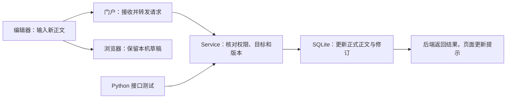

# 看懂 SthStart，再用它学测试

核对日期：2026-11-10。内容按当前工作区源码和项目文档整理。这里讲的是项目实现了哪些功能、数据怎么走；本次没有启动服务或重新验收功能。

你可以把 SthStart 想成一个创作桌：**左边找资料，中间写故事，右边把选好的故事做成作品。** 角色、笔记、图片都可以在不同项目间复用；作者写下的正式正文、别人提的建议、以及拿去制作的旧版本，各自有自己的记录。

这轮学习不换技术栈：你继续在 VS Code 用 Python 写测试。我负责解释、出题和看你写的代码。先用“保存一章正文”看懂前端、后端和数据，然后用同一章学浏览器、MCP、AI。你之前写过的测试直接拿来当材料，不从安装 Python 重新开始。

## 1. 这个项目里可以做什么

| 你想做什么 | 从哪进 | 里面存的是什么 |
| --- | --- | --- |
| 继续写一个故事 | 工作台 → **创作项目** → 项目总览 → **继续写作** | 大纲、世界观、场景、章节、项目角色，以及它们的历史版本。总览还能看参考资料、媒体和制作。 |
| 随手记下一段灵感，或整理素材 | **资料库** | 创作笔记、灵感素材、搜集任务、待整理内容与数据源。笔记可以先保存在当前浏览器，随后同步到后端。 |
| 查阅已存在的剧情，或写自己的感想 | **叙事档案**、**对话感想** | 档案保存已导入的作品、任务、场景与台词；感想是自己的记录。它们和你正在写的正式章节是不同的东西。 |
| 管理能在多个故事里用的角色 | **角色库** | 角色档案、外貌、关系和发布版本。项目可以采用其中一版，再单独改自己的角色设定。 |
| 查找图片、音频、视频和文件 | **媒体库** | 文件登记、来源、引用和可用状态。文件本身存放在磁盘，数据库中有登记不等于文件还能打开。 |
| 把正文做成漫画或视频 | 创作项目 → **制作**，或打开已有制作台 | 选定的章节版本、镜头、画面、对白、配音和导出结果。建好一个制作版本，只表示已经有了制作草稿。 |
| 单独试一张图或一段视频 | **自由生成** | 生成任务、执行状态和生成产物。具体能否运行取决于引擎、工作流和模型配置。 |
| 查看生日和日程 | **创作日历** | 日程、生日等时间信息，可用来安排创作和企划。 |
| 配置模型、查看失败或备份 | **设置** | 公共服务连接、模型用途、生成配置、运行控制、AI 调用记录与备份。 |
| 打开邻舍聊天 | **邻舍**入口 | 门户可以嵌入或托管邻舍；邻舍自己的聊天、记忆和数据仍由邻舍管理。 |

创作项目总览的地址是 `/apps/projects/项目ID`，点“继续写作”会打开 `/apps/story/同一个项目ID`。这是两个页面在看同一个项目：一个看全貌，一个专心编辑。旧 `/apps/story` 列表入口仍可用。

资料库、角色库和媒体库都可以独立使用。你不用先建一个故事才能写笔记，也不用为了学习章节保存就启动邻舍、ComfyUI 或真实模型。

功能来源：[创作工作区说明](../PRODUCT_WORKSPACE.md)、[项目总览页面](../../app/features/projects/project-workspace.tsx)、[资料库页签](../../app/features/resources/resource-nav.tsx)、[后端模块入口](../../apps/service/src/server.ts)。最近界面收敛和主题调整见 [11 月 9 日工作区验收](../development/reviews/2026-11-09-workspace-consolidation-acceptance.md) 与 [共享界面调整记录](../development/reviews/2026-11-09-shared-ui-polish.md)；这些是当时的记录，不代表本次重新实测。

## 2. 一章正文是怎么保存下来的

假设服务器里有一章《钟楼》，当前正文是“等钟响再出发”，这是第 3 版。你把输入框改成“天亮再出发”。

1. **页面先拿到你输入的字。** 输入框出现新内容时，服务器还不一定收到。编辑器还会尝试把未提交的内容留在当前浏览器里，以便失败时恢复。
2. **页面发出保存请求。** 请求会说：“我要改这一个项目的这一章，我看到的是第 3 版，新正文是‘天亮再出发’。”
3. **门户把请求转给后端。** 门户是你打开的网页和网页的请求入口。正常页面请求走自己的会话检查，门户在服务器端附带管理凭据再转发给 Service；浏览器不用知道后端的管理员令牌。
4. **后端检查后写入。** Service 是处理请求的程序。它确认这章仍是第 3 版后，把正文改为新内容，版号变成 4，并留下修订记录。如果已有其他操作把它改成第 4 版，旧的保存请求会被拒绝。
5. **页面收到结果。** 保存成功时可以更新状态；失败时可能保留本机草稿。重新用正式接口读取，才能确认后端现在存的是哪一版。



这里最容易弄混的是三种“我看到了新正文”：

| 你在哪里看到 | 它能证明什么 |
| --- | --- |
| 输入框里 | 新内容进了当前编辑器 |
| 刷新后选择“恢复本机文本”又看到了 | 浏览器能恢复这份草稿 |
| 重新请求后端，读到了新正文和新版本 | 这份内容已进入正式数据 |

**举个测试例子：**断网后，输入框里还写着“天亮再出发”，而后端仍是“等钟响再出发”。这两个结果可以同时正确。测“保存失败不丢字”要看前者；测“失败不误写”要看后者。

<details>
<summary>想在代码里跟一次保存，再看这里</summary>

| 问题 | 打开哪个文件、找什么 |
| --- | --- |
| 页面何时保存，失败怎么办？ | [章节草稿逻辑](../../app/features/story/use-story-entry-draft.ts)：找 `flush`，看传入的正文与 `expectedRevision`，再看失败分支。 |
| 浏览器请求的地址怎么变成后端地址？ | [Story 页面请求](../../app/features/story/api.ts) 的 `updateDocument`；[门户管理代理](../../app/api/admin/[...path]/route.ts) 中的 `target`。网页发 `/api/admin/story/…`，转成后端 `/api/v1/admin/story/…`。 |
| 为什么旧版不能保存？ | [后端路由](../../apps/service/src/story/routes.ts) 的文档 PUT；[存储代码](../../apps/service/src/story/store.ts) 的 `updateDocument`，看 SQL 更新条件里的版本和事务里的修订写入。 |
| 发送时需要哪些字段？ | [共享契约](../../packages/contracts/src/story.ts) 的 `UpdateStoryDocumentSchema`。契约就是前后端对字段、类型和形状的约定。 |

当前主要业务记录默认存于 `data/sthstart.db`，叙事档案有独立的 `data/narrative.db`；媒体文件默认存于 `data/artifacts`。这是配置默认值，不是你当前运行实例的实测路径。练习用 [Python fixture](../../tests/python/conftest.py) 另建临时数据库、文件和日志目录，不能指向日常创作数据。Python 接口用例直连 Service，所以不能替代浏览器、门户转发或页面会话测试。

</details>

## 3. 一份修改建议怎么变成正式正文

先把两种操作分清：

- **作者保存：**我现在就要改正文。请求里的 `expectedRevision` 表示“我是在这一版上改的”。
- **提交建议：**有人建议改成另一段。建议里的 `baseRevision` 表示“我看着这一版提出建议”。提交后只是待审，作者正文不动。

以第 3 版为例：

| 发生什么 | 正式正文 | 建议 |
| --- | --- | --- |
| 有人建议改成“午夜出发” | 还是“等钟响再出发”，第 3 版 | 待审，基于第 3 版 |
| 作者先保存“天亮再出发” | “天亮再出发”，第 4 版 | 仍待审，依据仍是第 3 版 |
| 作者尝试接受旧建议 | 保持“天亮再出发”，第 4 版 | 接受被拒绝，仍待审 |

如果作者还没改过正文就接受这份有效建议，正式内容会变成“午夜出发”并产生新修订；如果作者拒绝，只有建议状态变化。服务把接受与正文更新、修订写入放在一组事务里，避免只完成其中一部分。

这就是当前最合适的接口练习：你的代码已经测过**直接用旧版本保存会冲突**，接下来换成**建议创建时没过期，作者后来才保存新版本**。两个场景都可能返回 409，但一个是在保存时发现旧版本，另一个是在接受建议时发现。要证明测到的是后一种，先看到“建议创建成功、作者保存成功”，再去点接受，最后读回正文和建议。

在网页里，如果页面已经知道建议过期，[审阅面板](../../app/features/story/story-review-panel.tsx) 会提示原因，并让“接受并保存”不可点。接口测试直接发请求，验证即便绕开这个按钮，后端也会保护正文。以后做浏览器测试时，就检查提示和按钮状态，不需要硬点一个不能点的按钮。

操作步骤与接口提示在 [旧建议练习](STHSTART_TESTING_WORKBOOK.md)。源码可以对照 [已有章节冲突测试](../../tests/python/story/test_story_api.py) 的 `test_story_revision_conflict`、[已有提案测试](../../tests/python/story/test_story_proposals.py) 和 [提案决定实现](../../apps/service/src/story/store.ts) 的 `decideProposal`。

## 4. 资料、角色、制作和媒体，怎么连到故事上

### 4.1 加入资料，和采用为正式设定，是两步

例如你在笔记中写了“钟楼只在冬季敲钟”。点“加入项目”，项目会记录来源，并保存当时的标题、文字内容或节选等信息。它现在是项目的参考资料。你再明确选择“采用为设定”，才会根据保存的参考内容创建一条项目世界观设定，并保留来源。

之后原笔记改成“夏季也敲钟”，不能无声改写项目里的正式设定。测试时分别看**原笔记、项目参考、正式设定**这三处：只加入时没有新设定；采用后有；再次采用同一条不会重复创建；原笔记更新不会覆盖已经采用的设定。

角色类似：采用的是角色库里一个已发布版本；项目自己的角色设定可以单独调整。库里发布新版本时，项目可以提示来源更新，原采用版本不会自动替换。读实现时找 [项目资料与采用](../../apps/service/src/projects.ts) 的 `add`、`adopt`，以及 [项目总览](../../app/features/projects/project-workspace.tsx) 的角色采用操作。

### 4.2 正文的第 4 版，和制作里的第 4 版来源

假设你拿《钟楼》第 4 版创建制作版本。制作草稿会记住所选章节的**修订 ID**与内容指纹，以后镜头、对白与画面可以追溯到这一版。你接着把正式章节改成第 5 版，旧制作还基于第 4 版。这就是文档里说的“冻结来源”：让制作继续引用当时选定的版本。

流程可以这样记：

```text
选中已经保存的章节修订
→ 创建制作草稿
→ 编排镜头、画面和对白
→ 按配置生成或选择媒体、配音
→ 导出漫画或视频等文件
```

测试可以先停在“创建制作草稿”，核对来源不随正文更新而变，不用真的生成图或视频。生成另有引擎、工作流、素材和预算条件；导出又要检查实际文件与内容。参考 [制作数据存储](../../apps/service/src/publication/store.ts) 中的 `entryRevisionIds`、`sourceHash` 和 [剧情到发布说明](../STORY_PUBLICATION.md)。

### 4.3 媒体库记录和实际文件是两回事

上传或生成结果会有一条产物记录，文件字节存在磁盘；加入项目建立的是引用。把图片从一个项目的引用里移开，并不等于删除原文件。反过来，项目还有这条引用，也不代表原文件可读。

测试媒体时要把“列表有记录”“预览能打开”“实际文件下载成功”分开。项目已有一个真实的学习案例：[11 月 9 日内容可用性审计](../development/reviews/2026-11-09-content-availability-report.md) 记录过数据库完整性正常、媒体文件却缺失。该报告还记录当时生成引擎/工作流不可用的情况；是否已经配置好，需要另查当前运行环境。

## 5. AI、MCP、Skill 在哪里

这三个词先用一句话记住：**模型负责想，MCP 工具负责查或提交，Skill 告诉模型做任务时该注意什么。** 配了 Skill，不代表模型已经拿到项目；工具连上，也不代表模型分析正确。

| 场景 | 数据走向 | 练习时看什么 |
| --- | --- | --- |
| **外部资料接入** | SthStart 的资料/叙事功能 → 来源连接器（可接 MCP）→ 取得外部内容 → 按导入流程进入档案 | 搜索结果不等于已导入，档案资料不等于创作项目正文。 |
| **创作代理读本项目** | DSH 等客户端 → Story MCP → 门户的项目桥接 → Service → 读取正式内容或建立待审建议 | 读取 ID 和版本是否正确，提交建议后正文是否未动。 |
| **外部代理参与制作** | 制作 MCP → 制作工作区的资料与草稿，受自己的授权和操作限制 | 哪些动作只读，哪些会产生制作草稿或后续任务。先认识它与 Story MCP 的边界。 |
| **应用调用模型** | 应用或工作台 → 按各自配置选模型 → 请求上游 → 返回文本、流式消息或生成结果 | 模型调用失败和模型回答不好是两种问题。DSH 原生模型配置独立于 SthStart 公共模型绑定。 |
| **Skill 指导任务** | 宿主加载一份指导 → 模型按任务查资料、分析或形成草稿 | 看实际加载记录、工具轨迹、引用和结论。只要求分析时，检查没有擅自写入或提交。 |

**学习顺序：**先不用模型，自己用 MCP 客户端读取一章，再提交建议，确认作者接受前正文没变。这样先验证“工具好不好用”。之后给模型一个明确矛盾的故事，观察有无 Skill 时是否读对资料、指出矛盾、给出证据。一次对照只说明这一次的结果。

按需读 [剧情 MCP 和 Skill](../story-mcp-and-skills-guide.md)、[制作 MCP](../HARNESS_MCP.md)、[公共服务](../PUBLIC_SERVICES.md)、[叙事档案](../NARRATIVE_ARCHIVE.md)。

## 6. 新学习计划：每次只多学一件事

| 顺序 | 先弄懂什么 | 在本项目亲手做什么 | 做到什么算过关 |
| --- | --- | --- | --- |
| **1. 看懂一次保存** | 页面、本机草稿、服务端正文是三处数据 | 打开你写过的章节冲突测试，把“第一次保存、第二次被拒绝、重新读取”三段标出来。再对照第 2 节画出数据走向。 | 能说明章节 ID、旧版本、新正文分别从哪来；能解释为什么最后还要读一次。 |
| **2. 自己设计一条后端测试** | 测试要先把事情按正确顺序做出来 | 用 [旧建议练习](STHSTART_TESTING_WORKBOOK.md) 编写一条过期提案用例。先写到建议创建成功，再加作者保存与尝试接受。 | 看到正确的拒绝原因、作者的正文和版本保住、建议仍待审。你能解释少做一步会漏什么。 |
| **3. 在浏览器里测同一件事** | 用户看见的提示、实际请求与持久状态 | 从“创作项目”进编辑器，输入、等本次保存、刷新；然后单独模拟一次保存失败。用 Playwright Python 编写。 | 保存成功后正式内容与刷新页面一致；失败后未保存文本还在、正式内容没误改。 |
| **4. 用另一个模块练数据关系** | 引用、复制、正式内容的区别 | 用一条笔记练“加入项目 → 采用为设定”，或用一章练“制作选定修订后，正文再修改”。先选其一。 | 用两次读回证明数据什么时候改变、什么时候保持原样。 |
| **5. 测真实 MCP 工具** | 外部客户端的权限、参数和结果 | 在隔离项目读取正文与版本、提交待审建议；再做一次撤销凭据后的读取。最后把正常流程接到浏览器。 | 能区别“工具列得出来”“工具真的读得到”“工具允许提案但没改正文”。 |
| **6. 学模型调用和 Skill 评估** | 请求解析可以用固定输入检查，回答质量需要看证据 | 先用假响应练超时/错误处理，再选一个连贯性场景，比较同模型有无 Skill。 | 能根据资料评价证据、结论和授权边界，记录真实条件和失败，不把一次结果说成普遍规律。 |
| **7. 学回归和报告** | 改一处代码该复测哪几处 | 挑一次失败，记录操作、预期、实际、第一处不一致和复跑结果。再把最有用的用例归为日常回归。 | 别人能按你的记录复现；你能解释为什么跑这些检查，哪些还没测。 |

**怎么补基础：**做到第 1—2 步时，学前置条件、操作、断言、版本冲突和数据隔离；到第 3 步再学定位、等待和 Mock；到第 5—6 步再学异步、协议和评分。遇到词不懂，就翻 [软件测试基础](SOFTWARE_TESTING_FOUNDATIONS.md) 对应章节；遇到字典、fixture、参数化不熟，再翻 [Python 配套教材](TESTING_FOUNDATIONS.md)。性能、专项安全和全项目覆盖留在完成这条主线之后。

## 7. 今天从哪行开始

打开 [test_story_api.py](../../tests/python/story/test_story_api.py)，搜索 `test_story_revision_conflict`。你已经写过这段，所以先别新增文件。只找出三行或三段代码：

1. **哪一行记住第一次创建时的版本？**
2. **哪一次请求保存成功？哪一次故意带了旧版本？**
3. **失败之后，哪一次请求重新取回了真正保存的正文？**

用自己的话记两句：“第二次为什么失败”“我怎么知道正文没被覆盖”。接着去 [实训手册](STHSTART_TESTING_WORKBOOK.md) 写旧建议的测试开头。第一次只写到“建议创建成功”。卡住时贴你写到的几行和第一处报错，我先解释眼前这一步。

这轮看过的文件和实际运行结果记在 [学习进度](LEARNING_PROGRESS.md)。你给出结果后才更新掌握状态。
