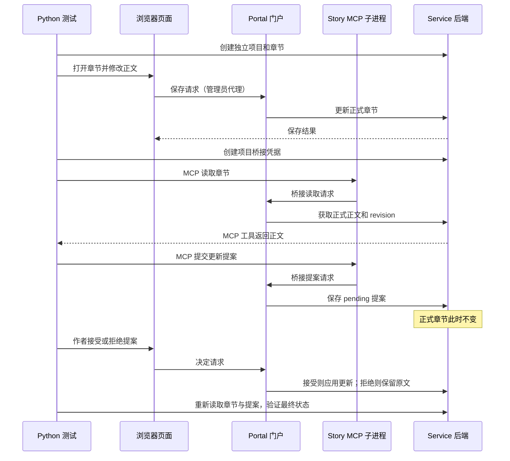

# Story 垂直路径测试学习指南

更新时间：2026-10-13（Asia/Shanghai）  
项目目录：`F:/Project/SthStart`  
学习方式：你设计和编写 Python 测试，助手解释思路、审阅代码、提示和记录进度。

## 1. 这份文档怎么用

本指南用 Story 剧情工作室的一条完整业务路径学习测试：

**作者编辑章节 → 保存正式正文 → MCP 读取最新正文 → 提交待审提案 → 作者接受或拒绝 → 检查最终状态。**

先分别验证各层，再串起一条流程。每阶段遵循：明确行为 → 准备数据 → 执行操作 → 检查响应和数据 → 定位失败 → 修正 → 回归。完成标准是能解释用例保护的行为，并自行修改一个变化后的场景。

本期实践覆盖 API、pytest 数据准备、浏览器、MCP 协议、一次 Skill 观察和失败证据。暂缓全项目覆盖、全量权限矩阵、性能、数据库迁移、视觉回归、多模型比较和全面 CI 接入。已有边界测试保留；后续按这条主线推进。

仓库已有 [TypeScript 流程参考](../../tests/e2e/learning-story.spec.ts)，包含浏览器保存、MCP 提案和作者审阅。本指南据此选取代表行为，由你用 Python 编写；文中的接口示例和局部语法提示不是完整测试答案。

第一次阅读先看第 2—6 章，完成当前 API 任务；进入下一阶段时再读对应章节。完整范围约为 4 个提案 API 行为、2 个浏览器行为、2 个 MCP 行为、1 条综合流程和 1 个 Skill 观察案例。

第 13 章按前面第 1—12 章逐项解释测试中会用到的 Python 语法与运行机制。先看当前阶段对应的小节，遇到不熟悉的语法再回查；示例展示语法和思路，不是要你整段复制成测试答案。

## 2. 先看懂这条路径



上图中的 MCP 请求由测试代码直接调用工具，尚未涉及模型。最后的 Skill 观察阶段才引入真实模型判断。

### 2.1 四种业务对象

| 对象 | 用途 | 从哪个响应拿 ID |
| --- | --- | --- |
| 项目 project | 隔离一组剧情数据 | 创建项目的 `id` |
| 章节 document | 保存正式标题、正文、版本 | 创建章节的 `id`、`revision` |
| 剧情会话 session | 管理员提案所关联的会话记录 | 创建剧情会话的 `id` |
| 提案 proposal | 保存待审核的修改内容 | 创建提案的 `id` |

```text
project_id
├── chapter_id：正式正文，revision=N
├── session_id：管理员提案需要关联它
└── proposal_id
    ├── targetId=chapter_id
    ├── baseRevision=N
    ├── proposedTitle / proposedBody：建议内容
    └── status：pending / accepted / rejected
```

新建项目自带一份 outline 大纲。章节列表可能包含大纲、世界观、场景和章节，因此不要把 `items[0]` 当成目标章节，也不要假设新项目的列表为空。使用本次创建响应的章节 ID 查找目标。

### 2.2 正式数据、提案与本机草稿

| 数据 | 所在位置 | 验证方式 |
| --- | --- | --- |
| 页面正在编辑的文本 | 浏览器输入框与草稿状态 | 检查编辑器内容 |
| 正式章节 | 后端 Story 数据 | 管理员 API 重新读取 |
| 待审提案 | 后端提案记录 | 提案列表或工具查询 |
| 保存失败保留的本机草稿 | 当前浏览器存储 | 页面提示、刷新后恢复文本 |

输入框显示新正文，不能单独证明后端已经保存；接口返回 201，也不能单独证明提案已经被作者接受。每个用例都应说明它验证的是哪一份数据。

### 2.3 revision 的含义

`revision` 是章节的正式版本号。`expectedRevision` 用于作者直接保存，`baseRevision` 用于提案记录它依据的版本。都应来自实际章节响应，不能硬编码为 1。

| 操作 | 提案状态 | 正式章节变化 |
| --- | --- | --- |
| 基于 N 创建提案 | pending | 标题、正文、revision 仍为原值 |
| 拒绝提案 | rejected | 原值不变 |
| 接受仍基于当前 N 的提案 | accepted | 应用提案内容，revision=N+1 |
| 创建提案后作者保存新正文 | 仍 pending | 作者正文生效，revision=N+1 |
| 接受基于旧 N 的提案 | 409；仍 pending | 作者正文和 N+1 保留 |
| 拒绝后再尝试接受 | 409；仍 rejected | 正式章节不变 |

最后一行指改变已经处理的决定。同一种决定重复请求在现有实现中会返回已处理记录，不应把所有重复决定都预计为 409。

## 3. 技术栈、目录与准备条件

### 3.1 技术栈

| 阶段 | Python 工具 | 验证对象 |
| --- | --- | --- |
| API | pytest、httpx | 请求响应与正式数据状态 |
| 数据准备 | pytest fixture、普通辅助函数 | 独立项目、生命周期和清理 |
| 浏览器 | pytest-playwright、Playwright 同步 API | 用户操作、保存提示、刷新与审阅 |
| MCP | 官方 MCP Python SDK、AnyIO | 真实 stdio 协议、工具发现与调用 |
| Skill | 一个支持加载 Skill 和连接测试 MCP 的模型宿主 | 行为证据与人工评分 |
| 报告 | pytest 输出/JUnit、Playwright Trace、工具轨迹 JSON | 失败定位和可复现信息 |

业务仍由现有 Node 服务运行，练习代码使用 Python。API 和浏览器起步采用同步写法；MCP 的异步接口在进入该阶段时学习。

这里的 API 测试通过真实服务验证后端集成，浏览器测试验证前端用户行为，综合流程验证多层协作。Python 不直接导入 TypeScript 内部函数或 React 组件；前端函数/组件单元测试保留在长期知识范围，首期不作为进入下一阶段的门槛。

### 3.2 当前文件与建议新增文件

截至本次核对，已有 `conftest.py`、健康检查、`story/` 下的 API/提案测试，以及 `helpers/` 下的数据和接口辅助函数。你已经将 Story 测试从 `tests/python/` 根目录移入 `tests/python/story/`。

```text
tests/python/
├── .venv/                           已有 Python 虚拟环境
├── conftest.py                      已有 API fixture；后续放共享的门户 fixture
├── test_health.py                   已有
├── helpers/
│   ├── story_data.py                 已有：生成准备数据
│   └── story_api.py                  已有：准备成功项目
├── story/
│   ├── test_story_api.py             已有
│   └── test_story_proposals.py       已有；先在这里收尾
├── e2e/                             浏览器阶段再新增
│   ├── conftest.py                   浏览器专属配置
│   ├── test_story_browser.py         保存和刷新
│   └── test_story_vertical.py        最后的一条串联流程
└── mcp/                             MCP 阶段再新增
    ├── conftest.py                   MCP 参数、异步后端等
    └── test_story_mcp.py             工具发现、读取与提案
```

这是分阶段目标目录；尚未存在的文件不是已交付代码。包结构和 import 风格统一沿用你当前可运行的方案，先用 `--collect-only` 检查导入。不要为了复用准备步骤而让一个测试调用另一个 `test_` 函数。

### 3.3 环境检查

在 VS Code 打开 `F:/Project/SthStart`，选择 `tests/python/.venv/Scripts/python.exe` 作为 Python 解释器。所有下列命令都从项目根目录执行。

```powershell
.\tests\python\.venv\Scripts\python.exe -m pytest tests/python/story/test_story_proposals.py --collect-only -q
.\tests\python\.venv\Scripts\python.exe -m pytest tests/python/story/test_story_proposals.py -v
```

第一条只检查能否导入和发现测试，不会执行用例；第二条才验证实际行为。2026-10-13 本文编写时，第一条收集到 1 个提案测试；本次没有重新执行该测试，也没有把目录调整认定为已完成全部学习目标。

新增依赖到对应阶段再安装：

```powershell
# 浏览器阶段
.\tests\python\.venv\Scripts\python.exe -m pip install pytest-playwright
.\tests\python\.venv\Scripts\python.exe -m playwright install chromium

# MCP 阶段；本文的 SDK 名称按官方 v2 接口写
.\tests\python\.venv\Scripts\python.exe -m pip install "mcp>=2,<3" anyio
```

安装后记录实际版本。Playwright 的 Python 包与浏览器二进制分别安装；项目里的 Node Playwright 依赖不等于 Python 依赖已安装。[官方安装说明](https://playwright.dev/python/docs/intro)

MCP SDK 的 v1、v2 客户端写法不同。本文按 v2 的 `Client`、`StdioServerParameters` 和 `is_error` 命名；若你的环境已经使用 v1，应先核对版本并统一示例，避免混用属性。[SDK 版本说明](https://github.com/modelcontextprotocol/python-sdk/tree/v1.x)

## 4. 测试环境与生命周期

### 4.1 明确两个 HTTP 地址

| 名称 | 指向 | 使用者 |
| --- | --- | --- |
| service_url | 临时 Node 后端 | httpx API 测试与准备数据 |
| portal_url | 临时 Portal 门户 | Playwright 页面、Story MCP 后端桥接 |

你的 `base_url` fixture 当前返回后端地址。pytest-playwright 也使用 `base_url` 命名，因此浏览器阶段先写完整页面地址：`portal_url + "/apps/story/" + project_id`。不要直接把后端地址当成页面入口，也不要以为 CLI `--base-url` 一定能替代你自己的同名 fixture。

### 4.2 fixture 的职责

| fixture / 辅助步骤 | 建议作用域 | 职责 |
| --- | --- | --- |
| api_service | session | 创建临时数据目录，启动 Node 服务，等待健康响应，结束时关闭 |
| client | function | 打开/关闭 httpx.Client，连接当前 service_url |
| story_project、chapter/context | function | 每个用例创建独立项目和目标章节，返回本次 ID 与版本 |
| portal_service | session；只被浏览器/MCP 用例请求 | 启动连接同一测试后端的门户，等待可访问，结束时关闭 |
| page/context | function | 为每个浏览器测试提供独立浏览器状态 |
| MCP Client 连接 | 每个用例 | 启动 stdio 子进程，完成协议连接，结束时退出上下文 |

同一测试会话可以共用临时服务；每个测试的数据仍应独立。禁止使用“上一个测试创建的 project_id”或依赖测试运行顺序。

### 4.3 门户启动任务

现有 API fixture 只启动 Service。浏览器和原生 Story MCP 还需要 Portal。先用项目根目录的 `npm run build:portal` 准备门户生产构建；随后门户 fixture 可参照现有学习配置启动 `npx vinext start --port <本次门户端口> --hostname 127.0.0.1`。这是一项待你实现的 fixture 任务，不是现有 Python 测试已经具备的能力。

`<本次门户端口>` 由 fixture 分配并填入子进程参数；Windows 调用 npm/npx 可使用 `.cmd` 入口或找到的绝对路径。不要把带占位符的命令直接复制运行。服务启动仍可沿用 `node --import tsx/esm apps/service/src/start.ts`，不要求完整构建后端。

对子进程配置以下环境，值应由 fixture 统一产生：

| 环境变量 | 设置位置与用途 |
| --- | --- |
| SERVICE_HOST / SERVICE_PORT | Service：回环地址和本次后端端口 |
| STHSTART_DATABASE_PATH / STHSTART_NARRATIVE_DATABASE_PATH | Service：本次临时 SQLite |
| STHSTART_ARTIFACT_DIR / STHSTART_LOG_DIR | Service：本次媒体和日志目录 |
| STHSTART_ADMIN_TOKEN | Service 和 Portal：同一个专用测试 token |
| STHSTART_SESSION_SECRET | Portal：专用测试会话签名值，至少 32 字符 |
| STHSTART_SERVICE_URL | Portal：指向本次 service_url |
| NEXT_PUBLIC_STHSTART_SERVICE_URL | Portal：与测试 service_url 对齐，参照现有配置 |
| PORTAL_PORT | Portal：本次门户端口 |
| PORTAL_ORIGINS / STHSTART_PUBLIC_ORIGINS | 相关进程：本次 portal_url |
| STHSTART_LAN_ACCESS | 测试环境：false，使用本机回环访问 |

准备数据、页面代理和 MCP 必须连接同一个测试后端。沿用 `os.environ.copy()` 生成子进程环境，然后覆盖测试值；不修改日常 `.env`。门户与服务就绪都要检查进程是否提前退出，等待应有截止时间和启动日志。

Fixture 设计参考 [pytest 官方生命周期说明](https://docs.pytest.org/en/stable/how-to/fixtures.html)。项目启动参数参考 [隔离学习配置](../../tests/config/playwright.learning.config.ts)。

### 4.4 三种凭据不要混淆

| 类型 | 用途 | 怎么获取 |
| --- | --- | --- |
| 管理员 token | Python 直接调用 Service 管理员 API | 当前 `admin_headers` fixture |
| 浏览器管理员会话 | 页面通过 Portal 管理员代理读写数据 | 本机页面的现有会话流程；必要时检查 `/api/auth/admin-session` |
| Story bridge token | MCP 访问指定项目的桥接接口 | 管理员调用项目 `/bridge-grant` |

浏览器会话 cookie 与 CSRF token 属于页面认证链路；不要为方便而向所有浏览器请求塞管理员 token，这会改变所验证的认证范围。MCP 使用项目桥接凭据，不能拿管理员 token 替代。桥接凭据仅保存在测试内存中，报告记录“已获取/已撤销”，不记录其原文。

退出顺序应保证依赖还在：MCP 连接关闭 → 浏览器上下文释放 → Portal 关闭 → Service 关闭。异常和断言失败也要进入清理流程。当前核对的 Story 管理员路由未提供项目删除入口，不能依赖 `DELETE /projects/{id}` 清理；主要通过本次临时环境实现隔离，按原 fixture 生命周期管理临时文件。

## 5. 管理员 API 速查与请求数据

以下路径都连接 service_url，使用 `headers=admin_headers`。令 `R` 表示 `/api/v1/admin/story/projects/{project_id}`。

| 方法与路径 | 请求体或用途 | 成功响应 |
| --- | --- | --- |
| POST `/api/v1/admin/story/projects` | title；可选 summary | 201，项目对象 |
| POST `R/documents` | kind、title、body | 201，章节对象，含 id/revision |
| GET `R/documents` | 读取正式文档列表 | 200，`{"items": [...]}` |
| PUT `R/documents/{chapter_id}` | expectedRevision、title、body | 200，更新后的章节对象 |
| POST `R/sessions` | title | 201，剧情会话对象 |
| POST `R/proposals` | 管理员更新提案，见下方 | 201，提案对象 |
| GET `R/proposals` | 读取项目提案列表 | 200，`{"items": [...]}` |
| POST `R/proposals/{proposal_id}/decision` | decision=accepted 或 rejected | 200，决定后的提案对象 |
| POST `R/bridge-grant` | 空 JSON 对象 | 201，projectId/token/createdAt |
| DELETE `R/bridge-grant` | 撤销项目桥接凭据 | 204 |

管理员文档读取使用列表接口，再按 ID 查找；本文核对的路由没有 `GET R/documents/{id}`。

### 5.1 准备项目、章节与会话

```python
project_payload = {"title": "pytest-剧情项目"}
chapter_payload = {
    "kind": "chapter",
    "title": "学习章节",
    "body": "林遥说：等钟响后再走。",
}
session_payload = {"title": "提案学习会话"}
```

从各响应读取 `project["id"]`、`chapter["id"]`、`chapter["revision"]`、`session["id"]`。准备函数可以检查成功状态再返回 JSON；被测的失败请求应保留原始 response，让测试自行断言，不能调用一个默认断言 201 的准备函数来测试 400/401/409。

### 5.2 管理员更新提案

```python
proposal_payload = {
    "sessionId": session_id,
    "kind": "chapter",
    "targetId": chapter_id,
    "baseRevision": current_revision,
    "proposedTitle": "学习章节-修改建议",
    "proposedBody": "林遥说：我会等钟声。",
    "reason": "明确角色等待的条件。",
}
```

这个接口关联已存在的同项目会话，只修改已有目标，响应直接是提案对象；其 operation 为 update。创建会话和调用管理员提案接口本身不会启动模型。

### 5.3 作者直接保存与作出决定

```python
save_payload = {
    "expectedRevision": current_revision,
    "title": "作者手动修改的标题",
    "body": "作者手动修改的正文",
}
accept_payload = {"decision": "accepted"}
reject_payload = {"decision": "rejected"}
```

接受请求返回的是提案，不是章节；接受之后要重新 GET 文档列表，找到目标章节再检查 title/body/revision。

### 5.4 本期必须区分的错误

| 场景 | HTTP | error 字段 | 要检查的数据 |
| --- | --- | --- | --- |
| 无效输入 | 400 | 以实际校验响应为准 | 不把失败响应当章节对象 |
| 管理员令牌无效 | 401 | unauthorized | 未发生未授权新增/更新 |
| 正式保存使用过期 expectedRevision | 409 | story_revision_conflict | 正式内容仍是最新成功版本 |
| 创建提案时 baseRevision 已过期 | 409 | story_revision_conflict | 没创建新的有效提案 |
| 提案创建后目标被作者更新，再接受它 | 409 | story_proposal_stale | 提案 pending，作者内容仍在 |
| 已拒绝的提案改为接受 | 409 | story_proposal_decided | 提案 rejected，正式内容未改变 |

业务错误响应通常是 `{"error": "错误码", "message": "说明"}`。使用 `.json()["error"]` 读取错误码；状态码使用 `.status_code`，不是把 response 对象与数字比较。

接口依据：[共享契约](../../packages/contracts/src/story.ts)、[路由](../../apps/service/src/story/routes.ts)、[状态变更实现](../../apps/service/src/story/store.ts)。

## 6. 阶段 A：收尾提案 API 测试

目标文件：`tests/python/story/test_story_proposals.py`。先补断言，再按行为拆分独立用例。每个用例创建自己的项目、章节和所需会话。

| 编号 / 建议函数名 | 操作 | 必须验证 |
| --- | --- | --- |
| A1 `test_reject_proposal_keeps_chapter` | 创建提案 → 读回章节 → 拒绝 → 再读回 | 创建时 pending；拒绝后 rejected；正式 title/body/revision 全程保持原值 |
| A2 `test_accept_proposal_updates_chapter` | 新的 pending 提案 → 接受 → 读回 | accepted；提案内容进入正式章节；revision 增加 1 |
| A3 `test_rejected_proposal_cannot_be_accepted` | 拒绝 → 接受同一 ID → 重新读提案与章节 | 409/story_proposal_decided；状态仍 rejected；章节未改变 |
| A4 `test_stale_proposal_keeps_manual_edit` | 基于 N 提案 → 作者保存 N+1 → 接受旧提案 | 409/story_proposal_stale；状态仍 pending；作者 title/body/N+1 未被覆盖 |

**A4 的数据顺序：**

```text
读取章节 N
  → 创建 baseRevision=N 的 pending 提案
  → PUT 章节 expectedRevision=N，得到 N+1
  → 接受旧 proposal_id
  → 检查 409/story_proposal_stale
  → 重新 GET proposals 与 documents，检查失败后的持久状态
```

不要在创建提案之前先更新章节，否则测试变成了“创建提案依据版本过期”，不是“接受已经过期的提案”。失败后的断言必须重新发 GET；请求之前读到的旧字典不会自动更新。

局部提示：先保存原值，避免覆盖 `chapter` 变量后失去原版本；为了查找条目，可以使用你已经练过的 for 循环或 `next(..., None)`。先断言找到目标，再取它的字段。对提案也按 proposal_id 查找，不依赖排序。

**通过阶段 A 的标准：**四个行为可以分别运行；错误码和失败后的状态一致；你能解释 baseRevision 与 expectedRevision 的区别。完成后开始阶段 B，不再扩展所有 Story API。

## 7. 阶段 B：Python Playwright 入门与浏览器实战

目标文件：`tests/python/e2e/test_story_browser.py`。先实现门户 fixture，再写一个保存流程；API 负责准备项目和章节，浏览器负责被测的编辑行为。

### 7.0 先认识 Playwright 的写法

**第一步：理解三个对象与 fixture。**

| 对象 | 含义 | 本期怎么获取 |
| --- | --- | --- |
| Browser | 启动的浏览器实例 | pytest-playwright 管理 |
| BrowserContext | 独立的浏览器会话，隔离 cookie/存储 | 插件每个测试提供新的 context |
| Page | 这个会话里的一个页面标签 | 在测试函数参数中声明 `page` |
| Locator | 如何找到某个页面元素 | 用 `page.get_by_role()` 等方法构造 |

插件提供 `page`，你不用先自行编写同名 fixture。自定义的 `portal_url` 仍需由前面设计的门户 fixture 返回。浏览器上下文隔离也不等于后端数据库隔离，项目数据仍由自己的 API fixture 准备。[Page 官方说明](https://playwright.dev/python/docs/pages)

**第二步：先写一个最小页面检查。**这段代码只用于确认门户可访问，并展示 page/expect 的用法；保存业务还要按 B1 继续实现。

```python
from playwright.sync_api import Page, expect


def test_story_home_opens(page: Page, portal_url):
    page.goto(f"{portal_url}/apps/story")
    heading = page.get_by_role("heading", name="剧情工作室")
    expect(heading).to_be_visible()
```

`page: Page` 是类型提示；pytest 依据参数名 `page` 注入 fixture。`portal_url` 是你的 fixture，不是安装插件后自动得到的值。缺少它会提示 `fixture 'portal_url' not found`，此时先完成环境准备。

**第三步：定位并操作元素。**

| 写法 | 用途 | Story 中的练习 |
| --- | --- | --- |
| `page.goto(url)` | 打开页面 | 打开本次项目 |
| `page.get_by_role(role, name=...)` | 按可访问角色和名称定位 | 小说正文编辑、按钮、对话框 |
| `page.get_by_label(name)` | 按标签定位输入控件 | 有明确 label/aria-label 的表单 |
| `locator.fill(text)` | 替换输入框内容 | 将章节正文 A 改为 B |
| `locator.click()` | 点击元素 | 选章节、打开审阅、接受提案 |
| `page.reload()` | 刷新页面 | 验证保存后的正文仍在 |
| `expect(locator).to_have_count(1)` | 等待定位结果只有一项 | 避免点击了另一章或另一份提案 |
| `expect(locator).to_have_value(text)` | 等待输入值正确 | 核对正文 |

例如，在已选中目标章节之后，可以这样限定编辑器所在区域：

```python
workspace_editor = page.get_by_role("region", name="正式资料编辑器")
editor = workspace_editor.get_by_role("textbox", name="小说正文编辑")
expect(editor).to_have_count(1)
expect(editor).to_have_value(original_body)
```

`original_body` 来自你准备的章节数据。`get_by_role` 的 name 是可访问名称，可能由标签、aria-label 或按钮文字构成；不是 HTML 的 name 属性。先用页面或 Inspector 核对名字，再写定位器。定位失败时先检查目标是否唯一，而不是直接加 `.first()` 或延长等待。[官方定位器指南](https://playwright.dev/python/docs/locators)

**第四步：等待当前操作的结果。**

`fill()`/`click()` 会等待元素具备操作条件，但不会自动保证后台保存流程已经结束。页面条件用 `expect` 等待；目标保存请求可以用 `page.expect_response()` 在触发操作前订阅。

下面是自动保存的局部语法，要求你已经打开目标章节，准备好 project_id/chapter_id/new_body：

```python
save_path = f"/api/admin/story/projects/{project_id}/documents/{chapter_id}"

with page.expect_response(
    lambda response: save_path in response.url
    and response.request.method == "PUT"
    and (response.request.post_data_json or {}).get("body") == new_body
) as saved:
    editor.fill(new_body)

assert saved.value.status == 200
expect(workspace_editor.get_by_text("已保存", exact=True)).to_be_visible()
```

这是浏览器实际发给 Portal 的 `/api/admin/...` 请求；你此前直接用 httpx 调后端的路径是 `/api/v1/admin/...`。等待放在 fill 之前，且按正文筛选，避免把别的读取请求或旧正文保存当成成功。之后仍须用 API 读回以及刷新页面验证持久化。

还要区分响应对象：httpx 使用 `response.status_code`，Playwright Response 使用 `response.status`。本期都用同步 API，因此获取 JSON 的 `.json()` 可以同步调用。

**第五步：模拟一个保存失败。**在修改正文之前注册拦截；这里只演示拦截写法，页面和后端状态断言由你按 B2 补写：

```python
import json


def fail_target_save(route):
    if route.request.method == "PUT":
        route.fulfill(
            status=503,
            content_type="application/json",
            body=json.dumps({"error": "service_unavailable", "message": "学习模拟失败"}),
        )
    else:
        route.continue_()


page.route(
    f"**/api/admin/story/projects/{project_id}/documents/{chapter_id}",
    fail_target_save,
)
```

`fulfill()` 在浏览器侧直接返回模拟响应，该请求不会真的更新后端；`continue_()` 让其他匹配到的请求继续。作用域限定到本次章节，不拦截所有 API。[官方网络监听与拦截说明](https://playwright.dev/python/docs/network)

**第六步：运行与定位失败。**先用 `--headed` 观察一次，再用 Trace 查看最后一个正确动作、失败的定位器、网络响应和页面状态。后面的 7.3 给出运行命令，第 11 章给出 Trace 打开方式。浏览器尚未安装、门户未启动、定位器不唯一、业务断言不成立是不同问题，按错误类型分别处理。

### 7.1 B1 正常保存

1. 用 API 创建独立章节，正文为 A，记住章节 ID。
2. 打开 `portal_url + "/apps/story/" + project_id`。
3. 选中自己创建的章节，确认编辑器初始正文为 A。
4. 将正文改为 B；页面有自动保存和显式保存能力，首个练习按 7.0 的例子等待自动保存。掌握后再练“保存”按钮，避免自动保存已经完成后继续等待一个不会再出现的写请求。
5. 等待本次保存请求成功及编辑器保存状态；确认正式 API 读到 B。
6. 刷新页面，重新选中章节，确认正文仍为 B。

使用实际页面里已有的可访问名称作为定位起点：

```python
editor = page.get_by_role("textbox", name="小说正文编辑")
expect(editor).to_have_value(expected_body)
```

章节按钮名称可能包含额外信息；不要盲目 `.first()`。先缩小到章节列表/目标条目并确认定位唯一，保存状态可以限定到名为“正式资料编辑器”的区域。页面当前状态文本包括“待保存”“保存中…”“已保存”“版本冲突”“仅保存在本机”。

“已保存”可能在输入前就存在，因此不能只看到该文本就认定本次 B 已保存。可在操作前开始等待目标 PUT 响应，并检查它成功，然后读回 B；或使用带截止时间的 API 轮询等待 B 持久化。自动保存与手动保存可能合并/连续执行，不要把一定只增加一次 revision 当成浏览器用例的核心断言。

`expect(locator)` 会等待条件成立；普通 Python `assert` 立即求值。对页面状态使用前者，对已经拿到的 JSON 使用后者。别用固定 sleep 判断是否保存完成。[官方断言说明](https://playwright.dev/python/docs/test-assertions)

### 7.2 B2 一个代表性失败：503 保存失败

在新的独立用例里，拦截当前目标章节的页面 PUT 请求，让它返回 503 和 JSON 错误。只拦截这个项目/章节的写请求，其余读请求正常通过。

验证：页面提示保存未完成；编辑器仍显示 B；API 正式正文仍为 A。若继续练习刷新恢复，则确认页面提供“恢复本机文本”后再恢复 B。

这是模拟接口失败的浏览器行为测试，不能据此声称已经验证真实服务故障。先只覆盖 503；409 的正式业务冲突已在 API 阶段练习。

### 7.3 阶段 B 验收

保存测试和失败测试各有独立数据/浏览器上下文；不用固定等待；能通过 Trace 看到失败前的页面和网络请求；能解释“输入框是 B”和“正式数据库是 B”的区别。

运行命令在文件和 fixture 写好后使用：

```powershell
.\tests\python\.venv\Scripts\python.exe -m pytest tests/python/e2e/test_story_browser.py -v --browser chromium --headed --tracing retain-on-failure --screenshot only-on-failure --output test-results/python/browser
```

这些 Trace/截图选项来自 pytest-playwright，适用于它管理的 page/context；手工另建上下文需要自己配置跟踪。Python 插件默认不会生成 Node Playwright 的 HTML 报告。[插件说明](https://playwright.dev/python/docs/test-runners)

## 8. 阶段 C：Python 调用真实 Story MCP

目标文件：`tests/python/mcp/test_story_mcp.py`。连接项目实际的 `native-mcp-server.ts`，先发现工具，再调用工具。用 httpx 请求 bridge REST 接口只能验证桥接 HTTP 行为，不能替代此处的 MCP 协议练习。

### 8.1 连接前准备

1. Service 和 Portal 都已启动，Portal 指向本次测试 Service。
2. 用管理员 API 创建独立项目/章节，并记住正式正文和 revision。
3. POST 项目 `/bridge-grant`，取响应中的项目 bridge token。
4. 用 SDK 的 stdio 配置启动 `node --import tsx/esm apps/service/src/story/native-mcp-server.ts`，工作目录设为项目根目录。

MCP 子进程必须收到：

```text
STHSTART_STORY_PROJECT_ID=<本次 project_id>
STHSTART_STORY_BRIDGE_TOKEN=<本次 bridge token>
STHSTART_STORY_PORTAL_URL=<本次 portal_url>
```

`STHSTART_STORY_PORTAL_URL` 指向门户根地址，server 自己追加 `/api/story-bridge/...`。它不是 Service 地址，也不是一个 `/mcp` HTTP endpoint；测试通过进程 stdin/stdout 发送 MCP 消息。Windows 子进程还应具备 PATH/SystemRoot 等启动所需环境。

v2 SDK 的连接思路是构造 `StdioServerParameters`，交给 `Client`，在 `async with` 中调用工具；进入上下文完成连接协商，退出时由 SDK 管理子进程生命周期。具体参数以安装版本为准。[官方 stdio 客户端说明](https://py.sdk.modelcontextprotocol.io/client/transports/)

### 8.2 管理员提案与 MCP 提案的区别

| 内容 | 管理员 `POST .../proposals` | MCP `submit_proposal` |
| --- | --- | --- |
| 凭据 | 管理员 token | 项目 bridge token |
| sessionId | 必须提供 | 不需要；本期原生提案返回 sessionId=null |
| operation | 请求不传，现有接口固定 update | 必传，本期使用 update |
| targetId/baseRevision | 已有章节 ID 与版本 | 同样来自刚读取的正式章节 |
| 业务响应形状 | 直接是 proposal 对象 | 工具文本 JSON 内是 `{"proposal": {...}, "created": true}` |
| 能否直接接受 | 管理员另调 decision | MCP 只提案；作者另行决定 |

### 8.3 本期选择的工具

| 工具 | 参数提示 | 本期验证 |
| --- | --- | --- |
| `list_tools()` | SDK 协议调用，无业务参数 | 包含 read_entry、submit_proposal、get_proposal_status；关键 schema 字段存在 |
| `read_entry` | kind=chapter、id=chapter_id；可选 offset | 读到本次正文、正确 id/revision |
| `submit_proposal` | 下方示例 | pending，正式正文与版本不变 |
| `get_proposal_status` | proposalId | 作者决定后返回 accepted/rejected |

工具列表还可能包含其他工具，因此检查关键工具是列表的子集，不写死整个工具数量。首期正文保持短小；如果返回 `truncated=true`，说明不能把一次读取视为完整正文，分页深入留到后续。

```python
tool_arguments = {
    "operation": "update",
    "kind": "chapter",
    "targetId": chapter_id,
    "baseRevision": current_revision,
    "proposedTitle": "学习章节",
    "proposedBody": "林遥说：我会等钟声。",
    "reason": "明确等待条件，交给作者审核。",
}
```

### 8.4 工具结果不是 httpx response

当前 Node server 的成功结果主要位于文本 content block 中，内容是 JSON；不应假定每个成功调用都有 structured_content。使用 v2 SDK 的 `result.is_error` 判定工具错误，从 text block 的 `text` 用 `json.loads()` 得到业务字典，再按业务字段断言。

例如读取工具应核对解析后的 id/body/revision；提案工具应从业务字典的 `proposal` 里拿到 proposal_id/status。不要只用“整个结果字符串包含正文”代替字段核对，也不要对 MCP 结果调用 `.status_code` 或 `.json()`。[SDK 客户端返回值说明](https://py.sdk.modelcontextprotocol.io/client/)

Node 协议 JSON 里的 `isError` 和 Python v2 模型属性 `is_error` 是不同层次的命名，类似 `inputSchema` 与 `input_schema`。记录 SDK 版本以避免混淆。

### 8.5 两个代表用例

**C1 正常读取和提案：**发现工具 → read_entry → 用返回 revision 提交 update 提案 → 确认 pending → 管理员 API 重新读取章节，正文和 revision 不变 → 管理员接受 → 查询提案 accepted，并读回更新后的正文。

**C2 一个错误：**完成一次正常读取后，管理员撤销 bridge grant；用现有 MCP 连接再次调用 read_entry。预期工具结果标记错误，业务 error 为 `story_bridge_unauthorized`；这是连接已经建立后工具失败，不是初始化失败。不要期待一个 HTTP Response 对象。

如果 MCP 子进程还没连上就报错，先看 cwd、Node、tsx 和三项环境变量；有些连接能完成工具发现却读不了数据，因为发现工具不一定需要访问 Portal。发现成功不能替代业务读取成功。

异步用例可用 pytest 的 AnyIO 标记，并在 MCP 子目录 fixture 中选择 asyncio 后端；整个异步连接的进入、调用、退出应在同一个生命周期。先分别运行 C1/C2，再进入串联。

### 8.6 fixture 放在哪里，以及先准备什么

pytest 会沿当前测试文件所在目录向上查找 conftest，不会自动读取兄弟目录的 conftest。若 portal_url 只定义在 `e2e/conftest.py`，`mcp/test_story_mcp.py` 就看不到它。

建议把被浏览器和 MCP 共用的 `portal_service`、`portal_url` 放在 `tests/python/conftest.py`；浏览器专属参数放 e2e 子目录，MCP 参数和异步后端选择放 mcp 子目录。通用读取/提案辅助步骤可写在 helpers 下，不导入另一个目录的 conftest 来执行 fixture。

按以下顺序实现，避免一次处理所有依赖：

| 步骤 | 你需要编写或验证的内容 | 结束时应得到 |
| --- | --- | --- |
| C0-1 | 当前 API fixture 正常准备一个项目和章节 | project_id、chapter_id、当前正文/revision |
| C0-2 | 共享门户 fixture 指向本次 API 服务 | portal_url，门户能够代理这个项目 |
| C0-3 | 管理员 POST bridge-grant，检查 201 | grant 字典，token 只放内存 |
| C0-4 | 组装 stdio 子进程参数 | command/args/cwd/env |
| C0-5 | 进入 SDK Client 上下文并 list_tools | 关键工具名与 schema |
| C0-6 | 调一次 read_entry | 正确正文和 revision，而不仅是连接成功 |

共享 fixture 不设置 autouse；纯 API 测试只有请求到这些 fixture 时才启动 Portal。顶层 conftest 也不必在 API 阶段就导入未安装的 MCP/Playwright 包。

### 8.7 async/await、AnyIO 与连接生命周期

你以前的 `client.get()` 发出请求后直接返回响应。MCP SDK 的方法是异步方法：`await story_mcp.call_tool(...)` 表示等待工具结果。`async with Client(...)` 表示打开连接并在离开时释放，不能把退出上下文后的 client 返回给同步代码继续使用。

MCP 子目录的后端选择可以从这个局部 fixture 开始：

```python
import pytest


@pytest.fixture
def anyio_backend():
    return "asyncio"
```

在异步测试上使用 `@pytest.mark.anyio`，并把函数声明为 `async def`。显式选择一个后端能避免同一用例因为不同异步后端重复运行。先让连接的建立、工具调用和退出都发生在同一个测试任务内，再学习跨测试异步 fixture。[AnyIO 官方测试说明](https://anyio.readthedocs.io/en/stable/testing.html)

准备项目的同步 fixture 可以沿用已有 httpx.Client；在异步连接流程中执行接受/撤销等管理员请求时，建议使用独立的 `httpx.AsyncClient`，通过 await 发请求并在上下文结束时关闭。不能直接给现有同步 client.get() 加 await；同步与异步客户端是不同对象。示意如下：

```python
import httpx

# 写在 async 函数内；service_url 来自本次 API fixture
async with httpx.AsyncClient(base_url=service_url, headers=admin_headers, timeout=5.0) as admin:
    revoked = await admin.delete(f"/api/v1/admin/story/projects/{project_id}/bridge-grant")
    assert revoked.status_code == 204
```

这个片段只展示管理员请求的异步方式；C2 还应在同一 MCP 连接里执行撤销前后的工具读取。[HTTPX 异步客户端说明](https://www.python-httpx.org/async/)

下面演示本项目的参数组装；project_id、bridge_token、portal_url 都必须由本次 fixture 提供。这些变量不是环境里预置的固定值：

```python
import os
from pathlib import Path
from mcp import Client, StdioServerParameters

project_root = Path.cwd()  # 此示例要求从项目根目录运行
mcp_env = {
    key: os.environ[key]
    for key in ("PATH", "SystemRoot", "TEMP", "TMP")
    if key in os.environ
}
mcp_env.update({
    "STHSTART_STORY_PROJECT_ID": project_id,
    "STHSTART_STORY_BRIDGE_TOKEN": bridge_token,
    "STHSTART_STORY_PORTAL_URL": portal_url,
})
parameters = StdioServerParameters(
    command="node",
    args=["--import", "tsx/esm", str(project_root / "apps/service/src/story/native-mcp-server.ts")],
    cwd=str(project_root),
    env=mcp_env,
)
```

进入连接后的最小读取形式如下。这是一个辅助步骤的语法示例，尚不包含你的业务断言：

```python
async def read_one_chapter(parameters, chapter_id):
    async with Client(parameters) as story_mcp:
        result = await story_mcp.call_tool(
            "read_entry",
            {"kind": "chapter", "id": chapter_id},
        )
        return result
```

返回的是一次调用的数据结果，而不是仍然打开的连接。C1/C2 需要在同一个连接里执行多次操作时，应把它们都安排在同一个 async with 内。[stdio 参数 API](https://py.sdk.modelcontextprotocol.io/api/mcp/client/stdio/)

进程 stdout 是 MCP 通信通道；排查子进程时读取 stderr，不向 stdout 添加普通调试文字。客户端连接错误、JSON-RPC 协议错误和工具业务错误应分别记录，不能都归为“401”。

### 8.8 从发现工具到解析业务字段

**发现工具**时，把结果分成“列表”和“单个工具定义”：

```python
# 这些局部代码应写在已连接的 async 上下文内
discovered = await story_mcp.list_tools()
tools_by_name = {tool.name: tool for tool in discovered.tools}
assert {"read_entry", "submit_proposal", "get_proposal_status"} <= set(tools_by_name)
assert {"kind", "id"} <= set(tools_by_name["read_entry"].input_schema["required"])
```

`set(...)` 用于判断成员是否存在，`<=` 表示左侧集合是右侧的子集。这里不检查所有工具字段，也不要求工具顺序固定。你继续补一条 submit_proposal 的关键 required 参数断言。

**解析当前服务的工具结果**时，先检查错误标记，再找 text block：

```python
import json

assert not result.is_error
texts = [block.text for block in result.content if block.type == "text"]
assert len(texts) == 1
payload = json.loads(texts[0])
assert isinstance(payload, dict)
```

当前 Story server 正常调用返回一个 JSON 文本块，因此这里验证一个 text block；不要把它推广成所有 MCP 工具都只能返回一块文本。

| 调用 | 解析后的关键字段 | 如何断言 |
| --- | --- | --- |
| read_entry | id、kind、title、body、revision、totalLength、offset、truncated | id/正文/版本与本次 API 数据相同；短文本 truncated=False |
| submit_proposal | proposal、created | created=True；proposal.status=pending；targetId/baseRevision 对应刚读到的章节 |
| get_proposal_status | id、status、targetId 等提案字段 | 查询的 id 正确，状态与作者操作结果一致 |
| 撤销凭据后的 read_entry | error、message、retryable | result.is_error 为真；error=story_bridge_unauthorized |

错误用例中的解析不能经过一个默认断言 `not result.is_error` 的成功 helper。让 JSON 解析函数只负责结构，成功或错误由用例自行判断。这和 API 阶段把“成功准备函数”与“被测失败请求”分开的原则相同。

### 8.9 C1/C2 应该检查到什么程度

C1 按四个检查点写：

1. 读取前用管理员 API 留下章节快照；MCP read_entry 的正文和 revision 与之相同。
2. 提交后留存 proposal_id，检查 proposal 的 targetId、baseRevision、proposedBody 和 pending 状态。
3. 重新 GET 正式章节，title/body/revision 与提案提交前的快照一致。
4. 管理员接受后，MCP 查询状态为 accepted；再 GET 章节，正文是建议内容，revision 相对提交依据增加 1。

C2 先成功读取一次，以证明参数与环境原本正确；撤销后使用同一个 token 和连接再读。不要重新创建 grant，否则实际测试的是新凭据正常使用。SDK 外层连接可以继续存在，而实际访问项目数据的工具已经被拒绝。

两个用例分别创建自己的项目和 grant。记录撤销是否完成、读取错误字段和正式章节状态，关闭连接也要在断言失败时执行。工具名/参数/返回字段的检查由你写；不需要首期覆盖所有 MCP 工具。

### 8.10 进入下一阶段的提交材料

提交 `test_story_mcp.py`、相关 fixture/辅助函数、定向 pytest 输出，以及一份脱敏工具调用记录。说明四个值的来源：portal_url、project_id、bridge_token、baseRevision。能独立解释“发现成功但读取失败”和“工具返回错误但连接没断开”，就可以进入综合流程。

## 9. 阶段 D：一条真正串联的端到端用例

目标文件：`tests/python/e2e/test_story_vertical.py`。首期只串接受路径，拒绝与 stale 已由独立 API 用例保护。

| 步骤 | 操作 | 必须留下的检查 |
| --- | --- | --- |
| D1 | API 准备项目和章节 A | project_id/chapter_id 来自本次响应 |
| D2 | 浏览器打开章节，编辑保存 B | 本次保存成功；API 正式正文=B |
| D3 | MCP read_entry | 读到 B 和保存后的 revision |
| D4 | MCP submit_proposal 建议正文 C | pending；API 正式正文仍=B |
| D5 | 浏览器打开“提案审阅” | 找到本次 proposal，不依赖默认排序 |
| D6 | 作者点击“接受并保存” | 页面显示“已接受”；API 提案状态 accepted |
| D7 | API 读回并刷新页面 | 正式正文=C；revision 比 D3 增加 1；页面正文=C |
| D8 | 清理环境 | MCP、浏览器、门户、服务正常退出 |

提案面板当前位于“审阅与项目连接”对话框内。建议一个测试项目只保留本次 pending 提案，或按提案内容/卡片缩小定位；不要把对话框第一个“接受”按钮默认为目标。

保持 API、浏览器和 MCP 三层各自的小测试，再保留这一条综合用例。综合失败后先判断是哪一个步骤失败，运行对应小测试缩小范围。

**同步与异步的组合提示：**阶段 B 采用同步 Playwright，阶段 C 的 MCP 方法是 async。首个串联用例可以保持同步浏览器测试，通过一个独立的 async MCP 辅助步骤读取并提交，然后用 AnyIO 运行该步骤并返回 proposal_id。该步骤退出连接后，浏览器继续审阅。不要在正在运行的 async 事件循环中调用 Playwright 同步 API；先掌握此分段方法，再考虑全异步浏览器方案。

最终用例中不调用模型，提案正文 C 是固定测试数据，所以失败主要来自程序、协议、环境或测试本身。

### 9.1 先固定 A/B/C 三份正文和快照

```python
body_a = "林遥说：等钟响后再走。"
body_b = "林遥说：我会等你。"
body_c = "林遥说：我会等钟声。"
```

这三份文本用途不同：A 是准备时正式正文；B 是浏览器保存后的正文；C 是等待作者接受的建议正文。不要反复覆盖一个叫 body 的变量，导致最终不知道在验证哪一步。

建议留存这些普通字典数据：

| 快照 | 获取时机 | 至少保留 |
| --- | --- | --- |
| initial | API 创建章节后 | id/title/body/revision |
| saved | 浏览器保存 B 后重新 GET | id/title/body/revision |
| mcp_read | MCP 读取 B 后 | id/body/revision |
| pending | MCP 提交 C 后 | proposal_id/targetId/baseRevision/status |
| accepted | 浏览器接受后 GET 提案 | id/status/resultEntryId |
| final | 浏览器接受后 GET 章节 | id/title/body/revision |

两条重要关系是 `mcp_read.revision == saved.revision` 和 `final.revision == mcp_read.revision + 1`。浏览器自动保存可能不止一次，不能用 initial.revision+2 来猜最终版本。

### 9.2 把 MCP 步骤接到同步浏览器测试

写一个 async 辅助步骤，其职责是“连接 → 读取 → 提案 → 关闭”，返回普通字典，建议包含：

```python
mcp_step_result = {
    "read_body": body_b,
    "read_revision": source_revision,
    "proposal_id": proposal_id,
    "proposal_status": "pending",
}
```

上面是返回结构示意，实际值应从工具响应取得，不能返回写死的预期值。被测步骤中不得调用 Playwright 同步 page，也不得返回活跃连接。

同步测试调用该辅助步骤的局部形式：

```python
import anyio

mcp_step_result = anyio.run(
    read_and_submit,       # 这是需要你编写的 async 辅助函数
    parameters,
    chapter_id,
    proposed_title,
    body_c,
)
```

一次 anyio.run 运行完毕后，浏览器测试继续。不要给这个同步测试加 AnyIO 标记；也不要在 MCP 的 async 函数内再次 anyio.run。独立 MCP 用例使用异步测试；综合浏览器用例采用这段边界清晰的组合方法。[AnyIO 运行入口](https://anyio.readthedocs.io/en/stable/basics.html)

在调用 MCP 辅助步骤前确认 B 已经保存；提交后到接受前不再编辑章节，否则基准版本过期，测试就从正常接受变成 stale 场景。

### 9.3 定位本次提案并处理确认框

给 proposed_title 加上本次数据的唯一后缀。打开审阅面板后，可按 article 和该标题缩小范围；实际执行前应确认只匹配一张卡片：

```python
review = page.get_by_role("dialog", name="审阅与项目连接")
card = review.locator("article").filter(has_text=proposed_title)
expect(card).to_have_count(1)
expect(card.get_by_role("heading", name=proposed_title, exact=True)).to_be_visible()
accept_button = card.get_by_role("button", name="接受并保存", exact=True)
expect(accept_button).to_be_enabled()
```

当前源代码在接受前执行 `window.confirm()`。这是浏览器原生对话框，与页面里的 role=dialog 不同；有原生 dialog 处理器时必须处理，否则后续操作可能等待不结束；没有处理器时 Playwright 默认关闭它，会取消接受。

在点击接受前，为这一次确认注册处理器：

```python
def confirm_this_accept(dialog):
    assert dialog.type == "confirm"
    assert "确认接受提案" in dialog.message
    dialog.accept()


page.once("dialog", confirm_this_accept)
```

再将按钮点击放在目标 decision 请求的响应等待中，检查响应 status=200、响应 JSON status=accepted，以及卡片出现“已接受”。这里的 dialog.accept() 只是点击确认框的确认按钮，不代表业务接受已经成功，仍要检查实际请求和持久状态。[官方原生对话框说明](https://playwright.dev/python/docs/dialogs)

页面中的 stale 提案会将接受按钮禁用并提示版本变化。浏览器验证它时可以检查提示和 disabled；不能点击被禁用按钮然后预期服务返回 409。HTTP 409 的规则由 API 用例直接验证。本期综合流程使用未过期的提案。

### 9.4 验证最终结果，而不止验证提示

接受后的验证顺序建议是：

1. 重新 GET proposals，找到本次 ID，检查 status=accepted、targetId 对应本章；更新提案的 resultEntryId 应指向目标章节。
2. 重新 GET documents，检查本章正文=C、标题等于建议标题、revision 比 MCP 读取时增加 1。
3. 刷新页面并重新选中章节，检查编辑器正文=C。

新标题可能改变章节列表按钮名称，因此刷新后不能继续用旧标题定位；根据新的标题定位并核对只有一个目标。

界面成功提示负责证明反馈正确，API 读回负责证明后端状态，刷新后的页面负责证明重新加载正确。三者共同构成本期端到端用例的完成证据。

### 9.5 一次失败定位练习与完成标准

先在隔离测试环境成功跑通综合流程，再临时调整一个预期值，观察 pytest 把失败定位到哪一个检查点；恢复后重跑。另一种练习是复用阶段 B 的 503 拦截，只验证它截断在保存阶段，不把后面没执行的 MCP/接受步骤算成已覆盖。

记录“最后一个已确认正确的状态”和“第一个实际失败的状态”。例如 B 已保存、MCP 读到 B、提案仍 pending、接受请求没有发出：优先检查页面定位、确认框和按钮是否禁用，先不要修改 MCP 解析代码。

完成标准：一条综合用例在独立数据上通过；你能说出 A/B/C 和三个 revision 的关系；能处理原生 confirm；能凭 Trace 和工具记录把一次失败定位到对应层。首期不用追加所有拒绝、冲突、分页组合到这一个综合测试。

## 10. 阶段 E：一个 Skill 的真实观察

确定性串联完成后，选择“剧情连贯性检查”一个 Skill、一个固定场景。先学习分辨模型判断与程序断言，不建立完整评测系统。

### 10.1 固定资料

在新的隔离项目中，用 API 保存一条 world 资料与一章 chapter：

```text
世界规则：林遥只有拆开城主的密封信后，才会知道密室的位置。
章节正文：林遥尚未拆开密封信。他对同伴说：“密室就在钟楼地下，我昨天已经知道了。”
```

固定任务为：查阅项目资料，检查这一章是否存在人物知识或设定冲突，给出证据和最小修改建议。这次任务只要求分析，预期没有提案提交，也没有正式正文修改。

模型宿主需连接本次测试项目的 MCP，使用相同模型、参数、资料和任务，在两个新会话中分别运行“有 Skill / 无 Skill”。本项目其他会话的历史和日常项目数据不作为资料。配置或模型凭据不可用时记为环境未就绪，不自动换模型。

有 Skill 组需要记录实际加载证据，例如宿主的加载事件/读取记录及该次 Skill 文件哈希。仅在提示词里说“请使用某 Skill”不足以证明加载。无 Skill 组也需要确认宿主没有自动注入相同 Skill；无法隔离时只记录探索观察，不声称完成了受控对照。

### 10.2 评分与程序检查

| 项目 | 0 分 | 1 分 | 2 分 |
| --- | --- | --- | --- |
| 证据准确性 | 引用错误或编造来源 | 方向正确但定位不清 | 正确引用 world/chapter，注明实际 ID/revision 或位置 |
| 冲突判断 | 漏判或无依据断言 | 指出疑点但论证不完整 | 用“获知条件”和章节行为明确解释矛盾，并承认可能的额外背景 |
| 修改忠实度 | 大幅改写无关剧情 | 建议可用但范围偏大 | 最小修复知识获取顺序或对白，保留原意 |
| 工具与写入边界 | 越权写入或称已修改正式正文 | 说明含糊 | 实际读取依据，仅输出分析，无未授权提交/正式改动 |

程序侧检查章节 title/body/revision 和提案 ID 集合在运行前后保持不变。人工评分必须附具体理由和原文证据，不能只写“模型表现好”。每组先运行一次，只能形成案例观察；不能据此断言 Skill 普遍有效。

Skill 的可编辑源文件为 [continuity-check/SKILL.md](../../apps/service/src/story/skills/continuity-check/SKILL.md)；`.agents/skills/story-continuity-check/SKILL.md` 是同步产物。此练习观察既有 Skill，不要求你修改它。

### 10.3 第一次实验怎么准备

先写一张实验卡，明确下面这些信息再发起真实调用：

| 项目 | 本期选择 | 要保存的证据 |
| --- | --- | --- |
| 问题 | Skill 是否帮助正确识别人物知识冲突并引用依据 | 同一个任务文本 |
| 数据 | 10.1 的 world 与 chapter 两条正式资料 | kind/title/body 的内容快照 |
| 对照组 | 同一模型、同一 MCP 能力、无本次 Skill | 新会话和未注入该 Skill 的证据 |
| 实验组 | 同一模型、同一 MCP 能力、加载本次 Skill | 加载记录和实际 Skill 内容/哈希 |
| 次数 | 各一次探索调用 | 两份独立结果，不自动重试 |
| 写入范围 | 只分析，不提交提案 | 运行前后的正文与提案集合 |
| 人工判断 | 四项 0—2 分，每项附理由 | 原文、工具记录、模型输出定位 |

两个组各用独立测试项目和新会话。内容应相同，但数据库自动产生的项目/条目 ID 可以不同；比较的是资料内容和行为，不是要求两组 ID 字符串一致。每组输出中的证据 ID 必须对应自己的实际项目。

尽量把“读取规则”“读取章节”“分析冲突”“给出最小修复”作为相同任务模板，不给有 Skill 组额外透露正确答案。在比较之前写下预期：规则限定获知条件，而正文描述角色尚未满足条件却已知位置；模型应给依据并指出冲突或需要核实的额外背景。

### 10.4 先保存快照，再记录加载证据

运行前，用管理员 API 读取本组所有正式文档和提案，保存相关字段。只分析任务完成后再读取一次，比较 title/body/revision 和提案 ID 集合。比较列表前按 ID 排序，避免显示顺序改变造成误报。

可用 Python 为实际 Skill 文件计算哈希：

```python
import hashlib
from pathlib import Path

skill_path = Path("apps/service/src/story/skills/continuity-check/SKILL.md")
skill_sha256 = hashlib.sha256(skill_path.read_bytes()).hexdigest()
```

这段只证明你记录了哪份文件，不能证明模型读到了它。再记录宿主读取/加载了哪个路径，以及实际发送给模型的 Skill 指令证据。宿主可能剥离 frontmatter；如果比较的是指令正文而不是完整文件，应分别注明哈希对象和加载依据。

本项目有两种名称：原始 Skill 的 frontmatter 为 continuity-check，同步到 `.agents/skills/` 的文件名/名称可能带 story 前缀。使用当前宿主实际识别的 Skill，不因名称相似就认定加载的是同一份内容。

如果两个组都自动带入了同一份 Skill，实验条件已经不成立，不能把得分差异归因为 Skill。如果宿主看不到发送给模型的指令，只能记录可获得的加载事件和证据限制；不编造“已完整加载”。

### 10.5 工具轨迹和输出如何评分

把观察分成三部分：

1. **程序检查**：工具是否真的读取到资料；有无越权提案；正式数据是否变化。这些可以写确定性断言。
2. **语义判断**：是否正确识别知识冲突、是否准确引用规则与章节、建议是否保留原意。由你逐项评分并注明理由。
3. **实验条件**：模型/参数/资料是否一致，Skill 是否实际加载，是否新会话。这决定能否把两次结果作为对照，不混入语义总分。

例如，一份输出正确指出“知道密室位置的时间不合理”，但引用的 chapter_id 不存在：冲突判断可以得分，证据准确性必须扣分。另一份输出提到一个正确 ID，却没有读对应条目的记录，也不能仅凭 ID 存在就认定分析充分。

针对只分析任务，任何提案新增或正式修改都应单独标出，即使语义评分很高。不要让总分把写入边界问题掩盖。

你可以用下面的记录结构整理结果；这是学习报告示意，不是现有评估程序的配置文件：

```json
{
  "case_id": "learning-knowledge-conflict",
  "variant": "with_skill",
  "model_id": "实际模型标识",
  "skill_sha256": "本次实际哈希",
  "skill_load_evidence": "实际加载记录的位置与说明",
  "canonical_unchanged": true,
  "proposal_ids_unchanged": true,
  "scores": {
    "evidence": {"score": 2, "reason": "对应本组真实条目与原文"},
    "judgment": {"score": 1, "reason": "示意理由，实际运行后填写"}
  },
  "usage": null,
  "manual_review_complete": false
}
```

实际输出、分数、true/false 和理由都在运行后填写，不照抄示意值。拿不到用量时记 null 或“不可获得”，不要填 0。

### 10.6 可选：阅读项目已有真实评估入口

项目已经有评估脚本、固定场景和自动检查，可作为后续理解评估工程的参考。它们是 TypeScript/DSH 入口，不属于你已写的 Python 回归测试：

- [场景定义](../../tests/ai/scenarios.json)：每个场景的资料、任务、断言与人工 rubric。
- [运行器](../../scripts/testing/ai-eval.ts)：解析场景、隔离环境、解析当前 Story 模型配置、分组运行和报告。
- [自动评分](../../tests/ai/grading.ts)：正式数据、工具读取、提案及编译结果的检查。

先列出场景，这个参数会在模型配置解析前返回：

```powershell
npm run test:ai:compare -- --list
```

如果决定借用现有运行器做一次探索，且模型/DSH/凭据已经具备，可选择它的 continuity-conflict 场景并把重复次数设为 1：

```powershell
$learningEvalOutput = "artifacts/ai-evals/learning-" + (Get-Date -Format "yyyyMMdd-HHmmss")
npm run test:ai:compare -- --scenario continuity-conflict --repeats 1 --output $learningEvalOutput
```

第二条会调用真实模型，不在本次文档整理中执行。现有 continuity-conflict 的资料是钟楼时间与暗号知识两个冲突，与 10.1 的密封信案例不同；使用它时按 scenarios.json 的实际数据评分，不把结果写成密封信案例的证据。

运行器只读解析当前 Story 模型绑定与凭据引用，在隔离环境运行；环境不可用时停止，不回退模型。报告中的自动通过不代表人工质量通过。例如“出现过读取工具调用”不等于两个必要来源都已完整阅读；人工仍要核对轨迹和引文。

### 10.7 阶段 E 的交付与范围边界

交付两份输出、模型/参数记录、资料快照、加载证据、工具轨迹、运行前后状态和评分理由。总结应具体，例如“这次有 Skill 组准确引用两份依据，无 Skill 组漏掉获知条件”；不要写成“一次实验已证明 Skill 有效”。

某组失败时先判断是服务连接、模型凭据、加载缺失、工具使用还是语义判断。保留原失败；需要再次运行时记为新一轮，不能静默替换第一次结果。只观察这个案例后，先完成报告与复盘，不自动扩展所有 Skill 场景。

## 11. 运行入口、报告与失败排查

### 11.1 先定向，再回归

```powershell
# 已有 API 测试
.\tests\python\.venv\Scripts\python.exe -m pytest tests/python/story/test_story_proposals.py -v

# 写好 MCP 测试和依赖后
.\tests\python\.venv\Scripts\python.exe -m pytest tests/python/mcp/test_story_mcp.py -v

# 写好浏览器串联和 fixture 后
.\tests\python\.venv\Scripts\python.exe -m pytest tests/python/e2e/test_story_vertical.py -v --browser chromium --tracing retain-on-failure --screenshot only-on-failure --output test-results/python/vertical

# 后续阶段均具备依赖和环境后，再运行全部 Python 用例
.\tests\python\.venv\Scripts\python.exe -m pytest tests/python -v --junitxml=test-results/python/junit.xml
```

以上目录中新测试尚待编写。刚创建空文件时，出现“没有收集到用例”不算测试通过。项目已有 `npm run test:e2e:learning` 运行 TypeScript 参考流程，需要构建和 Node 浏览器依赖；它不会运行你写的 Python 测试。

使用插件生成的实际 trace.zip 路径打开跟踪：

```powershell
.\tests\python\.venv\Scripts\python.exe -m playwright show-trace "实际生成的trace.zip完整路径"
```

路径用运行输出中的真实值替换。Trace 能查看动作、DOM 和网络过程，帮助区分定位失败与保存失败。[官方 Trace 指南](https://playwright.dev/python/docs/trace-viewer)

### 11.2 留下什么证据

| 层次 | 首期报告 | 需要记录 |
| --- | --- | --- |
| API | pytest 终端输出、可选 JUnit XML | 用例名、通过/失败、耗时、错误位置、必要的响应 |
| 浏览器 | Trace、失败截图、pytest 输出 | 页面步骤、定位对象、目标请求与最终状态 |
| MCP | 脱敏工具轨迹 JSON | 工具名、参数、业务返回、错误标记、耗时、proposal_id |
| Skill | 独立 Markdown/JSON 观察记录 | 模型与参数、资料快照、Skill 哈希/加载证据、输出、评分理由 |

建议输出到 `test-results/python/`，学习材料放 `docs/testing/`。凭据、cookie、Authorization 请求头不进入分享报告。普通回归和真实模型观察分开记录。

记录模板：

```text
用例编号 / 日期：
测试目标与所验证的层：
准备的数据与 ID 来源：
操作：
响应预期：
操作后数据预期：
实际结果与证据路径：
失败原因属于测试 / 程序 / 环境 / 模型中的哪一类：
修改与回归结果：
我能解释的部分 / 还需提示的部分：
```

### 11.3 本次学习中最常见的失败

| 现象 | 先检查 | 正确的排查方向 |
| --- | --- | --- |
| collection 阶段 SyntaxError | 最下面的文件/行号 | 代码未运行；先修语法与导入 |
| f-string 引号冲突 | 外层字符串和字典取值 | 先保存 proposal_id，再拼 URL |
| response 与 200 比较失败 | 是否取 `.status_code` | 区分响应对象与状态码 |
| KeyError: id/title/revision | 响应是成功对象、列表包装还是错误对象 | 先断言状态码，再按真实结构取字段 |
| pending/panding 等比较失败 | 预期字符串 | 查契约，别因拼写错误修改业务 |
| 列表有 2 条但预计 1 条 | 项目默认 outline | 按 ID 查找或比较操作前后集合 |
| 检查通过却没验证后续操作 | GET 的执行时间 | 操作后重新读取，不复用旧 items |
| 浏览器 404/无页面 | 地址是 service_url 还是 portal_url | 页面访问 Portal，API 访问 Service |
| 保存后偶发拿到旧正文 | 是否等本次写请求与读回状态 | 不用固定 sleep，不把旧“已保存”当新成功 |
| MCP 发现工具成功，读取失败 | Portal 地址、凭据、后端代理 | 工具发现和业务读取分别验证 |
| MCP 没有 `.json()` | SDK result 类型 | 检查 is_error，解析 text content |
| Skill 输出不同 | 模型参数、输入快照、加载/会话证据 | 区分程序回归与模型波动，不自动重跑掩盖 |

### 11.4 辅助函数什么时候抽取

重复三次以上且语义稳定的“成功准备项目/章节/会话”可以抽成普通函数或 fixture。测试仍应保留关键目标操作与断言，让阅读者一眼看到它在验证什么。无效请求不要藏在一个只支持成功的 helper 里。

优先用独立测试数据实现可靠性，再追求少写几行。整理后选择一个用例单独运行、改变文件运行顺序、再运行代表性整套；同一个环境每次启动也应得到新临时目录。

### 11.5 从一次失败报告开始定位

按四个步骤读错误：

1. **看阶段**：是 collection、fixture setup、测试断言还是 teardown？收集失败时业务请求还没发生。
2. **找自己代码的位置**：沿 traceback 找到 `tests/python/...` 的第一个相关行，优先读最下面的真实错误，而不是先修改 pytest 内部库。
3. **看实际值与预期值**：例如 409 与 200、pending 与 panding、列表 2 与 1；再查看目标请求的必要响应。
4. **核对业务状态**：失败是测试预期写错、准备数据不对、接口行为不对还是环境不可用？修正后先重跑同一用例。

三个练习案例：

| 输出 | 可先作出的判断 | 接下来验证什么 |
| --- | --- | --- |
| `ERROR collecting ... SyntaxError` | 文件不能导入，测试未执行 | f-string、缩进、导入路径；先 collect-only |
| `FAILED ... assert 409 == 200` | 测试已经拿到响应 | error 字段；是否使用旧 revision；提案是否已处理 |
| `Timeout ... 接受并保存` | 浏览器动作或等待未完成 | 按钮是否禁用、目标是否唯一、confirm 是否被取消、请求是否发出 |

状态和错误码需要一起看。409/story_proposal_stale 与 409/story_proposal_decided 的准备条件不同，不能用一个“反正都是 409”断言替代它们。

### 11.6 选择文件、函数、标记与运行顺序

拆分测试之后，可以按完整 node ID 运行一个函数：

```powershell
# 函数实现并采用这个名字后使用
.\tests\python\.venv\Scripts\python.exe -m pytest tests/python/story/test_story_proposals.py::test_stale_proposal_keeps_manual_edit -v --tb=short

# 筛选名字中包含 stale 的用例
.\tests\python\.venv\Scripts\python.exe -m pytest tests/python/story/test_story_proposals.py -k stale -v
```

第一条精确选择函数，第二条按名称表达式筛选，可能匹配多项。文件名/函数名不存在时 pytest 会明确报告，不能把空结果当通过。

后续可在项目 pytest 配置中注册自己的分组标记，再为用例添加对应装饰器：

```ini
[pytest]
markers =
    api: deterministic Story HTTP tests
    browser: Story browser interaction tests
    mcp: Story protocol tests
    vertical: one complete Story path
```

这是待实现配置示例；现有学习代码不会因为文档里写了它就自动获得 marker。首次配置只注册名称，不提前修改默认全套收集范围。选择 `-m api` 仍可能先导入其他测试文件；若 MCP 依赖尚未安装，阶段性运行请明确指定 API 文件目录，而不是指望 marker 阻止导入失败。

标记注册与筛选的规则可查 [pytest 官方说明](https://docs.pytest.org/en/stable/how-to/mark.html)；输出和 JUnit 选项见 [pytest 输出说明](https://docs.pytest.org/en/stable/how-to/output.html)。

顺序无关的验证可以先把两个文件参数换个次序运行，再单独跑某个用例。若第二个用例依赖第一个创建的 ID，修复数据 fixture，不通过调整执行顺序让它暂时通过。

### 11.7 Trace、日志和工具轨迹各看什么

| 证据 | 推荐检查顺序 | 能回答的问题 |
| --- | --- | --- |
| pytest traceback | 阶段 → 自己的代码行 → 实际/预期 | 为什么当前断言或准备失败 |
| Portal/Service 启动日志 | 进程退出信息 → 监听地址 → 健康请求 | 为什么环境没准备好 |
| Playwright Trace | 最后正确动作 → 失败定位 → 当时 DOM → 网络响应 | 用户流程在哪一步被打断 |
| MCP 子进程 stderr | 启动命令/cwd → 配置错误 → 连接异常 | MCP 是否成功启动与连接 |
| MCP 工具记录 | 工具名 → 参数 → 错误标记 → 业务字段 | 它读的是哪个版本，提案指向哪里 |
| Skill 记录 | 实验条件 → 加载证据 → 读资料轨迹 → 输出和评分 | 这次观察是否可比较、理由是否有依据 |

以“作者点击接受没有更新”为例：先看 Trace 中是否出现确认框和 decision 请求；若请求未发出，检查 UI；若发出 409，检查业务错误码和版本；若请求 200 而 API 数据不变，再定位到后端状态变化。不要从最后一个症状直接猜是哪一层坏了。

工具轨迹只存必要业务字段，示意如下：

```json
{
  "step": "mcp.submit_proposal",
  "tool": "submit_proposal",
  "arguments": {"operation": "update", "kind": "chapter", "targetId": "本次章节ID", "baseRevision": 3},
  "result": {"is_error": false, "proposal_id": "本次提案ID", "status": "pending"},
  "duration_ms": 120,
  "check": "正式章节仍保持提交前的正文和版本"
}
```

此处数值是格式示意。实际耗时可用 `time.perf_counter()` 差值计算；不能把同一个 120 写入所有调用。不要输出完整 env、请求头或 cookie，尤其不要为了排查把 bridge token 打印出来。

### 11.8 写一份可复盘的最小报告

每次阶段交付只需一份简短报告，包含：运行命令和版本、实际执行的用例、通过/失败/错误/未执行、关键证据路径、一次失败的判断与修正，以及未完成项目。

报告中的状态说明：

| 状态 | 表达的事实 | 不应混淆为 |
| --- | --- | --- |
| passed | 实际执行的断言成立 | 未写/未执行的场景也通过 |
| failed | 执行到目标行为但断言不成立 | 一定是业务程序有缺陷 |
| error | 收集、fixture 或清理失败 | 用例正常执行并验证了业务 |
| skipped | 明确条件导致跳过 | 检查结果通过 |
| environment-unavailable | 学习报告/AI 运行器注明前置依赖不足 | pytest 自带的通用第五种结果 |
| not-run | 这次没有执行 | skipped 或 passed |

JUnit XML 记录 pytest 执行结果；人工报告补充层次、资料和排查理由。Python pytest-playwright 默认不生成 Node Playwright HTML 报告，本期用 Trace、截图、终端/JUnit 足够。要分享 HTML 可以后续再加报告插件，不把安装报告插件当成下一阶段的门槛。

### 11.9 清理、回归与什么时候停止扩展

在 finally 或上下文退出中释放客户端与进程；保留失败证据后再结束环境。使用文件日志时也要关闭文件句柄。后端比较需要服务仍在线，不要先终止 Service 再发读回请求。

一个可采用的回归顺序是：目标用例通过 → 对应阶段文件通过 → 已完成阶段的代表用例共同运行。已经通过且没有新增改动/疑点时，不重复全项目测试来代替进入下一阶段。

本期收尾只确认：数据独立、顺序改变不影响结果、失败能定位、主要资源能清理、报告说明真实执行范围。CI、全量 coverage 和所有工具参数组合留在后续范围。

## 12. 学习检查表与当前起点

| 阶段 | 交付 | 完成判断 | 状态（2026-10-13） |
| --- | --- | --- | --- |
| A API 收尾 | 4 个独立提案行为 | 成功与失败均检查实际状态；能解释 N/N+1 | 进行中；当前组合用例可收集，待完善和拆分 |
| B 浏览器 | 保存刷新＋一个 503 失败用例 | 等待可靠，正文持久化与本机保留证据清晰 | 未开始 |
| C MCP | 工具发现/读取/提案＋撤销凭据错误 | 真实 stdio，解析字段正确，正式正文受保护 | 未开始 |
| D 纵向串联 | 一条浏览器→MCP→作者接受流程 | 同一测试环境、数据一致、最终正文和版本正确 | 未开始 |
| E Skill | 一个固定场景、两次新会话观察 | 有加载证据和评分理由；结果如实呈现 | 未开始 |

目前先在 `tests/python/story/test_story_proposals.py` 做三件事：补接受状态及失败后版本/提案状态断言；把当前组合流程拆为独立行为；补 A4 过期提案。完成后直接进入阶段 B。

你提交代码时可以同时写一句“我预计这条断言能证明什么”，并保留本次运行输出。助手先根据实际文件和失败位置给方向；需要时再给局部代码或参考答案。学过的主题与下一步统一维护在 [LEARNING_PROGRESS.md](LEARNING_PROGRESS.md)，长期范围见 [LEARNING_ROADMAP.md](LEARNING_ROADMAP.md)。

### 12.1 每阶段的最小交付清单

| 阶段 | 提交的代码/材料 | 审阅时重点看 |
| --- | --- | --- |
| A | 提案测试、准备数据 helper/fixture、定向结果 | 操作后重新读取；业务错误码与 N/N+1 正确；拒绝与接受用独立提案 |
| B | 门户 fixture、页面正常保存/失败两个用例、一次 Trace | 同一个隔离后端；定位唯一；等待本次保存；刷新持久化 |
| C | MCP 参数 fixture、两个协议用例、脱敏工具记录 | 初始化与业务读取分开；结果解析；撤销后不重建 token；异常退出清理 |
| D | 一条串联用例、步骤快照、Trace/工具记录 | A/B/C 正文不混淆；实际处理 confirm；接受后正式数据与页面一致 |
| E | 两组输出、实验卡、加载证据、评分理由 | 实验条件可比较；证据真实；自动状态与语义评分分开 |

“交付”不要求一次写出完美封装。只要当前层的行为可独立运行、断言有业务意义、失败原因可读，就可以进入下一阶段，再在复盘中整理重复代码。

### 12.2 从哪里继续，以及如何分批提交

按下列检查点推进，不要求一次把 8—12 章的所有示例都抄成代码：

1. 先完成 A 的 stale 场景与状态断言，独立运行确认数据受保护。
2. B 先交门户启动和最小页面检查，再交保存/刷新，最后交 503。
3. C 先交连接与工具发现/读取，再交提案与撤销错误。
4. D 在前三层都有证据后串一次接受流程，遇到失败返回对应层的小用例。
5. E 最后才真实调用模型；先确认资料、配置和对照条件，再观察输出。

卡住时提交自己当前写出的部分、完整的最新失败段和预计验证的行为。连续贴几次历史结果时，注明哪次对应当前保存的文件，避免把旧错误当成现状。

### 12.3 自己判断一条测试是否有效

在代码旁检查五个问题：

- 准备的 project_id、chapter_id、proposal_id 是否属于本次用例？
- 被测操作是否对每个参数组合实际发生，而不是被 if 分支绕过？
- 操作后是否重新读取状态，而不是断言旧响应？
- 断言是否能区分“请求被接受”和“正式内容已改变”？
- 如果真正保护的行为被破坏，这个用例是否会失败？

最后一点可以用受控的预期变化练习，例如暂时把 expected_body 改成别的值观察失败，再恢复。不要把“无条件 return”“没有 assert”“断言固定示例字典”当成完成业务测试。

### 12.4 学习进度与复习怎么记录

每次记录至少保留：日期、场景/文件、实际运行结果、你如何定位错误、得到的提示程度和下一步。参考答案帮助完成后，不立即标为已掌握；安排一次小变化，例如换章节、改变顺序或换一个拒绝结果，由你独立处理。

当前文档扩充是教学材料交付，不代表 MCP、串联或 Skill 已经实现或运行。进度继续依据你的代码和最新执行证据更新。小型路径完成后再由你选择深入浏览器、MCP、AI 评估或其他业务模块。

## 13. Python 知识逐章讲解

这一章解释第 1—12 章练习里出现的 Python 写法。顺序跟着项目测试走，不要求先学完一本 Python 教材。建议每次只读当前阶段的小节：看懂语法后，回到前面的目标自己写；如果能预测某个值的类型、函数何时执行、资源何时关闭，就说明理解正在形成。

### 13.1 对应第 1 章：测试函数、断言与 Arrange–Act–Assert

Python 用 `def` 定义函数。函数体通过缩进表示；同一层级的语句要使用一致缩进。pytest 默认收集名字以 `test_` 开头的函数：

```python
def test_example():
    expected = 2
    actual = 1 + 1
    assert actual == expected
```

逐行看这段代码：`def test_example():` 定义一个测试函数；`expected` 和 `actual` 是变量名；`=` 把右侧的值绑定到变量；`==` 比较左右值是否相等；`assert` 在条件为假时抛出 `AssertionError`，pytest 会把它报告为失败。只有写出 `assert` 或调用其他会在错误时抛异常的检查，测试才会真正失败。单独写 `response.status_code == 200` 只是算出 `True` 或 `False`，没有检查结果。

Arrange–Act–Assert 可以直接映射到 Python 函数的三段代码：先准备变量和数据；再调用接口或页面操作；最后断言实际值。测试名描述被保护的行为，例如 `test_accept_proposal_updates_chapter`，让失败报告能说明失败的场景。

常见比较符：

| 写法 | 含义 | 例子 |
| --- | --- | --- |
| `actual == expected` | 值相等 | 正文与预期正文一致 |
| `actual != expected` | 值不相等 | 拒绝后正文不等于提案正文 |
| `actual > expected` | 大于 | revision 增加后大于旧值 |
| `value is None` | 是否就是 Python 的空值对象 | 查找结果是否没找到 |
| `value is not None` | 是否不是空值对象 | 找到目标章节后再取字段 |
| `a in values` | 成员是否存在 | 必要工具名是否在发现列表中 |

`==` 比较内容，`is` 比较是否为同一个对象。检查空值时惯例使用 `is None`，不要写 `value == None`。布尔值要写 `assert condition`；如果需要明确表示真假，也可以写 `assert condition is True`，但前者通常更易读。断言失败时优先看 pytest 显示的左右实际值，不要先改业务代码去迎合测试。

### 13.2 对应第 2 章：变量、字典、列表和数据快照

接口 JSON 对象在 Python 中通常解析成 `dict`（字典），JSON 数组解析成 `list`（列表）。常见 JSON 类型映射如下：

| JSON | Python | 例子 |
| --- | --- | --- |
| object | `dict` | `{"id": "chapter-1"}` |
| array | `list` | `["read_entry", "submit_proposal"]` |
| string | `str` | `"pending"` |
| number | `int` 或 `float` | `3`、`2.5` |
| true / false | `bool` | `True`、`False` |
| null | `None` | `None` |

字典通过键取值：`chapter["revision"]`。如果键不存在，这种方括号写法会产生 `KeyError`，通常说明响应结构和假设不一致。`chapter.get("revision")` 在缺键时返回 `None`，可用于可选字段；但若 revision 是必需字段，直接访问并让测试明确失败通常更好。

列表保存有序的多个对象。项目文档列表形状是 `items: list[dict]`，不能假设目标章节总在第一项。以下表达式逐个检查列表中的字典，找到 ID 相同的项：

```python
chapter = next(
    (item for item in items if item.get("id") == chapter_id),
    None,
)
assert chapter is not None
```

`item for item in items if ...` 是生成器表达式：它按需产生符合条件的 `item`，不必先建立另一个完整列表。`next(生成器, None)` 取第一个结果；没有符合项时返回 `None`。后面的断言要放在访问 `chapter["body"]` 之前，否则目标不存在时会得到不够清楚的 `TypeError`。如果更容易理解，也可先写普通 `for` 循环，先掌握行为再考虑简写。

读取和保存的状态要保留成不同快照，例如 `initial_chapter`、`saved_chapter`、`final_chapter`。不要把旧 response 当作数据库实时对象：发出后续 GET 会创建新的响应和字典，旧字典不会自动更新。可从每个响应抽出 ID、标题、正文和 revision 作比较。字典是可变对象，`before = chapter` 只让两个名字指向同一字典；浅拷贝 `chapter.copy()` 仅复制外层，嵌套字典仍可能共享。此处只保存字符串、数字等字段通常最清晰。

### 13.3 对应第 3 章：解释器、虚拟环境、导入与 pytest 收集

虚拟环境是一套独立的 Python 解释器和依赖目录。执行：

```powershell
.\tests\python\.venv\Scripts\python.exe -m pytest tests/python/story/test_story_proposals.py -v
```

这里明确调用 `.venv` 的解释器，再用 `-m pytest` 让这个解释器导入并运行 pytest。用 `python -m pip install ...` 安装依赖也遵循同一原则，保证安装和运行使用同一个 Python。若用另一个终端里的全局 `pytest`，可能出现“插件没安装”或“包版本不同”，即使你记得装过依赖也一样。

pytest 收集通常包含两个步骤：导入测试模块、寻找匹配命名的测试函数。因此 `--collect-only` 能发现语法错误、导入错误和命名/收集问题，但不会验证业务断言。`test_story_api.py` 是普通 Python 模块文件；导入模块时最外层语句会执行，所以不要把真实网络请求直接写在文件顶层，应放进测试函数、fixture 或按需调用的辅助函数。

`conftest.py` 是 pytest 用来发现 fixture 的特殊文件。测试文件能看到当前目录以及父目录中的 conftest fixture；兄弟目录中的 conftest 不会自动互相可见。`from tests.python.helpers.story_data import ...` 属于普通 Python 导入，能否成功取决于项目根目录、包结构和 pytest 的导入路径。先沿用已经运行成功的导入方式，不要同时改目录、包结构和测试代码。

`Path.cwd()` 取得“启动 Python 时所在的当前目录”，不是当前 `.py` 文件的目录。相对路径如 `apps/service/...` 会相对当前目录解析。因此指南命令要求从仓库根目录运行；如果脚本需要相对自身位置定位文件，应从 `Path(__file__).resolve()` 出发，而不是误认为 cwd 永远等于脚本目录。

### 13.4 对应第 4 章：fixture、作用域、yield 和资源清理

fixture 是 pytest 管理的准备资源。测试函数只需在参数中声明 fixture 名称，pytest 就会在运行测试前找到并调用它；fixture 不是普通函数参数，也不是通过 `client()` 手动调用。这个机制按名称匹配：

```python
@pytest.fixture
def client():
    ...

def test_something(client):
    ...
```

pytest 看到 `test_something` 需要 `client`，就先运行 `client` fixture，并把结果传入测试。类型提示 `client: httpx.Client` 可帮助编辑器和读者理解类型，但 fixture 的发现依赖参数名，不依赖类型提示。

`@pytest.fixture` 是装饰器写法，必须紧贴它要登记的函数。Python 在定义函数时会把这个函数交给装饰器处理；pytest 用它把函数标记成可发现的 fixture。你先把它理解为“告诉 pytest：这是一个准备资源的函数”，不需要现在自己编写装饰器。装饰器不是测试函数体的一部分，也不会因为函数名叫 `client` 就自动生效。

默认 fixture 的 `scope` 是 `function`，也就是每个测试都会重新准备一份。`scope="session"` 表示本次 pytest 会话共用一份资源，适合启动一次临时 Service；但项目、章节等可变业务数据通常仍按测试独立创建。大作用域 fixture 不该保存上一个测试的 proposal_id 供下一个测试依赖。

fixture 中的 `yield` 是“先交出资源供测试使用，测试结束后继续执行清理代码”的分界：

```python
@pytest.fixture
def managed_client():
    with httpx.Client(timeout=5.0) as opened_client:
        yield opened_client
```

Python 的 `with` 是上下文管理器：进入代码块时取得资源，离开时调用清理逻辑。无论测试通过、断言失败还是抛异常，pytest 都会结束 fixture，`with` 也会关闭客户端。生成器 fixture 的 `yield` 后面可以写额外清理操作；测试运行完后 pytest 才继续到那里。

管理外部 Node 进程时，`subprocess.Popen(...)` 返回进程对象；`process.poll()` 可检查进程是否已经退出；`terminate()` 请求结束，`wait(timeout=...)` 等待结束，超时后可 `kill()` 再 `wait()`。启动日志对排查很有用，但若把 stdout/stderr 接到 PIPE 却一直不读取，输出量大时子进程可能被管道写满而卡住。可以把日志写文件、定期读取，或只在确实不需要输出时丢弃。即使 fixture 启动中途失败，也要用 `try/finally` 或上下文管理方式确保清理。

常见 fixture 生命周期大致是：创建临时目录 → 准备环境变量 → 启动服务 → 等待健康检查 → `yield` URL/服务句柄 → 结束服务 → 删除或保留临时目录。`os.environ.copy()` 产生当前环境变量字典的副本；修改副本不会直接改写当前 PowerShell/系统配置。再用 `env.update({...})` 覆盖本次服务需要的测试值。

等待服务就绪是允许轮询的地方：每轮请求健康接口，检查截止时间，短暂间隔后再试。用 `time.monotonic()` 测经过时长，它不会因系统时钟调整而倒退；不要在页面业务断言中用 `sleep(5)` 猜保存何时结束，浏览器阶段应等待真实请求或页面状态。

### 13.5 对应第 5 章：HTTPX 请求、请求体和响应对象

`httpx.Client` 是同步 HTTP 客户端。`.post()`、`.get()`、`.put()` 返回 `httpx.Response`。例如：

```python
response = client.post(
    f"/api/v1/admin/story/projects/{project_id}/documents",
    headers=admin_headers,
    json={"kind": "chapter", "title": title, "body": body},
)
```

这里的 `f"...{project_id}..."` 是 f-string：花括号里的 Python 表达式会转成文本，适合把本次真实 ID 放进路径。`json=` 会把 Python 字典编码成 JSON，并设置 JSON 请求头。`headers=` 传认证头。若接口接收表单，才使用 `data=`；不要把两者当成一样。

响应对象有状态、请求 URL、响应头、正文等属性。常见写法是 `response.status_code` 取 HTTP 状态码，`response.json()` 把合法 JSON 正文解析成字典或列表。HTTPX 的响应对象不是字典：先 `.json()`，再按 JSON 结构取字段。响应状态 401 与 JSON 字段 `{"error": "unauthorized"}` 是两项不同检查；权限用例应检查两者。

写成功用例时先检查状态，再读响应结构：

```python
assert response.status_code == 201
created = response.json()
assert created["id"]
```

写失败用例时也要保留 response，因为 400/409 是该场景的预期结果。`response.raise_for_status()` 会对 HTTP 错误状态抛出异常；若你要检查错误响应里的 `error` 字段，就不要在断言前调用它，否则测试会被提前打断。若服务器可能返回非 JSON 错误页，调用 `.json()` 本身也可能解析失败；应先理解服务约定，必要时检查 `response.text` 和 Content-Type 来定位。

### 13.6 对应第 6 章：辅助函数、参数化和状态断言

普通辅助函数用 `def` 定义，参数是调用者传入的值，`return` 把结果交回调用者。它与 fixture 的区别是：辅助函数由你显式调用；fixture 由 pytest 根据测试参数名按生命周期注入。成功准备 project/session 的重复逻辑可以提取，但提案创建、决定和最终断言最好仍清楚地留在测试正文中。

`pytest.mark.parametrize` 把多个输入案例送入同一测试函数。每一行是一组参数，测试函数参数名与装饰器第一项一一对应：

```python
@pytest.mark.parametrize(
    ("candidate_title", "expected_status"),
    [
        pytest.param("普通标题", 201, id="normal-title"),
        pytest.param("", 400, id="empty-title-example"),
        pytest.param(None, 400, id="null-title-example"),
    ],
)
def test_title_validation(client, candidate_title, expected_status):
    ...
```

这段只讲参数化语法。空字符串或 `None` 在项目接口中的实际状态码必须查当前校验规则后确定，不能因为示例写 400 就照搬。Python 列表允许放不同类型的元素，所以 `candidate_title` 可以先后收到 `str` 与 `None`；请求的 JSON 编码会分别变成字符串和 JSON `null`。类型不同不是参数化语法错误，关键是每个案例都要写清预期，不能把输入/预期错位。

`@pytest.mark.parametrize(...)` 也是装饰器：它给测试函数附加一组参数案例，pytest 收集时据此生成多个独立运行项。`pytest.param(..., id="...")` 给其中一项一个可读名称，失败报告会显示它。若有三个参数，每个案例都要提供三项；参数名称和案例值个数不一致会在收集或执行时出错。不要用一个列表里塞多个候选值、然后在测试里用 `if` 跳过请求；每个参数案例都应真的执行被测请求。

A1—A4 更适合四个独立测试，因为它们有不同状态准备和业务目标；参数化适合“同一行为、同一断言、输入不同”的小矩阵。一个典型区别是：A3 要拒绝后重试接受，A4 要先保存 N+1 再接受旧提案。它们都返回 409，但准备动作和错误码不同，不适合仅因结果都是 409 就合并成同一行参数。

revision 是从真实响应读出的整数。`new_revision == old_revision + 1` 直接表达“增加一版”；不要把版本固定成 1，因为测试数据准备或之前的合法操作可能影响真实起始值。失败请求之后，再发一次 GET 取得数据库最新状态，确认请求没有产生意外变化。

### 13.7 对应第 7 章：Playwright 同步 API、定位器与等待

本阶段用 Playwright Python 的同步接口，所以方法调用时没有 `await`：`page.goto(url)`、`editor.fill(body)`。同步接口会在调用内部等待必要的浏览器条件。以后看到 `async_playwright` 或 MCP SDK 时才会进入异步 API；不要把两套写法混在同一个调用链里。

`from playwright.sync_api import Page, expect` 导入类和断言函数。`page: Page` 是类型提示，主要用于编辑器补全、静态检查和说明参数含义；它不会把传入对象自动转换成 Page。`page` fixture 是 pytest-playwright 插件提供的资源，pytest 仍通过测试函数的参数名注入。

`page.get_by_role(...)` 返回 `Locator`，可以理解为“之后如何查找目标元素”的规则，并非立刻抓取并永久保存一个 DOM 节点。页面变化后，定位器会按规则重新解析。按 role/name/label 定位能表达用户看到的控件含义。一个 locator 匹配多个元素时，点击通常会因 strict mode 报错；这是提醒你先缩小范围并证明唯一，不要随手加 `.first()` 掩盖歧义。

Playwright 的 `expect(locator).to_be_visible()`、`to_have_value()`、`to_have_count()` 会在超时时间内重复检查条件。普通 `assert actual == expected` 是立刻检查已拿到的 Python 数据，不会等待页面变化。页面检查用 Playwright expect；API JSON 检查用 Python assert。固定 `time.sleep()` 让测试变慢且仍可能不够久，应等待目标状态。

`with page.expect_response(predicate) as response_info:` 也是上下文管理器。代码先进入 `with` 并注册响应监听，再执行缩进块中的 `fill()`；收到符合 predicate 的响应后退出，结果位于 `response_info.value`。如果先操作再注册监听，快速请求可能已经结束而错过它。predicate 是小函数，`lambda response: ...` 可理解为“接收 response，返回 True/False 的筛选规则”。闭包里引用 `project_id`、`chapter_id`、`new_body`，因此这些变量应在操作前设置为本次测试值。

网络路由处理器是回调函数。`page.route(pattern, handler)` 给匹配请求调用 handler；`route.fulfill()` 构造模拟响应，`route.continue_()` 让请求继续到真实服务。`json.dumps(python_dict)` 把字典序列化成 JSON 字符串，和 HTTPX `json=` 自动编码的用法不同。模拟 503 只证明前端在收到这个模拟状态时的行为，不证明真实后端故障处理。

### 13.8 对应第 8 章：async/await、异步上下文和 MCP SDK

异步函数用 `async def` 定义。调用普通函数通常会立即执行函数体并得到返回值；调用 `async def` 函数会得到 coroutine（协程对象），它描述一项尚未完成的异步工作。要让异步工作运行并取得结果，必须在异步上下文里 `await` 它：

```python
async def read_one(story_mcp, chapter_id):
    result = await story_mcp.call_tool(
        "read_entry",
        {"kind": "chapter", "id": chapter_id},
    )
    return result
```

`await` 的意思不是“另开一个线程”，而是把控制权交还异步运行器，等操作可继续时再回来。少写 `await` 时变量可能仍是 coroutine，而不是工具结果；在普通 `def` 里直接写 `await` 会产生语法错误。一个 `async def` 的结果要由 AnyIO/asyncio 运行，不能只调用函数然后不理返回对象。

`async with Client(parameters) as story_mcp:` 是异步上下文管理器：进入时建立协议连接并进行初始化，离开时关闭连接和子进程。连接内所有需要该连接的 `await call_tool(...)` 都应在这个区块里执行。不要把 client 放到 `async with` 外继续使用；资源已经关闭。

同步 HTTPX 和异步 HTTPX 是两类客户端：`httpx.Client.get()` 立即得到 Response；`httpx.AsyncClient.get()` 返回需要 `await` 的异步操作。可以分别这样理解：

```python
# 同步函数中
response = sync_client.get("/health")

# async 函数中
response = await async_client.get("/health")
```

给同步 `client.get()` 前加 `await` 不会让它变异步，反而会报错。异步客户端使用 `async with httpx.AsyncClient(...) as client` 保证关闭。初学时同一测试内部保持一种风格，跨层综合时按第 9 章在清晰边界处组合。

`@pytest.mark.anyio` 让 pytest 通过 AnyIO 运行 `async def test_...`。`anyio_backend` fixture 返回 `"asyncio"` 是明确只在 asyncio 后端跑一次；某些默认设置会选择多个兼容后端，导致测试重复运行。先把一个 MCP 用例跑通，再尝试异步 fixture；不要一开始把服务进程、浏览器和 MCP 全改成异步。

`@pytest.mark.anyio` 同样是在测试函数上附加标记，让 pytest 知道这个用例交给 AnyIO 异步运行器执行。普通 `def` 测试加上标记，并不会自动把函数变成异步函数；要同时使用 `async def`。这一点和 `@pytest.mark.parametrize` 类似：装饰器在函数定义附近为 pytest 提供测试元数据或运行方式。

MCP SDK 返回的是工具结果对象，不是 HTTPX Response。`result.is_error` 是协议结果里的工具错误标志；连接失败、协商失败、JSON-RPC 传输异常可能直接以 Python 异常表现。前者需要检查工具返回内容，后者要看异常和 stderr。二者不能统一写成“不是 200”。SDK 的 `result.content` 通常是列表，每个 block 有类型；列表推导式 `[block.text for block in result.content if block.type == "text"]` 只收集文本块。方括号建立一个新列表，`for` 逐个遍历，末尾 `if` 只保留类型为 text 的 block。`json.loads(text)` 把 JSON 文本转成 Python 字典；之后再检查 `payload["proposal"]["status"]` 等业务字段。

工具发现示例中的 `set(tool_names)` 会把名称集合转成集合类型，集合适合检查“不看顺序、只看成员是否存在”。集合的 `required_names <= discovered_names` 表示 required_names 是 discovered_names 的子集，也就是左边列出的每一个名字都出现在右边。`<=` 在集合这里表示子集关系，不是数字比较。若要检查完整列表相等才用列表或集合相等判断；本项目有其他工具，所以只检查关键名称子集更稳。

解析器与成功断言要分开：解析器负责把格式转成字典并说明结构无效；成功用例检查 `is_error` 为假和字段值；错误用例则检查错误标志与错误码。若所有调用都通过一个先 `assert not result.is_error` 的 helper，错误场景会在拿到业务错误之前被 helper 截断。

### 13.9 对应第 9 章：同步浏览器与异步 MCP 如何衔接

`anyio.run(async_function, arg1, arg2)` 从同步 Python 代码启动一个异步任务，等待任务完成并返回它的值。因此同步 Playwright 测试可以按顺序：先用 `page` 操作浏览器；调用 `anyio.run(...)` 运行一个纯 MCP async 步骤；取得普通结果后继续操作 `page`。MCP 步骤应返回 `proposal_id`、读取到的正文和版本等简单数据，不要返回还活着的连接对象。

一个 async 辅助函数的参数和返回值就像普通函数：参数要明确传入，`return` 的值会成为 `anyio.run()` 的返回值。辅助函数不能偷偷依赖全局变量里的项目 ID，最好由当前用例传入本次 ID。这样失败时可以追踪这些值从哪来，也方便不同用例独立运行。

不要在已经由 AnyIO 运行的 async 函数内部再调用 `anyio.run()`；此时已有事件循环，再嵌套启动运行器会失败。也不要把 Playwright 的同步 page 对象传给 async MCP 函数然后在里面操作；这会把两个执行模型混在一起。首期选择“浏览器同步步骤 → 一次完整 async MCP 步骤 → 浏览器同步步骤”，边界简单、容易排错。

正文 A、B、C 分开命名的好处是避免可变变量名掩盖业务状态。快照应从真实响应取得；例如 `mcp_read_revision` 来自 MCP 实际返回值，不能直接赋值为预期的 `saved_revision` 再断言相等，那会形成循环断言。准备值可写成期望；观察值必须从被测系统读回。

确认框回调 `def confirm_this_accept(dialog): ...` 是同步回调。`page.once("dialog", callback)` 表示只对下一次 dialog 事件调用该函数；回调检查类型/文字后调用 `dialog.accept()`。回调里的 `assert` 若失败，测试应报告失败；不要无条件确认所有弹窗，否则一个错误弹窗也可能被当成成功流程。确认只是浏览器事件处理，最终仍要检查请求响应和数据。

### 13.10 对应第 10 章：报告数据、哈希与人工评分

评估记录本质上是一份描述性数据：字典保存单次报告，列表可保存多次运行，数字保存评分，布尔值保存检查结果，`None` 表示没有可用数据。`json.dumps(report, ensure_ascii=False, indent=2)` 可生成可读 JSON；`ensure_ascii=False` 让中文直接以中文保存，`indent=2` 控制缩进便于阅读。文件写入前要确保目标目录存在，并确认不包含 token、cookie 等凭据。

计算 Skill 文件哈希时，先读取原始字节，再用 SHA-256：

```python
from hashlib import sha256
from pathlib import Path

skill_bytes = Path(skill_path).read_bytes()
skill_hash = sha256(skill_bytes).hexdigest()
```

哈希是文件字节内容的指纹；同一份字节得到相同十六进制字符串，文件内容变化通常会得到不同哈希。它只能证明报告对应哪个文件版本，不能证明本次模型运行真的加载了该文件。加载事件、宿主日志或等价证据仍要单独记录。

自动检查适合可明确判断的事实，例如正式正文没被改、工具确实读取了需要的章节、提案状态符合预期。语义评分不能伪装成确定的 `True/False`：用固定 rubric（评分规则）给分，并附上具体证据和理由。每组分数来自一次真实观察；不要写成预设常量，也不要把“没有 usage 信息”伪造成 `0`。若两组输入、模型或资料不一致，结果不能作公平比较，应先如实记录实验条件问题。

### 13.11 对应第 11 章：异常、计时、文件和 pytest 选择器

Python 异常包含错误类型和调用栈。pytest traceback 从测试调用一路显示到出错位置；排查时找第一个属于你测试代码的位置，再读最后的异常类型和信息。`try/except` 用来处理你确实能恢复或需要补充上下文的情况，不要写 `except Exception: pass`：它会把真实故障吞掉，让测试看似继续。

pytest 的 node ID 一般形如 `tests/python/story/test_story_proposals.py::test_stale_proposal_keeps_manual_edit`，用于精确定位单个用例。`-k stale` 是按文件名/函数名/参数 ID 中的表达式筛选；它不是代码内部的 Python `if`。`-m api` 根据 marker 筛选，但测试模块仍可能先被导入，所以没安装的导入依赖仍可能导致 collection error。

计时用 `time.perf_counter()`：先记录开始值，完成后再相减，得到适合比较耗时的单调计时结果。不要用 `datetime.now()` 的差值测很短的程序耗时，因为系统时钟可能被调整。真实耗时写入日志时取实际差值；不要用示例里的常数替代。

用 `pathlib.Path` 操作报告目录会比拼接路径字符串更清楚：`output_dir.mkdir(parents=True, exist_ok=True)` 创建所需父目录，`output_file = output_dir / "report.json"` 组合路径。`json.dump(report, file, ensure_ascii=False, indent=2)` 将数据写到已打开的文件句柄。文件也可用 `with output_file.open("w", encoding="utf-8") as report_file:` 自动关闭。

真实响应/日志报告前要挑选必要字段，不能直接序列化整份请求环境。管理员 token、bridge token、cookie、Authorization 头都属于凭据；脱敏意味着不写入或明确替换，而不是只把它们隐藏在终端显示里。pytest 自带 `passed/failed/error/skipped` 表达不同测试状态；`environment-unavailable` 和 `not-run` 是学习报告里的额外描述，不是 pytest 标准结果。

### 13.12 对应第 12 章：掌握证据与刻意练习

学习进度记录要区分“看过代码”“能运行”“能解释”和“能独立应对变化”。一条测试运行通过，只说明这次执行的断言成立。要检验理解，可以改一个预期值，观察 pytest 展示的 actual/expected；恢复之后，再换章节 ID、变更决定状态或改变执行顺序，说明哪一个行为仍应成立。

这种临时改变预期值是可控的失败练习。只在隔离测试数据库和临时项目中进行；不要把错误预期提交为最终代码，也不要通过修改正式业务数据库制造失败。练习后恢复代码，并重新运行正确预期的用例。

记录时写清：我准备了什么、对系统执行了什么、观察到了什么、为什么断言能证明目标、失败是测试/程序/环境/模型哪一类、我用了多少提示。下一次回到同一类问题时，先尝试自己解释并写一个小变化案例，再更新“掌握”状态。阅读本章或复制代码片段本身不是掌握证据。

### 13.13 推荐的 Python 学习顺序

| 顺序 | 先学会什么 | 再进入什么 |
| --- | --- | --- |
| 1 | 变量、字符串、数字、布尔值、`None`、缩进、函数、`assert` | 第 1 章和第 5 章 API 检查 |
| 2 | 字典、列表、索引、循环、条件、函数返回值 | 第 2、5、6 章读取项目数据 |
| 3 | 导入、异常信息、路径、虚拟环境 | 第 3 章运行与排查 |
| 4 | fixture 注入、作用域、`yield`、上下文管理、子进程 | 第 4 章独立环境生命周期 |
| 5 | 参数化、生成器表达式、快照、辅助函数 | 第 6 章状态测试 |
| 6 | 同步调用、回调、lambda、上下文等待 | 第 7 章 Playwright |
| 7 | coroutine、`async`/`await`、`async with` | 第 8 章 MCP |
| 8 | 同步/异步边界、JSON 报告、哈希、计时 | 第 9—11 章综合与评估 |

暂时不需要先学装饰器原理、元类、线程池或复杂类型系统。知道 `@pytest.fixture` 是把函数注册给 pytest 使用即可；等当前测试确实需要更深的 Python 特性，再补对应知识。
